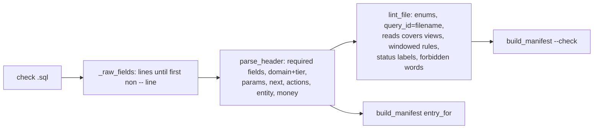

# Check header schema (`-- field:` lines at the top of each check .sql)

One-line summary: each `app/queries/checks/<qid>.sql` opens with `--` comment fields — 14 required, 7 optional — parsed by `tools/header_schema.py`, validated by `tools/lint_headers.py`, and turned into `app/queries/manifest.json`; the header is the single source of truth (tools/header_schema.py:1-46; tools/lint_headers.py:1-18; tools/build_manifest.py:2-5).

## Fields

| Field | Required | Shape | Evidence |
|---|---|---|---|
| query_id, title, reads, requires, confidence, confidence_note, read_this, healthy, investigate_if, actions, next, caveats, params | yes | text | tools/header_schema.py:15-30 |
| domain | yes | `<domain>   tier: <tier>` | tools/header_schema.py:74, 214-219 |
| runnable | no | `false` keeps it out of the runner (default true) | tools/header_schema.py:33, 230 |
| empty_if | no | tokens from EMPTY_IF_VOCAB | tools/header_schema.py:51-59, 232 |
| not_assessed_reasons | no | `code: words; code2: words2` | tools/header_schema.py:35-36, 184-200 |
| windowed | no | yes/no (default no) | tools/header_schema.py:37, 227 |
| pre | no, repeatable | SHOW statement run first | tools/header_schema.py:38-39, 47, 228 |
| money | no | one output column | tools/header_schema.py:40-42, 244 |
| entity | no | `<noun> = <col>[, <col>]` | tools/header_schema.py:43-45, 167-177 |

- Enums: tier `lite|standard|deep`, confidence `confirmed|needs_confirmation`, 7 domains (tools/header_schema.py:61-71).
- A `--` line that is not a field start continues the previous field (tools/header_schema.py:105-112).

## Parse examples

- `params: :period_days (default 30) days...; :min_idle_minutes (default 30) ...` -> `[{name: period_days, default: 30, ...}, {name: min_idle_minutes, default: 30, ...}]`; numbers become int/float (tools/header_schema.py:116-137; app/queries/checks/sf_wh_idle_minutes.sql:9-14).
- `next: a, b (if x, y)` splits only on top-level commas -> `[{a, ""}, {b, "x, y"}]` (tools/header_schema.py:79-82, 140-157).
- `actions: 1) do X; 2) do Y` -> `["do X", "do Y"]` (tools/header_schema.py:83, 160-164).
- `entity: dynamic tables = database_name, schema_name, dt_name` -> `{noun: "dynamic tables", columns: [...]}`; missing `=` raises (tools/header_schema.py:167-177).

## Lint rules (tools/lint_headers.py)

- Every required field non-empty; `query_id` == filename (lint_headers.py:102-114).
- `reads` must list every SNOWFLAKE.* view the SQL reads, includes (`__INCLUDE_x__` from common/ or dims/) too (lint_headers.py:73-89, 104-107).
- `money` / `entity` columns and `not_assessed_reasons` codes must appear in the body (lint_headers.py:137-149).
- No hard-coded windows (`INTERVAL n DAYS`, `dateadd(day, -7|-NN, ...)`); `windowed: yes` iff body uses `:period_days` iff params declares it (lint_headers.py:65-70, 147-164).
- `status` CASE labels only OK, WARN, CRITICAL, NOT_ASSESSED, nested CASEs stripped (lint_headers.py:41-63, 174-179).
- Forbidden words: collector, verifier, `--share`, `findings/`, `feeds:` (lint_headers.py:32-39, 170-172).
- Ends with `build_manifest.py --check` (lint_headers.py:204-218).

## Duplicate parser (by design)

- `app/core/registry.py` re-implements a small part (field list, `not_assessed_reasons`) so `app/` never imports `tools/`; it drops a malformed reason silently where the lint fails loudly (app/core/registry.py:15-17, 109-151). The two field lists must stay in step by hand (app/core/registry.py:109-115 vs tools/header_schema.py:15-46).
