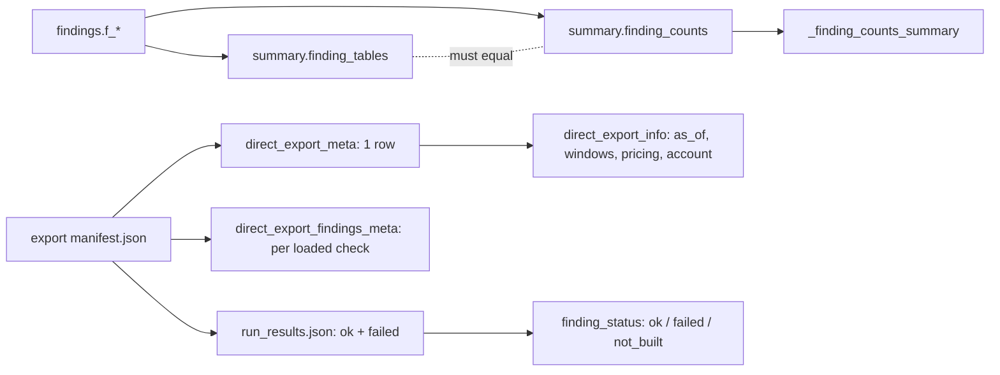

# summary.* schema, meta tables and the run_results sidecar

One-line summary: the loader writes row counts per check (`summary.*`), what the export was (`main.direct_export_meta`), per-check truncation and source (`main.direct_export_findings_meta`), and per-check ok/failed in `<db stem>.run_results.json`; the app reads all four to label numbers and to say why a check did not run (tools/load_results.py:426-453, 630-686; app/core/data.py:1633-1679, 1817-1834).

## summary.finding_counts / summary.finding_tables

- `finding_counts(query_id, window_days, status, n)`; `finding_tables(query_id, n_rows)` (tools/load_results.py:430-432).
- Only tables with `window_days` are counted (tools/load_results.py:438-439).
- **Self-check:** for each table `n_rows` must equal `sum(n)`, else the load fails (tools/load_results.py:447-453).
- **App reuse:** used only while the table's `estimated_size` still equals `n_rows`; a changed table is counted live (app/core/data.py:919-935).
- Example (test DB): `sf_wh_idle_minutes` `n_rows = 36` = 3 windows x (4 CRITICAL + 1 WARN + 7 NOT_ASSESSED).

## main.direct_export_meta (one row)

- 17 columns; JSON-encoded where nested (tools/load_results.py:632-656).
- `as_of` = manifest, else zip entry date, else newest file mtime (tools/load_results.py:630).
- Read by `direct_export_info()`, cached on file mtime (app/core/data.py:1633-1679).
- Example (test DB): `as_of 2026-09-21T12:00:00Z`, `as_of_date 2026-09-21`, `includes_today false`, `windows [7,30,90]`, `window_coverage {"7":7,"30":30,"90":30}`, `window_aliases {"90":"30"}`, `last_complete_day 2026-09-20`, `lag_hours 8`.
- `last_complete_day` = (now - lag) date - 1 day (tools/export_results.py:1337).

## main.direct_export_findings_meta

- `(query_id, truncated, max_rows, truncated_windows JSON, source JSON)` for loaded checks only (tools/load_results.py:658-670).
- `source` is set when the check ran from an INFORMATION_SCHEMA fallback (tools/load_results.py:585-587).
- Example: `max_rows 3`, truncated in window 30 -> `(True, 3, [30])`; untouched check -> `(False, 3, [])` (tests/test_load_results.py:284-299).

## run_results.json sidecar

- Path `<db stem>.run_results.json` beside the db (app/core/datasource.py:69-70).
- `{"generated_at", "results": [{query_id, status ok|failed, message, reason?, sources?, all_rows_not_assessed?}]}` (tools/load_results.py:282-303).
- `failed` covers export status `failed`/`not_assessed` and rejected files; `reason` = export `cause`, else `classify_error(error, error_code)` (tools/load_results.py:537-543, 560-563).
- `all_rows_not_assessed` when `not_assessed_rows == exported_rows` (tools/load_results.py:580-581).
- Truncated ok check message: "kept the first N rows per window" (tools/load_results.py:296).
- App: absent check -> `not_built`; missing file -> `available: false`, never an exception (app/core/data.py:1817-1834, 1986-2006).
- `AUDIT_RUN_RESULTS` overrides the path (app/core/data.py:115-117).
