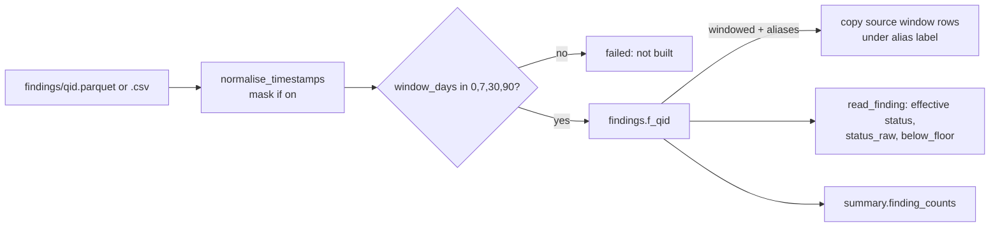

# findings.f_<query_id> — one table per check

One-line summary: every check that ran `ok` or `empty` becomes `findings."f_<query_id>"`, holding the check's own columns plus a required `window_days`; most tables also carry `account_id`, `status` and `not_assessed_reason`, and the app reads them read-only through `app/core/data.py` (tools/load_results.py:533-579; app/core/data.py:1-41).

## Common columns (frequency in the test DB, 296 tables)

| Column | Tables | Rule | Evidence |
|---|---|---|---|
| `window_days` | 296 | required; 0 point-in-time, 7/30/90 windows | tools/load_results.py:171-178 |
| `account_id` | 287 | account locator; account and env filters | app/core/data.py:13-14, 318-331 |
| `status` | 271 | only OK, WARN, CRITICAL, NOT_ASSESSED | tools/lint_headers.py:41-47, 176-179 |
| `not_assessed_reason` | 261 | codes declared in header `not_assessed_reasons:` | tools/header_schema.py:35-36; tools/lint_headers.py:143-145 |
| `price_basis` | 131 | how a $ was priced (inferred from name) | read from tests/db_audit_test.duckdb |
| `reasons` | 104 | plain-words reason (inferred) | read from tests/db_audit_test.duckdb |
| entity ids | varies | `warehouse_id`, `task_full_name`/`job_id`, `database_name`, `user_name`, ... | app/core/finding_columns.py:72-100 |
| money column | varies | one headline $, its kind decides how it sums | app/core/finding_columns.py:15-56, 135-152 |
| `is_total_row`, `is_alt_basis` | few | left out of $ sums | app/core/finding_columns.py:61-68 |

- Counts per column come from querying `information_schema.columns` of tests/db_audit_test.duckdb (no single file lists them).
- Read time adds `status_raw` and `below_floor` (app/core/data.py:258-281).

## Business rules with examples

- **Money kinds never add.** `waste`, `saving`, `saving_month`, `gap` count flagged rows only; the rest count all rows (app/core/finding_columns.py:53-56). Example: columns `[est_storage_usd_month, est_saving_usd_month]` -> headline `est_saving_usd_month`, kind `saving_month` (kind priority, app/core/finding_columns.py:132, 144-148).
- **Declared money wins.** Header `money: est_wasted_usd_list` and the table has it -> `(est_wasted_usd_list, waste)` (app/core/finding_columns.py:142-143).
- **Prior-period column is never headline.** `prev_usd_list` skipped (app/core/finding_columns.py:58-59, 149-151).
- **Entity count.** Columns `[database_name, schema_name, table_name]` -> noun `tables`, entity = all three, no dim (app/core/finding_columns.py:101-105, 180-184). `[warehouse_id]` -> `warehouses`, counted against `dims.dim_warehouse` (app/core/finding_columns.py:186-190).
- **Row noun when no entity.** Columns `{granted_on, privilege}` -> "grants" (app/core/finding_columns.py:108-125).
- **Aliased windows.** Test DB `sf_wh_idle_minutes`: counts per status are equal for 30 and 90 (CRITICAL 4, WARN 1, NOT_ASSESSED 7) because 90 is a copy of 30 (summary.finding_counts in tests/db_audit_test.duckdb; tests/test_load_results.py:77-89).
- **Not built is NOT_ASSESSED.** A missing table raises `FindingNotBuiltError`; the app shows the reason, never $0 (app/core/data.py:76-79, 239-250).
- **Safe identifiers.** `query_id` must match `[a-z][a-z0-9_]*` and exist in the registry before it names a table (app/core/data.py:33-37, 227-232; tools/load_results.py:545-547).

## Joins to dims (name (id))

- `warehouse_id` -> `dims.dim_warehouse` (app/core/data.py:1595-1608). Example: `('FAKE01','1001',CRITICAL,30)` -> `WH_ETL (1001)`.
- `task_full_name` / `job_id` -> `dims.dim_task.task_full_name` (app/core/finding_columns.py:73-74, 86).
- Warehouse filter on a table with only `warehouse_id`: `warehouse_id IN (SELECT warehouse_id FROM dims.dim_warehouse WHERE lower(warehouse_name) IN (...))` (app/core/data.py:438-442).
- Name filters strip a trailing ` (id)` before comparing: `"WH_ETL (1001)"` -> `wh_etl` (app/core/data.py:392-400).
