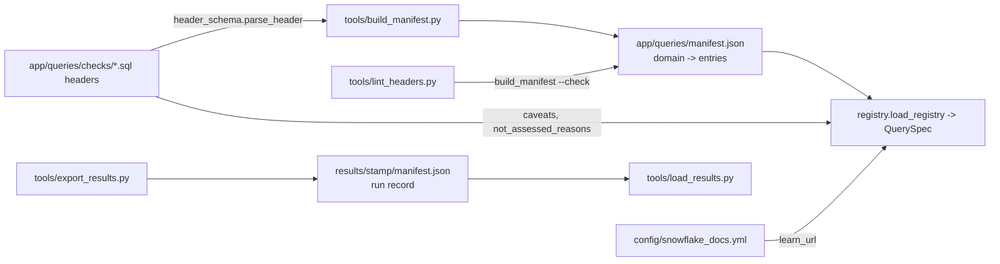

# manifest.json — two different files with one name

One-line summary: `app/queries/manifest.json` is the check catalog generated from the SQL headers (298 checks in 7 domains) and read by `app/core/registry.py`; the export's `manifest.json` (in each results folder) is the run record read by the loader — do not confuse them (tools/build_manifest.py:1-10; app/core/registry.py:1-17; tools/export_results.py:1123-1151; tools/load_results.py:458-464).

## A. Check catalog: app/queries/manifest.json

- Shape: `{domain: [entry, ...]}`, domains in sorted order, entries by `query_id` (tools/build_manifest.py:82-98).
- Entry fields, fixed order: `query_id, title, domain, tier, runnable, windowed, pre, empty_if, money, entity, reads, requires, params, confidence, confidence_note, read_this, healthy, investigate_if, actions, next, sql_url` (tools/build_manifest.py:28-50).
- `sql_url` = `app/queries/checks/<qid>.sql` (tools/build_manifest.py:77). `learn_url` is not stored; registry resolves it (tools/build_manifest.py:26-27; app/core/registry.py:264, 289).
- Never hand-edit: `--check` fails if stale, compared byte for byte with LF (tools/build_manifest.py:105-123).
- Unknown domain fails the build (tools/build_manifest.py:87-92).
- Counts now: compute 22, cost 62, governance_access 94, jobs_pipelines 35, performance 35, serving_ai 19, storage 31 = 298 (read from app/queries/manifest.json; STATUS.md:8 says 298).
- Example entry (`cost_audit_self_usage`): `windowed: true`, `params: [{name: period_days, default: 30, ...}]`, `reads` 4 ACCOUNT_USAGE views, `healthy` "n/a - coverage/inventory..." -> registry `is_finding` false (app/queries/manifest.json; app/core/registry.py:265-268).

### Registry rules (app/core/registry.py)

- Every `reads` entry must be in `SOURCE_CONTRACT`, else `RegistryError` at load (app/core/registry.py:37-101, 170-199). Example: `SHOW PARAMETERS LIKE 'X' IN ACCOUNT` -> `("SHOW","PARAMETERS")` (tests/test_registry.py:59-65).
- Every `next` target must be a real check (app/core/registry.py:307-314).
- `is_finding` = `healthy` not starting "n/a -" AND body has `AS status` (app/core/registry.py:202-204, 265-268).
- `body` = SQL without header and trailing `;` (app/core/registry.py:154-163).
- `caveats` and `not_assessed_reasons` are re-read from the .sql (not in manifest) (app/core/registry.py:15-17, 298-299).
- Cached on manifest + docs file mtime/size (app/core/registry.py:317-344).

## B. Export run manifest: results/<stamp>/manifest.json

- Written once per export (tools/export_results.py:1123-1151). Keys the loader uses:

| Key | Loader use | Evidence |
|---|---|---|
| `findings{qid: {status, error, error_code, cause, unreadable, exported_rows, not_assessed_rows, truncated, truncated_windows, source, source_reads, source_note}}` | what to load / mark failed | tools/load_results.py:534-592 |
| `dims.available` | which dim files are this run's | tools/load_results.py:472-473 |
| `tag_sources.available`, `.truncated` | which tag sources load; `tag_sources_cut` | tools/load_results.py:393-398, 654 |
| `window_aliases` | copy windows | tools/load_results.py:477-484 |
| `max_rows` | truncation note | tools/load_results.py:468 |
| `as_of, as_of_date, includes_today, last_complete_day, lag_hours, windows, window_coverage, account, pricing, visibility, edition, masked, git_commit, tool_version` | `direct_export_meta` | tools/load_results.py:648-661 |
| `pricing.credit_price_usd` | tag cost tables priced or empty | tools/load_results.py:416-420 |

- No manifest -> import mode; nothing is truncated or failed (tools/load_results.py:486-495).
- Export also writes `sources`, `monitor_usage`, `manage_grants`, `days`, `mode`, `export_date`, `statement_timeout_s`, `include_snowflake_tasks` that the loader does not store (tools/export_results.py:1123-1151 vs tools/load_results.py:637-661).
