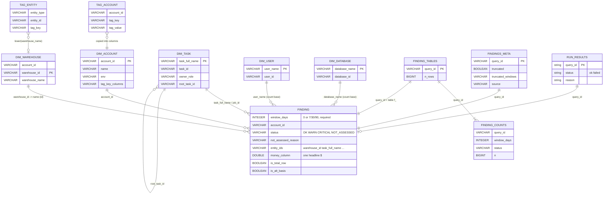

# DuckDB data model (the app side)

One-line summary: one DuckDB file per load holds `findings.f_<query_id>` (one table per check), `dims.*` (names for ids and count bases), `summary.*` (row counts per status), `tags.*` (tag rollups), and two `main` meta tables, plus a JSON sidecar; no foreign keys are declared, every join is logical (tools/load_results.py:530-531, 567, 603, 614, 426-446, 632-670; tools/build_tags.py:100).

Machine-readable version: `data/model.json`.

## Objects

| Object | Built from | Rows | Page |
|---|---|---|---|
| `findings.f_<query_id>` | export `findings/<qid>.parquet\|csv` (tools/load_results.py:548-579) | one per check entity per window; 296 tables in the test DB, 298 checks in the manifest (the ones in FAILED_ON_PURPOSE are left out, tests/test_load_results.py:52-60) | data/f_query_id.md |
| `dims.dim_account` | `dims/dim_account.sql` + env + tag columns (tools/load_results.py:599-600, 353-380) | 1 | data/dims.md |
| `dims.dim_warehouse` | WAREHOUSE_METERING_HISTORY, 400 days (app/queries/dims/dim_warehouse.sql:1-6) | per warehouse id | data/dims.md |
| `dims.dim_task` | TASK_VERSIONS latest version (app/queries/dims/dim_task.sql:1-11) | per task | data/dims.md |
| `dims.dim_user` | USERS live (app/queries/dims/dim_user.sql:1-4) | per user | data/dims.md |
| `dims.dim_database` | DATABASES live (app/queries/dims/dim_database.sql:1-4) | per database | data/dims.md |
| `summary.finding_counts` | GROUP BY over every findings table (tools/load_results.py:441-444) | qid x window x status | data/export_meta.md |
| `summary.finding_tables` | count(*) per table (tools/load_results.py:445-446) | per table | data/export_meta.md |
| `main.direct_export_meta` | export manifest (tools/load_results.py:632-656) | 1 | data/export_meta.md |
| `main.direct_export_findings_meta` | manifest `findings` entries (tools/load_results.py:658-670) | per loaded check | data/export_meta.md |
| `tags_src.*` (temporary) | export `tags_src/*.parquet` (tools/load_results.py:393-413) | dropped at load end (422) | data/tags.md |
| `tags.*` (8 tables) | tools/build_tags.build (tools/build_tags.py:91-358) | see tag slice | data/tags.md |
| `<stem>.run_results.json` | loader (tools/load_results.py:282-303) | per check | data/export_meta.md |
| `app/queries/manifest.json` | check headers (tools/build_manifest.py:82-98) | 298 checks, 7 domains | data/manifest.md |
| check header | `-- field:` lines (tools/header_schema.py:14-46) | per .sql | data/check-header.md |

## Join rule in one line

- Findings carry ids; names come from the dims at read time: `warehouse_id` -> `dims.dim_warehouse.warehouse_name`, shown `name (id)` (web/src/components/names.tsx:1-3, 45-48; app/api/app.py:1422).
- Example: finding row `(FAKE01, warehouse_id '1001', CRITICAL, window 30)` + dim row `('1001', 'WH_ETL')` -> cell `WH_ETL (1001)` (test DB `tests/db_audit_test.duckdb`; fake source tests/fake_snowflake/data.py:168).
- A missing dim -> empty stub, the id shows instead of the name (tools/load_results.py:779-782).
