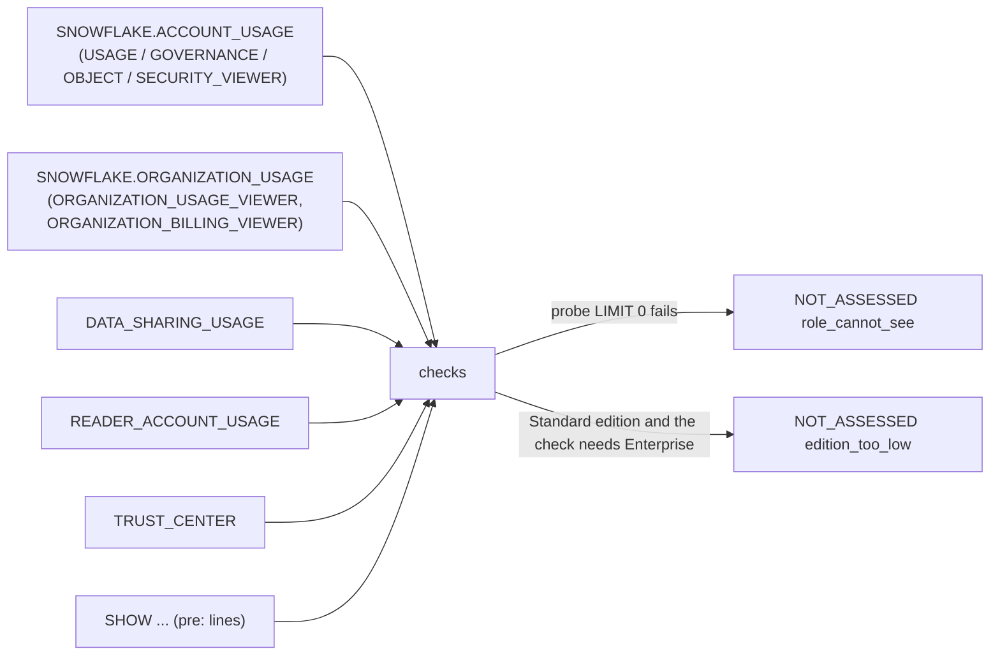

# Snowflake views the checks read

This page lists every `SNOWFLAKE.*` view the 298 checks read: how many checks read each one, and its edition, privilege and latency notes from the `snowflake-account-usage` skill catalog.

Sources:
- `app/queries/manifest.json` (each check's `reads:`);
- `app/queries/checks/*.sql` with the `common/*.sql` includes expanded;
- `.claude/skills/snowflake-account-usage/references/views.md` (edition, visibility, latency);
- `.claude/skills/snowflake-account-usage/references/traps.md:94-123` (visibility, edition).

The tables are generated by `snowflake-audit-app-knowledge-graph/_scripts/gen_queries_tables.py`.

## Access and edition rules

- **Access.** IMPORTED PRIVILEGES on `SNOWFLAKE` grants every AU database role:
  - USAGE_VIEWER: metering and usage.
  - GOVERNANCE_VIEWER: query and access history, policies, tags.
  - OBJECT_VIEWER: objects, tags, dependencies.
  - SECURITY_VIEWER: users, roles, grants, logins.
  - OU needs ORGANIZATION_USAGE_VIEWER, or ORGANIZATION_BILLING_VIEWER for the billing views.
  - Source: `references/traps.md:96-101`.
- **Role-filtered views.** These show only what the role can access: RESOURCE_MONITORS, COPY_HISTORY, COMPLETE_TASK_GRAPHS, PIPES, STAGES, SCHEMATA, FUNCTIONS, PROCEDURES, FILE_FORMATS, NETWORK_RULES, MASKING_POLICIES, TAGS and TAG_REFERENCES (`references/traps.md:102-108`).
- **Enterprise+ only.** On Standard edition these views exist but come back empty (`references/traps.md:118-121`):
  - MATERIALIZED_VIEW_REFRESH_HISTORY;
  - SEARCH_OPTIMIZATION_*;
  - DATA_QUALITY_MONITORING_USAGE_HISTORY;
  - QUERY_ACCELERATION_HISTORY;
  - ACCESS_HISTORY;
  - DATA_CLASSIFICATION_LATEST;
  - TAG_REFERENCES;
  - masking and row access policies.

  The export skips these checks as `edition_too_low` (`tools/export_results.py:1216-1226`).
- **Retention.** AU keeps 365 days (`references/traps.md:56`). `common/cost_lines.sql:18` asks for 400 days, and AU silently returns 365.
- **Latency.** 45 min (queries) to 3 h for most views; cloud services 6 h; attribution 8 h; OU billing 72 h (`references/traps.md:45-53`).
- **Probe.** Before any check runs, the export probes every view the checks read with `SELECT 1 ... LIMIT 0` (`tools/export_results.py:938-955`).
- **Which views a check may read.** The registry allows only the views in `SOURCE_CONTRACT` (`app/core/registry.py:33-60`).

## Notes on specific views

- **QUERY_HISTORY** has the most readers (77), then WAREHOUSE_METERING_HISTORY (45). The checks never select `QUERY_TEXT` (`README.md:58-59`; `references/traps.md:114`).
- **CORTEX_FUNCTIONS_USAGE_HISTORY** is still in `SOURCE_CONTRACT` (`app/core/registry.py:44`), but no check reads it; the counts below show it is absent.
- **OU.REPLICATION_USAGE_HISTORY** is read by `sf_org_replication_cost` (`checks/sf_org_replication_cost.sql:6, 39`). `traps.md:190` lists REPLICATION_USAGE_HISTORY as deprecated, without saying which schema.
- **Views not in the skill catalog.** Rows marked "not in catalog" below are views the checks read that have no row in `views.md`. The skill says to look a view up there first, and add a row if it is missing (`SKILL.md:12-14`). Some of these are listed in `traps.md:201-205` as still to verify.
- **Budgets.** `sf_acct_budgets` runs `SHOW SNOWFLAKE.CORE.BUDGET INSTANCES IN ACCOUNT` (manifest `reads:`). `SKILL.md:69` says budgets need `CALL ... GET_SPENDING_HISTORY` and `SHOW SNOWFLAKE.CORE.BUDGET INSTANCES`, "which are CALLs and not allowed"; the SHOW is not a CALL, and the read-only guard accepts SHOW (`tools/export_results.py:642-648`), so the skill wording is out of date.
- **`reads:` vs SQL.** The header `reads:` list and the views the SQL actually names agree for all but one check: `sf_secx_direct_user_grants` lists AU.ROLES in `reads:` but its SQL never reads it (see the last table).

## Views by number of checks

"checks reading it (SQL)" counts the checks whose SQL, with includes expanded, names the view. "in `reads:`" counts the checks whose header lists it.

<!-- generated below -->

| view | checks reading it (SQL) | in `reads:` | edition | visibility | latency |
|---|---|---|---|---|---|
| AU.QUERY_HISTORY | 77 | 77 | All | GOVERNANCE_VIEWER; whole account | 45 min |
| AU.WAREHOUSE_METERING_HISTORY | 45 | 45 | All | USAGE_VIEWER; whole account | 3h; cloud services 6h |
| AU.GRANTS_TO_ROLES | 41 | 41 | All | SECURITY_VIEWER | 2h |
| AU.TABLES | 40 | 40 | All | OBJECT_VIEWER; ignores MANAGE GRANTS | 90 min |
| AU.ACCESS_HISTORY | 37 | 37 | Enterprise+ | GOVERNANCE_VIEWER | 3h |
| AU.METERING_DAILY_HISTORY | 36 | 36 | All | USAGE_VIEWER; whole account | 3h |
| AU.QUERY_ATTRIBUTION_HISTORY | 36 | 36 | All | USAGE_VIEWER or GOVERNANCE_VIEWER | up to 8h |
| AU.USERS | 34 | 34 | All | SECURITY_VIEWER | 2h |
| AU.GRANTS_TO_USERS | 30 | 30 | All | SECURITY_VIEWER | 2h |
| AU.ROLES | 27 | 28 | All | SECURITY_VIEWER | 2h |
| AU.TABLE_STORAGE_METRICS | 23 | 23 | All | OBJECT_VIEWER / USAGE_VIEWER | 90 min |
| AU.POLICY_REFERENCES | 22 | 22 | All (policies Enterprise+) | GOVERNANCE_VIEWER, SECURITY_VIEWER; role-filtered | 2h |
| AU.TASK_HISTORY | 19 | 19 | All | Whole account (not stated otherwise) | 45 min |
| AU.TAG_REFERENCES | 17 | 17 | Enterprise+ | GOVERNANCE_VIEWER; role-filtered | 2h |
| AU.LOGIN_HISTORY | 12 | 12 | All | SECURITY_VIEWER | 2h |
| AU.DATA_TRANSFER_HISTORY | 11 | 11 | All | USAGE_VIEWER | 2h |
| AU.STORAGE_USAGE | 11 | 11 | All | USAGE_VIEWER | 2h |
| AU.TASK_VERSIONS | 10 | 10 | All | Not stated | 3h |
| AU.PIPES | 8 | 8 | All | Role-filtered; ignores MANAGE GRANTS | 3h |
| AU.PIPE_USAGE_HISTORY | 8 | 8 | All | USAGE_VIEWER | 3h |
| AU.TABLE_DML_HISTORY | 8 | 8 | All | USAGE_VIEWER | 6h |
| AU.WAREHOUSE_EVENTS_HISTORY | 8 | 8 | All | USAGE_VIEWER; whole account | 3h |
| AU.AUTOMATIC_CLUSTERING_HISTORY | 6 | 6 | All | USAGE_VIEWER; whole account | 3h |
| AU.COPY_HISTORY | 6 | 6 | All | Role-filtered | 2h (up to 2 days) |
| AU.DATABASES | 6 | 6 | All | OBJECT_VIEWER; all databases; ignores MANAGE GRANTS | 3h |
| AU.DYNAMIC_TABLE_REFRESH_HISTORY | 6 | 6 | All | USAGE_VIEWER | 3h |
| AU.METERING_HISTORY | 6 | 6 | All | USAGE_VIEWER; whole account | 3h; cloud services 6h; SNOWPIPE_STREAMING 12h |
| AU.OBJECT_DEPENDENCIES | 6 | 6 | All | OBJECT_VIEWER | 3h |
| AU.SCHEMATA | 6 | 6 | All | OBJECT_VIEWER; role-filtered | 2h |
| AU.SERVERLESS_TASK_HISTORY | 6 | 6 | All | USAGE_VIEWER | 3h |
| AU.SESSIONS | 6 | 6 | All | SECURITY_VIEWER | 3h |
| AU.CORTEX_AI_FUNCTIONS_USAGE_HISTORY | 5 | 5 | All | USAGE_VIEWER | ~2 min for running queries; varies |
| AU.FUNCTIONS | 5 | 5 | All | Role-filtered; ignores MANAGE GRANTS | 2h |
| AU.SEARCH_OPTIMIZATION_HISTORY | 5 | 5 | Enterprise+ | USAGE_VIEWER; whole account | 3h |
| AU.SNOWPARK_CONTAINER_SERVICES_HISTORY | 5 | 5 | All (commercial) | USAGE_VIEWER | 3h |
| AU.TABLE_QUERY_PRUNING_HISTORY | 5 | 5 | All | USAGE_VIEWER | 4h |
| AU.COLUMN_QUERY_PRUNING_HISTORY | 4 | 4 | All | USAGE_VIEWER | 4h |
| AU.MATERIALIZED_VIEW_REFRESH_HISTORY | 4 | 4 | Enterprise+ | USAGE_VIEWER; whole account | 3h |
| AU.PROCEDURES | 4 | 4 | All | Role-filtered | 2h |
| AU.STAGES | 4 | 4 | All | Role-filtered; ignores MANAGE GRANTS | 2h |
| AU.VIEWS | 4 | 4 | All | OBJECT_VIEWER | 90 min |
| AU.WAREHOUSE_LOAD_HISTORY | 4 | 4 | All | USAGE_VIEWER; whole account | 3h |
| AU.APPLICATION_DAILY_USAGE_HISTORY | 3 | 3 | All | USAGE_VIEWER | 24h |
| AU.CORTEX_SEARCH_DAILY_USAGE_HISTORY | 3 | 3 | not stated | not stated | not stated |
| AU.DATABASE_STORAGE_USAGE_HISTORY | 3 | 3 | All | USAGE_VIEWER | 3h |
| AU.DATA_METRIC_FUNCTION_REFERENCES | 3 | 3 | Enterprise+ | GOVERNANCE_VIEWER or USAGE_VIEWER | up to 3h |
| AU.DATA_QUALITY_MONITORING_USAGE_HISTORY | 3 | 3 | Enterprise+ | USAGE_VIEWER | 3h |
| AU.MASKING_POLICIES | 3 | 3 | Enterprise+ | GOVERNANCE_VIEWER; role-filtered | 2h |
| AU.NETWORK_POLICIES | 3 | 3 | All | SECURITY_VIEWER | 2h |
| AU.REPLICATION_GROUP_USAGE_HISTORY | 3 | 3 | All for db/share; Business Critical+ for other types | USAGE_VIEWER; secondary groups in the target account only | 3h |
| AU.ROW_ACCESS_POLICIES | 3 | 3 | Enterprise+ | GOVERNANCE_VIEWER | 2h |
| AU.TASKS | 3 | 3 | All | Role-filtered | not stated |
| AU.ALERT_HISTORY | 2 | 2 | All | Not stated | 45 min (index says 3h; use 3h) |
| AU.COMPUTE_POOLS | 2 | 2 | All (Snowpark Container Services regions) | not stated | up to 3h |
| AU.CORTEX_AGENT_USAGE_HISTORY | 2 | 2 | not stated | not stated | up to 1h; sql_query_credits and sql_query_warehouses up to 8h more |
| AU.CORTEX_ANALYST_USAGE_HISTORY | 2 | 2 | All | USAGE_VIEWER | 1h |
| AU.CORTEX_PROVISIONED_THROUGHPUT_USAGE_HISTORY | 2 | 2 | not stated | not stated | current billing period |
| AU.CREDENTIALS | 2 | 2 | All | SECURITY_VIEWER | 2h |
| AU.DATABASE_REPLICATION_USAGE_HISTORY | 2 | 2 | not in catalog | - | - |
| AU.EXTERNAL_ACCESS_HISTORY | 2 | 2 | All | USAGE_VIEWER | 3h |
| AU.NETWORK_RULES | 2 | 2 | All | SECURITY_VIEWER; role-filtered | 2h |
| AU.NOTEBOOKS_CONTAINER_RUNTIME_HISTORY | 2 | 2 | All | not stated | up to 3h |
| AU.QUERY_ACCELERATION_HISTORY | 2 | 2 | Enterprise+ | GOVERNANCE_VIEWER | 3h |
| AU.QUERY_INSIGHTS | 2 | 2 | not stated | not stated | up to 90 min |
| AU.SERVERLESS_ALERT_HISTORY | 2 | 2 | not in catalog | - | - |
| AU.SERVICES | 2 | 2 | All | not stated | not stated |
| AU.TABLE_PRUNING_HISTORY | 2 | 2 | All | Whole account | 6h |
| AU.TAGS | 2 | 2 | Enterprise+ | OBJECT_VIEWER or GOVERNANCE_VIEWER; role-filtered | 2h |
| AU.AGGREGATE_QUERY_HISTORY | 1 | 1 | All | Whole account | 3h |
| AU.AGGREGATION_POLICIES | 1 | 1 | not stated | Role-filtered | up to 2h |
| AU.ANOMALIES_DAILY | 1 | 1 | not stated | not stated | up to 8h |
| AU.APPLICATION_SPECIFICATIONS | 1 | 1 | not stated | not stated | near real time |
| AU.ARCHIVE_STORAGE_DATA_RETRIEVAL_USAGE_HISTORY | 1 | 1 | not stated | not stated | up to 1h |
| AU.BACKUP_SETS | 1 | 1 | All (retention lock and legal hold need Business Critical) | not stated | up to 6h |
| AU.BACKUP_STORAGE_USAGE | 1 | 1 | All | not stated | up to 6h |
| AU.BLOCK_STORAGE_HISTORY | 1 | 1 | All (Snowpark Container Services) | not stated | up to 3h |
| AU.CATALOG_LINKED_DATABASE_USAGE_HISTORY | 1 | 1 | not stated | not stated | not stated |
| AU.COLUMNS | 1 | 1 | not stated | not stated | up to 90 min |
| AU.COMPLETE_TASK_GRAPHS | 1 | 1 | All | Role-filtered | 45 min |
| AU.CORTEX_CODE_CLI_USAGE_HISTORY | 1 | 1 | not stated | not stated | up to 1h |
| AU.CORTEX_CODE_DESKTOP_USAGE_HISTORY | 1 | 1 | not in catalog | - | - |
| AU.CORTEX_CODE_SNOWSIGHT_USAGE_HISTORY | 1 | 1 | not in catalog | - | - |
| AU.CORTEX_DOCUMENT_PROCESSING_USAGE_HISTORY | 1 | 1 | All | USAGE_VIEWER | 1h |
| AU.CORTEX_FINE_TUNING_USAGE_HISTORY | 1 | 1 | All | USAGE_VIEWER | 1h |
| AU.CORTEX_REST_API_USAGE_HISTORY | 1 | 1 | not in catalog | - | - |
| AU.DATA_CLASSIFICATION_LATEST | 1 | 1 | Enterprise+ | GOVERNANCE_VIEWER | 3h |
| AU.DATA_METRIC_FUNCTION_EXPECTATIONS | 1 | 1 | not in catalog | - | - |
| AU.DATA_MOVEMENT_POLICIES | 1 | 1 | Enterprise+ | Role-filtered | up to 2h |
| AU.DATA_MOVEMENT_VIOLATIONS | 1 | 1 | Enterprise+ | Role-filtered | up to 3h |
| AU.FILE_FORMATS | 1 | 1 | All | Role-filtered; ignores MANAGE GRANTS | 2h |
| AU.GRANTS_TO_SHARES | 1 | 1 | All | not stated | up to 3h |
| AU.HYBRID_TABLE_USAGE_HISTORY | 1 | 1 | All (AWS, Azure commercial) | USAGE_VIEWER | 3h |
| AU.ICEBERG_STORAGE_OPTIMIZATION_HISTORY | 1 | 1 | All | USAGE_VIEWER | 2h |
| AU.INGRESS_NETWORK_ACCESS_HISTORY | 1 | 1 | All (not government regions) | not stated | up to 4h |
| AU.INTERNAL_DATA_TRANSFER_HISTORY | 1 | 1 | All | USAGE_VIEWER | 3h |
| AU.LOCK_WAIT_HISTORY | 1 | 1 | All | Whole account | not stated |
| AU.MODEL_SERVING_USAGE_HISTORY | 1 | 1 | not stated | not stated | up to 8h |
| AU.NETWORK_RULE_REFERENCES | 1 | 1 | All | SECURITY_VIEWER; role-filtered | 2h |
| AU.OPENFLOW_USAGE_HISTORY | 1 | 1 | not stated | not stated | not stated |
| AU.OUTBOUND_PRIVATELINK_ENDPOINTS | 1 | 1 | not stated | SECURITY_VIEWER | up to 2h |
| AU.PASSWORD_POLICIES | 1 | 1 | All | SECURITY_VIEWER | 2h |
| AU.PROJECTION_POLICIES | 1 | 1 | not stated | Role-filtered | up to 2h |
| AU.QUERY_ACCELERATION_ELIGIBLE | 1 | 1 | All (QAS itself Enterprise+) | GOVERNANCE_VIEWER | 3h |
| AU.QUERY_METERING_HISTORY | 1 | 1 | Enterprise+ | USAGE_VIEWER or GOVERNANCE_VIEWER; whole account | up to 1h |
| AU.REPLICATION_GROUPS | 1 | 1 | Standard+ (database/share replication); Business Critical+ for other objects and failover | not stated | up to 2h |
| AU.REPLICATION_GROUP_REFRESH_HISTORY | 1 | 1 | Standard+ (Business Critical for object replication) | not stated | up to 3h |
| AU.SEARCH_OPTIMIZATION_BENEFITS | 1 | 1 | Enterprise+ | USAGE_VIEWER | up to 6h |
| AU.SECRETS | 1 | 1 | All | SECURITY_VIEWER | 2h |
| AU.SEQUENCES | 1 | 1 | All | OBJECT_VIEWER | 2h |
| AU.SESSION_POLICIES | 1 | 1 | All | SECURITY_VIEWER | 2h |
| AU.SHARES | 1 | 1 | All | SECURITY_VIEWER | 3h |
| AU.SNAPSHOT_SETS | 1 | 1 | not stated | not stated | not stated |
| AU.SNAPSHOT_STORAGE_USAGE | 1 | 1 | All | not stated | up to 6h |
| AU.SNOWFLAKE_COWORK_USAGE_HISTORY | 1 | 1 | not in catalog | - | - |
| AU.SNOWPIPE_STREAMING_CHANNEL_HISTORY | 1 | 1 | All | USAGE_VIEWER | varies |
| AU.SNOWPIPE_STREAMING_CLIENT_HISTORY | 1 | 1 | All | USAGE_VIEWER | 2h |
| AU.SNOWPIPE_STREAMING_FILE_MIGRATION_HISTORY | 1 | 1 | All | USAGE_VIEWER | up to 12h |
| AU.STAGE_STORAGE_USAGE_DETAILS | 1 | 1 | not stated | not stated | up to 2 days |
| AU.STAGE_STORAGE_USAGE_HISTORY | 1 | 1 | All | USAGE_VIEWER | 2h |
| AU.STORAGE_LIFECYCLE_POLICIES | 1 | 1 | not in catalog | - | - |
| AU.STORAGE_LIFECYCLE_POLICY_HISTORY | 1 | 1 | not in catalog | - | - |
| AU.TRUST_CENTER_FINDINGS | 1 | 1 | All (scanner packages enabled) | SECURITY_VIEWER | 1h |
| DSU.LISTING_ACCESS_HISTORY | 1 | 1 | not stated | Provider account | up to 2 days |
| DSU.LISTING_AUTO_FULFILLMENT_DATABASE_STORAGE_DAILY | 1 | 1 | All | Provider account | up to 2 days |
| DSU.LISTING_AUTO_FULFILLMENT_REFRESH_DAILY | 1 | 1 | All | Provider account | up to 2 days |
| DSU.MARKETPLACE_PAID_USAGE_DAILY | 1 | 1 | All | Consumer account | up to 2 days |
| LOCAL.DATA_QUALITY_MONITORING_EXPECTATION_STATUS | 1 | 1 | not in catalog | - | - |
| OU.USAGE_IN_CURRENCY_DAILY | 15 | 15 | All | ORGANIZATION_BILLING_VIEWER; not for reseller customers | 72h |
| OU.ACCOUNTS | 7 | 7 | All | ORGANIZATION_ACCOUNTS_VIEWER | 24h |
| OU.METERING_DAILY_HISTORY | 5 | 5 | All | ORGANIZATION_USAGE_VIEWER; not premium | 2h |
| OU.DATA_TRANSFER_HISTORY | 2 | 2 | All | ORGANIZATION_USAGE_VIEWER; not premium | 24h |
| OU.STORAGE_DAILY_HISTORY | 2 | 2 | All | ORGANIZATION_USAGE_VIEWER; not premium | 2h |
| OU.CONTRACT_ITEMS | 1 | 1 | All | ORGANIZATION_BILLING_VIEWER; funding org only; active contracts | 24h |
| OU.LISTING_AUTO_FULFILLMENT_USAGE_HISTORY | 1 | 1 | All | Org account / ORGADMIN | 24h |
| OU.LOGIN_HISTORY | 1 | 1 | not in catalog | - | - |
| OU.RATE_SHEET_DAILY | 1 | 1 | All | ORGANIZATION_BILLING_VIEWER; not for resellers | 24h |
| OU.REMAINING_BALANCE_DAILY | 1 | 1 | All | ORGANIZATION_BILLING_VIEWER; funding org only | 72h |
| OU.REPLICATION_USAGE_HISTORY | 1 | 1 | not in catalog | - | - |
| OU.TRUST_CENTER_FINDINGS | 1 | 1 | Enterprise+ | Organization account only | 3h |
| OU.USERS | 1 | 1 | not in catalog | - | - |
| OU.WAREHOUSE_METERING_HISTORY | 1 | 1 | not in catalog | - | - |
| RAU.LOGIN_HISTORY | 1 | 1 | not in catalog | - | - |
| RAU.RESOURCE_MONITORS | 1 | 1 | not in catalog | - | - |
| RAU.WAREHOUSE_METERING_HISTORY | 1 | 1 | not in catalog | - | - |
| TC.FINDINGS | 1 | 1 | not in catalog | - | - |

145 SNOWFLAKE.* views in total.

### SHOW commands and functions named in `reads:`

| source | checks |
|---|---|
| SHOW WAREHOUSES | 23 |
| SHOW PARAMETERS IN ACCOUNT | 6 |
| SHOW STREAMS IN ACCOUNT | 3 |
| SHOW TASKS IN ACCOUNT | 3 |
| SHOW RESOURCE MONITORS | 2 |
| SHOW REPLICATION GROUPS | 2 |
| SHOW DYNAMIC TABLES IN ACCOUNT | 2 |
| SHOW SNOWFLAKE.CORE.BUDGET INSTANCES IN ACCOUNT | 1 |
| SHOW APPLICATIONS | 1 |
| SHOW MANAGED ACCOUNTS | 1 |
| SHOW INTEGRATIONS | 1 |
| SHOW SHARES | 1 |
| SHOW STAGES IN ACCOUNT | 1 |
| SHOW STREAMLITS IN ACCOUNT | 1 |
| SHOW NOTEBOOKS IN ACCOUNT | 1 |
| SHOW AUTHENTICATION POLICIES ON ACCOUNT | 1 |
| SYSTEM$CLIENT_VERSION_INFO() | 1 |
| SHOW PASSWORD POLICIES ON ACCOUNT | 1 |
| SHOW SECURITY INTEGRATIONS | 1 |
| SHOW DATABASES | 1 |
| SHOW PIPES IN ACCOUNT | 1 |
| SHOW ALERTS IN ACCOUNT | 1 |
| SHOW TASKS | 1 |
| SHOW SERVICES IN ACCOUNT | 1 |
| SHOW EXTERNAL TABLES IN ACCOUNT | 1 |
| SHOW ICEBERG TABLES IN ACCOUNT | 1 |

### `reads:` header vs the SQL body

A view the SQL reads (includes expanded) but the header omits, or the other way round. Header-only rows are often views a check reads only through a SHOW stand-in or an `OBJECT_CONSTRUCT(*)` wrapper.

1 checks differ.

| query_id | in SQL, not in reads | in reads, not in SQL |
|---|---|---|
| `sf_secx_direct_user_grants` | - | AU.ROLES |
