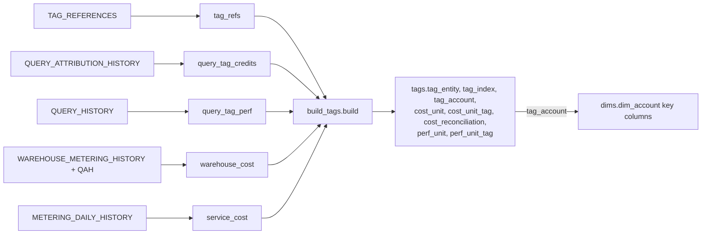

# tags_src.* (temporary) and tags.* (built)

One-line summary: the export runs five `app/queries/tag_sources/*.sql` into `tags_src/*.parquet`; the loader loads them into a temporary `tags_src` schema, `tools/build_tags.build` derives eight `tags.*` tables, the account tag is copied onto `dims.dim_account`, and `tags_src` is dropped (tools/export_results.py:1304-1317; tools/load_results.py:383-423; tools/build_tags.py:1-14).

## tags_src (dropped at load end, tools/load_results.py:422)

| Source | Grain | Notes | Evidence |
|---|---|---|---|
| tag_refs | object x tag | direct tags only; 8 domains; deleted objects out; `window_days 0` | app/queries/tag_sources/tag_refs.sql:1-11 |
| query_tag_credits | window x warehouse x tag | non-empty tags only; attributed compute credits | app/queries/tag_sources/query_tag_credits.sql:1-9 |
| query_tag_perf | window x warehouse x tag | NULL tag = untagged; counts, ms, spill | app/queries/tag_sources/query_tag_perf.sql:1-13 |
| warehouse_cost | window x warehouse | billed = compute + cloud services x billed ratio; idle only for hours > 8 h old with attribution | app/queries/tag_sources/warehouse_cost.sql:1-28 |
| service_cost | window x service_type | `credits_billed` (after the cloud-services adjustment) | app/queries/tag_sources/service_cost.sql:1-7 |

- Only sources in the manifest's `tag_sources.available` load (tools/load_results.py:392-397).
- With masking on, user names in `tag_refs.object_name` get the identity format (tools/load_results.py:401-408).

## Rules with examples

- **Idle credits.** compute 10, attributed 7 (both in hours older than 8 h) -> `idle_credits = 3`; attributed > compute -> 0 (GREATEST, app/queries/tag_sources/warehouse_cost.sql:10-13, 27). Inferred example.
- **Query tag parsing.** `{"team":"bi"}` -> `[(team, bi)]`; `team=bi;env=prod` -> two pairs; `team:bi` -> one pair; free text or `https:...` -> none (tools/build_tags.py:38-66).
- **Too many values.** A query-tag key with more than 500 values is an id, left out (tools/build_tags.py:24-26).
- **No price -> empty cost tables**, never $0 (tools/build_tags.py:182-185, 254).
- **Tag key filter.** `export_tag_keys` set -> also keeps cost-center, required and canonical keys and their spellings (tools/load_results.py:205-215; tests/test_load_results.py:524).
- **No tag_refs -> no tags schema**; note "the export wrote no tag sources" (tools/build_tags.py:97-98).

## Issues

- `app/core/tag_spend.py:18-26` is a stub: `available()` always False, `origins()` None; `data.tag_spend_ready()` docstring refers to `tags.cost_day`, which nothing builds (app/core/data.py:1568-1574; tools/build_tags.py:356-357).
- `warehouse_cost.sql` cuts attribution by `CURRENT_TIMESTAMP() - 8 h` while the window ends at `__AS_OF_DATE__` (app/queries/tag_sources/warehouse_cost.sql:10-16). Fine for the lag (real now), but a second "today" in one query; inferred, not a bug.
