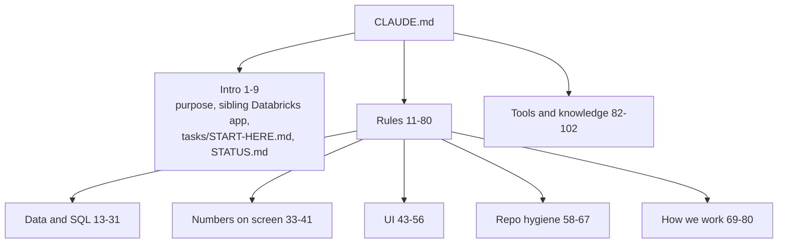

# CLAUDE.md (project)

The project rules for anyone (or any agent) changing the repo: data and SQL rules, how numbers show on screen, UI, repo hygiene, how to work and commit, and the tools and knowledge needed (CLAUDE.md:1-102).

## Sections

| Section | Rules (short) | Lines | Where code enforces it |
|---|---|---|---|
| Intro | Read-only Snowflake audit, built like the Databricks app; must sell to any customer, zero config; read `tasks/START-HERE.md` (git-ignored) and `STATUS.md` | 1-9 | – |
| Data and SQL | SELECT/WITH/SHOW only; never store query text, literals, secrets, policy bodies; `name (id)`; OUTER joins and FLATTEN; four money bug classes; Snowflake traps (10% cloud services, attribution not a total, role visibility, Fail-safe NULL names, POLICY_REFERENCES gaps, TABLE_ID vs BASE_TABLE_ID, 72 h org lag); verify on docs.snowflake.com; missing → NOT_ASSESSED | 13-31 | read-only: tools/export_results.py:642-647; no statement text: tests/test_sql_smoke.py:52-57 |
| Numbers on screen | not run shows "–" + why, never $0; same numbers across pages; units on counts; spend/change/waste never added; one money cut-off, today partial | 33-41 | tests/test_totals_agree.py:52-92; tests/test_waste_contract.py:1-30 |
| UI | 1–2 lines on screen, depth in the Guide; overview first, charts first; empty text with dates; one home per check; masking optional, off by default; keep the Databricks look | 43-56 | – |
| Repo hygiene | no customer / real names or absolute paths; name grep before every commit; `tasks/`, `data/`, `.env` out of git; one-line why-comments; no app security hardening | 58-67 | .gitignore:1-24 |
| How we work | answer first; push back; propose design changes, fix plain bugs; compile check by default; web change → commit source, build, commit dist; commit + push to main with fixed email and Co-Authored-By; list changed files for the zip user; no workflows unless named; Playwright check on real data | 69-80 | tests/test_build_web.py:33-38 |
| Tools and knowledge | Playwright, skill-creator for the `snowflake-account-usage` skill, WebFetch for docs; Python 3.11+, Node 20+, `gh`; billing and view knowledge; stack FastAPI + DuckDB + React 18/TS/Vite | 82-102 | requirements.txt:1-9; web/package.json |

## Related

- The `snowflake-account-usage` skill lives in `.claude/skills/snowflake-account-usage/` (SKILL.md plus `references/views.md`, `references/traps.md`) (CLAUDE.md:85; .claude/skills listing).
- `tasks/START-HERE.md` holds the work plan, local paths and the name grep; it is git-ignored and was not opened for this graph (CLAUDE.md:7, 60).
- The commit email is a fixed personal address in CLAUDE.md:76; it is not repeated here.

## Tensions with other documents

- "Test only when asked" (CLAUDE.md:73) vs README telling contributors to run `python tools/gate.py` (README.md:866-870): different audiences (agent vs contributor), not a real conflict.
- "No workflows and no background builder agents unless the user names them" (CLAUDE.md:79) also appears as a working preference (STATUS.md:36).
- `app/queries/README.md:67` says ACCOUNT_USAGE lags "up to 3 hours", while CLAUDE.md:25 and README.md:456-457 use 8 h for query attribution; the 3 h is a general figure, attribution is the exception. Worth a line in app/queries/README.md.
