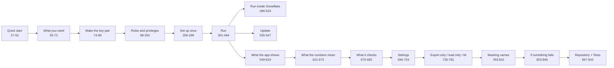

# README.md

The user manual: what the audit is, how to install, grant, export, load, run (locally or in Streamlit in Snowflake), read the numbers, configure, mask, troubleshoot and test (README.md:1-923).

## Map of sections

| Section | What it describes | Lines |
|---|---|---|
| Intro | 298 read-only checks on ACCOUNT_USAGE / ORGANIZATION_USAGE through one small warehouse; results in local DuckDB; only export and Refresh query Snowflake; "needs confirmation" until run on a busy account | 1-16 |
| Quick start | `python start.py`, 7 days, prompts, `.env`, `--refresh`, `--windows` | 27-53 |
| What you need | Python 3.11+, a role, a small warehouse (4 workers), key pair / password / browser; probe of every source; Node not needed | 55-72 |
| Make the key pair | openssl commands, passphrase variant, `RSA_PUBLIC_KEY` | 74-96 |
| Roles and privileges | who sets up what, the grant script (copied into the kit's `grants.sql`), what each grant opens with check counts, how a missing grant shows | 98-254 |
| Set up once | venv on Windows / macOS / Linux, `.env` keys | 256-299 |
| Run | `first_run.py` (default 30 days), Refresh behaviour, `--validate`, export options, prices, INFORMATION_SCHEMA fallbacks (85 checks), today partial, own copies of views (`sources:`), data folder per OS | 301-494 |
| Run inside Snowflake | deploy role, `deploy.py --run`, no Refresh, access = all data, settings read-only, ~15 min warehouse cost, network allowlist; "Not yet run in Snowflake" | 496-533 |
| Update to a new version | zip or pull, keep `.env` and `settings.local.yml`, reinstall, re-export | 535-547 |
| What the app shows | 21 pages, global filters, URL hash state, "–" for not run, downloads, lenses (FinOps default, Data engineer, Governance, CTO, CFO), How it works | 549-619 |
| What the numbers mean | dollars = credits × effective price, cloud services after 10% adjustment, 8 statuses, possible waste vs savings never added, query attribution is not a total, materiality floors, thresholds, windows, 50,000 row cap, visibility | 621-673 |
| What it checks | 298 checks by area (62 cost, 94 access/security, 34 queries, 35 pipelines, 31 storage, 19 AI, 22 warehouses); ~170 sources; what no view holds | 675-692 |
| Settings | every `config/settings.yml` key; `settings.local.yml` overrides top-level keys, nested blocks replaced whole | 694-724 |
| Export only / load only | split machines, export kit contents, `make_export_kit.py`, verify queries | 726-781 |
| Masking names | on screen vs in export, kinds, salted tokens, system names kept, no unmask | 783-815 |
| API | everything reads except `PUT /api/settings/...` and `POST /api/refresh`; `/docs` | 817-821 |
| If something fails | 15 symptom → fix rows (390144, 390100, exit 2, port busy, OOM, ...) | 823-845 |
| Repository | folder map | 847-862 |
| Tests | gate, fake account, demo DB and scenarios, web commands, commit-then-build rule | 864-916 |
| License | MIT or Apache-2.0 | 918-921 |

## Key facts it states

- Read-only: checks are `SELECT`, `WITH`, `SHOW`; deploy to Streamlit is the only step that creates objects (README.md:8-11). Enforced in code by `assert_read_only` (tools/export_results.py:455-460).
- A check that did not run shows "–" and the reason, never $0 (README.md:589-590, 636).
- Spend, change, waste and savings are never added together (README.md:583, 647-650).
- Prices: CLI → rate sheet → 90-day invoice rate → settings 3.00 / 2.00 (README.md:378-396).
- Data lives outside the repo; export / load refuse a folder inside it (README.md:479-496, 838).

## Who uses it

- The person running the audit (Quick start to Run), an admin (Roles and privileges), a viewer (What the app shows / numbers mean), a developer (Repository, Tests).
- `tools/make_export_kit.py` reads its "Roles and privileges" section to build the kit README and `grants.sql`, so editing that section changes shipped files (tools/make_export_kit.py:112-132).

## Inconsistencies noticed

- Title is the brand "Crosshire" (README.md:1); the project and Streamlit app are called "Snowflake audit" elsewhere (CLAUDE.md:1; tools/streamlit_deploy/deploy.py:25, 139). Brand is a setting (README.md:714).
- "`first_run.py` takes `--windows` and the three prices" (README.md:356) but it also takes `--workers` (tools/first_run.py:84-87).
- `SNOWFLAKE_AUTHENTICATOR` is read by the export (tools/export_results.py:52, 487) but not documented in README or `.env.example`.
- Network allowlist: README says `*.snowflake.app` and WebSockets (README.md:535); the deploy README adds `*.snowflake.com` and `*.snowflakecomputing.app` (tools/streamlit_deploy/README.md:50).
