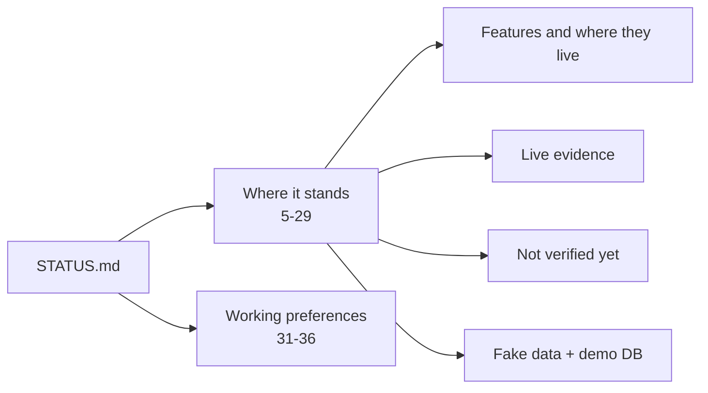

# STATUS.md

The project's current state: what is built, what ran live, what is not verified, and how the work is done (STATUS.md:1-36, last updated 6 Nov 2026).

## What it says

| Topic | Claim | Lines | Checked against code |
|---|---|---|---|
| Overall | POC feature-complete on `main`; ran on one small live trial account (3 days) plus fake and demo accounts | 6 | – |
| Checks | 298 in `app/queries/checks` | 8 | README.md:6 says the same |
| Heaviest tables, full scans, own copies (`sources:`), table day by day | built; not yet run live | 9-12 | `apply_sources` named in app/core/config.py (not opened here) |
| Activity, Last active, Access explorer | built; checked in browser on demo DB; Last active ran live on one small account | 13-15 | explorer route in app/api/explorer.py (not opened here) |
| First live run | 152 ok, 122 empty, 4 not assessed, 1 failed (`sf_ai_model_serving_spend`, error 100038); prices from RATE_SHEET_DAILY ($3.00, $2.00) | 16 | – |
| Prices | CLI → rate sheet → 90-day invoice → settings | 17 | README.md:378-396 |
| INFORMATION_SCHEMA fallbacks | 85 checks, 52 shim views, gates MONITOR USAGE / MANAGE GRANTS / APPLY policy; 22 left out on purpose; all 85 ran live | 18 | README.md:400-453 |
| App | FastAPI + DuckDB; React/TS built by Vite to `app/web/dist` | 19 | web/vite.config.ts:44 |
| Streamlit in Snowflake | ships API + build + DuckDB; refuses demo/test data by contents; warehouse runtime default (v1 frame, may not be allowed), container fallback; checked with local Streamlit 1.52.2 and 1.56 on Python 3.11; **not run in Snowflake** | 22 | tools/streamlit_deploy/deploy.py:43-57, 75-100, 129-139 |
| Export kit | refresh with `make_export_kit.py` after any SQL, check or README Roles change | 23 | tests/test_export_kit.py:38-42 |
| Not verified | error 100038 not reproduced; `sf_lin_copied_links` not run live; full suite passed at 485 tests (~25 min); newer tests pass on their own | 24 | – |
| Fake data | base files `data.py`, `gap_*.py`, `new_checks_data.py`, `batch3_data.py` (don't change); demo `demo_*.py`; demo DB ~4 min, ~2.3 GB; nine scenarios; `worst_case` | 25-28 | tests/fake_snowflake/demo_scenarios.py:40-58 (nine entries) |
| History | squashed to one commit on 15 Oct 2026 | 29 | `git log` now shows 91 commits since |

## Working preferences (STATUS.md:31-36)

- Commit and push to `main` after every finished change; don't over-engineer; no backward compatibility.
- Push back on costly or rule-breaking requests.
- Pages: less text; headline figure, a chart that shows the cause, a drill-down.
- Tests and browser review only at the end; compile checks between batches.
- Delegation: Sonnet builds, Opus designs and reviews; no workflows or builder agents unless asked.

## Notes

- "History: squashed to one commit" (STATUS.md:29) is history, not current state; there are 91 commits now (git log).
- "Tests and the browser review only at the end" (STATUS.md:35) reads softer than CLAUDE.md's "Check every changed page in a real browser ... before calling it done" (CLAUDE.md:80). Compatible if "done" means end of batch; unclear.
