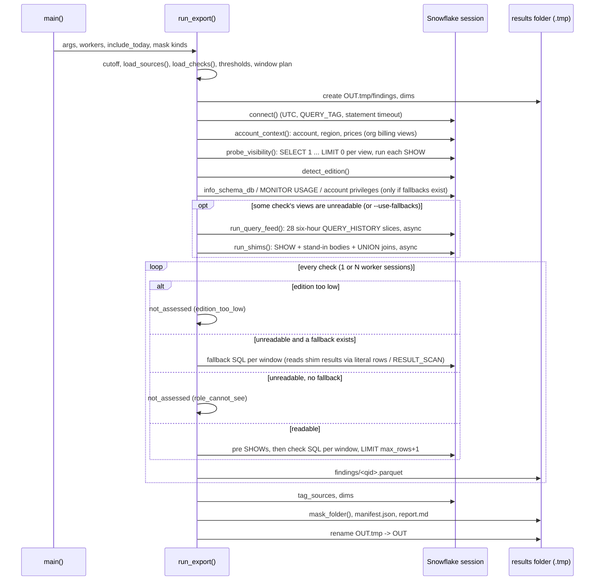

# Export flow (tools/export_results.py)

One run signs in, works out prices and what the role can read, runs every check (or its INFORMATION_SCHEMA fallback) over the 7/30/90-day windows, and writes `findings/*.parquet`, `dims/`, `tags_src/`, `manifest.json` and `report.md` into a results folder that `tools/load_results.py` loads.

Entry: `python tools/export_results.py --out DIR [...]` -> `main` (tools/export_results.py:1576-1625) -> `run_export` (tools/export_results.py:1146-1391). The kit's `run_export.py` follows the same steps on one session (see processes/export-kit.md).

## Sequence

## Steps

1. **Parse flags.** `build_parser` (tools/export_results.py:1528-1551). `--statement-timeout` sets the module global used by `connect` (tools/export_results.py:1577-1579). `--validate` branches to `run_validate` instead (tools/export_results.py:1580-1604).
2. **Pick the money cut-off ("as of").** `_cutoff`: with `include_today` the first day left out is tomorrow; else now minus 8 h (`LAG_HOURS`), as a date (tools/export_results.py:1050-1057). `main` reads `include_today` from settings (tools/export_results.py:1042-1047, 1581); the default setting is `True` (app/core/config.py:160).
   - Example (tests/test_export_show.py:136-142): now 21 Sep 12:00 UTC, include_today false -> `2026-09-21`; now 21 Sep 03:00, false -> `2026-09-20`; 03:00, true -> `2026-09-22`.
3. **Refuse an output inside the repo.** `datasource.inside_repo(out_dir)` (tools/export_results.py:1162-1163; app/core/datasource.py:36-38).
4. **Read `sources:`** (your own copies of the views) into `_SOURCES`; a bad `sources` key stops the run, any other settings error only warns (tools/export_results.py:1097-1109). See logic/fallbacks.md "Your own copies".
5. **Load checks, thresholds, window plan.** `load_checks` requires header `query_id` == file name (tools/export_results.py:97-106); `--only` must name real checks (tools/export_results.py:1166-1170). `window_plan`/`window_sources`/`window_aliases_map` (tools/common.py:24-40).
   - Example (tools/common.py:25): `--windows 30` -> plan `[(7,7),(30,30),(90,30)]`; sources run `(7,7)` and `(30,30)`; alias `90 -> 30`, so the 90-day label reuses the 30-day rows.
6. **Work in `OUT.tmp`.** Created fresh with `findings/`, `dims/` (tools/export_results.py:1176-1180); renamed to `OUT` only at the end (tools/export_results.py:1388-1390), so a failed run never leaves a half folder under the final name.
7. **Connect.** `_load_env` reads the 8 `SNOWFLAKE_*` keys from the environment, then `.env` at the repo root; `SNOWFLAKE_ACCOUNT` and `SNOWFLAKE_USER` are required (tools/export_results.py:48-52, 655-666). `connect`: key file > password > browser (`externalbrowser`, with stored temporary credential); session `TIMEZONE=UTC`, `QUERY_TAG=query_source()`, `STATEMENT_TIMEOUT_IN_SECONDS` (tools/export_results.py:690-713). Any sign-in error becomes one line with a fix via `explain_connection_error` (tools/export_results.py:776-803, 1165-1173).
8. **Account context and prices.** `account_context` reads `CURRENT_ACCOUNT/REGION/ACCOUNT_NAME/ORGANIZATION_NAME`, derives cloud from region, and fills the three prices (tools/export_results.py:839-891). Its failure is treated as a session problem (tools/export_results.py:1192-1199). Price order: logic/pricing.md.
9. **Probe what the role can read.** `probe_visibility`: `SELECT 1 FROM SNOWFLAKE.<schema>.<view> LIMIT 0` for every source schema in `_VIEW_SCHEMAS`, every check `pre:` SHOW run unfetched, and a warehouse gap count (billed in 30 days vs `SHOW WAREHOUSES`) (tools/export_results.py:941-992).
10. **Edition.** `detect_edition`: `ORGANIZATION_USAGE.ACCOUNTS`, else "ENTERPRISE" (meaning at least) from feature evidence, else unknown (tools/export_results.py:806-836). A missing feature never proves Standard.
11. **Fallback prerequisites** (only when the selected checks have fallbacks): `info_schema_db`, `has_monitor_usage`, `account_privileges` (tools/export_results.py:1202-1205). Fallbacks to run = those whose check has an unreadable source, or all with `--use-fallbacks` (tools/export_results.py:1206-1207).
12. **Shared fallback inputs, once.** `run_query_feed` when any fallback reads the query feed (tools/export_results.py:1208-1209, 410-441); `run_shims` for the stand-ins those fallbacks read (tools/export_results.py:1210-1211, 444-544). Details: logic/fallbacks.md.
13. **Run each check** (`run_one`, tools/export_results.py:1230-1313), in this order of decisions:
    - edition below Enterprise and the check needs it -> `not_assessed`, `edition_too_low`, not run (tools/export_results.py:1235-1245);
    - a source is unreadable (or `--use-fallbacks`) and a fallback exists -> run the fallback; any failure -> `not_assessed` `role_cannot_see`, never "empty" (tools/export_results.py:1246-1281);
    - a source is unreadable, no fallback -> `not_assessed` with each unreadable source and its error (tools/export_results.py:1282-1291);
    - else run it; an exception -> `failed` with `error_code` and `cause` from `reasons.classify_error` (tools/export_results.py:1292-1308).
14. **Per window.** `_run_check`: run the `pre:` SHOWs, render, pin `LAST_QUERY_ID()` to the SHOW's own query id, run with `LIMIT max_rows+1`, cut to `max_rows` and record the window as truncated, overwrite `window_days` with the label, blank unflagged waste (tools/export_results.py:1006-1020, 713-721; tools/common.py:70-85).
15. **Render.** `render`: paste `__INCLUDE_x__` from `app/queries/common/`, fill `:params` (header defaults overridden by `config/thresholds.yml`, `params_for` tools/export_results.py:270-277) and `:period_days`, the `__AS_OF_DATE__`/price/account placeholders, the query feed and shim results; leftover params raise; finally `apply_sources` (tools/export_results.py:614-657).
16. **Read-only guard.** Every statement passes `assert_read_only`: one `SELECT`/`WITH`/`SHOW`, no `;` outside string literals (tools/export_results.py:660-665); `run_sql` applies it on every call (tools/export_results.py:742-750).
17. **Normalise.** Lower-case column names (except `access_grants_inventory.grantee` -> `GRANTEE`), NUMBER -> int64/float64 (tools/export_results.py:717, 735-745).
18. **Workers.** `--workers N` (default 4, or 1 with browser sign-in: `default_workers` tools/export_results.py:766-773) gives each thread its own session, because a SHOW pre-step and its RESULT_SCAN must share one (tools/export_results.py:1219-1228, 1290-1303).
19. **Tag sources and dims** on the main session after all checks; failures only warn (tools/export_results.py:1329-1351; `_run_source` 1006-1022).
20. **Manifest.** Dates (`as_of_date`, `last_complete_day`, `export_date`, `lag_hours`), visibility, sources, edition, timeout, `monitor_usage`, `manage_grants`, windows/coverage/aliases, account, pricing with sources and `rate_basis`, `max_rows`, `masked`, per-check findings, dims, tag sources (tools/export_results.py:1355-1382).
21. **Mask, then write.** `app_masking.mask_folder` runs on the parquet files and the manifest before `manifest.json` and `report.md` are written, so no real name stays in the folder when masking is on (tools/export_results.py:1383-1387). Kinds: `--mask`, else `privacy.mask_fields` (tools/export_results.py:1566-1573).
22. **report.md.** Failed first, then not assessed, then all-NOT_ASSESSED rows, then the rest; header has price, edition, timeout, copies read, role visibility (tools/export_results.py:1112-1143, 1050-1077).
23. **Exit codes.** 2 = config error (`ExportConfigError`), 1 = connection error, 0 = done; prints the next command (tools/export_results.py:1611-1625).

There is **no zip step** in `export_results.py`; only the kit zips its output (`--no-zip` to skip, tools/export_kit/run_export.py:1525-1527). README says "zip the folder to move it" (README.md:739).

## Statuses written per check

| status | when | cite |
|---|---|---|
| `ok` / `empty` | ran; rows / no rows | tools/export_results.py:1298-1301 |
| `not_assessed` + `edition_too_low` | edition below Enterprise | tools/export_results.py:1237-1245 |
| `not_assessed` + `role_cannot_see` | source unreadable and no (working) fallback | tools/export_results.py:1266-1291 |
| `failed` | SQL error, timeout, view missing | tools/export_results.py:1302-1306 |

`--validate` instead runs every check and dim with `LIMIT 0` and writes `validate.json`/`validate.md`, grouping unreadable checks by cause with the GRANT for each; exits 1 only on real SQL errors (tools/export_results.py:1407-1521, 1574-1575).
