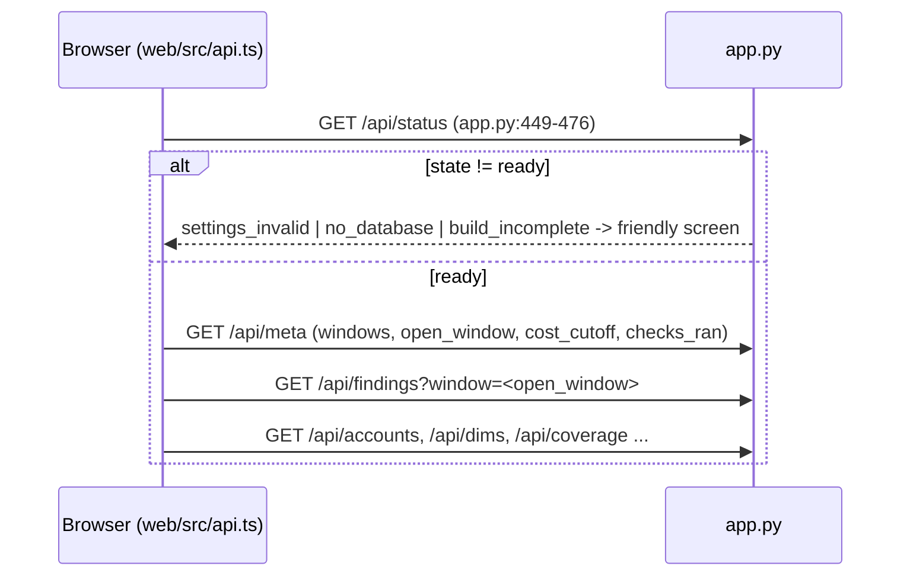
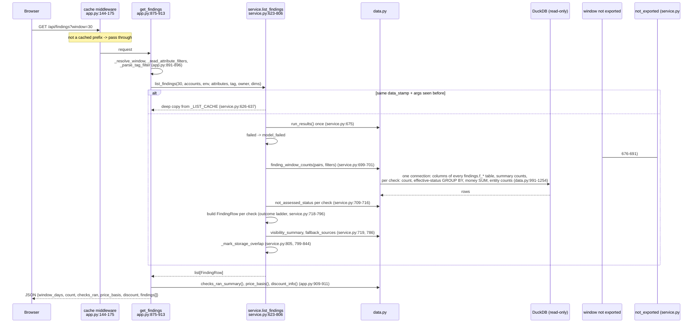

# Request flow: browser -> FastAPI -> service -> DuckDB -> JSON

How one page request travels through the backend, shown for GET /api/findings (the list every page reads) and GET /api/finding/{id} (one check), with real response shapes from the test DB.

## Boot order of the shell



- `/api/status` is called first and never raises (app.py:443-476; api.ts:196).
- `open_window` = settings.default_window if this db has it, else the largest available window (app.py:207-213).

## GET /api/findings (list)



## GET /api/finding/{query_id} (one check)

```mermaid
sequenceDiagram
  participant UI as Browser
  participant MW as cache middleware
  participant R as get_finding<br/>app.py:931-1076
  participant S as service.load_outcome<br/>service.py:277-425
  participant D as data.py
  participant DB as DuckDB
  UI->>MW: GET /api/finding/sf_wh_idle_minutes?window=30&limit=200
  MW->>MW: key=(data_stamp, path, query); hit -> cached bytes
  MW->>R: miss
  R->>S: load_outcome(qid, 30, ..., limit=offset+limit)
  S->>D: finding_status + truncation_info + exported_window_coverage
  alt run results say failed / window never exported
    S-->>R: not_assessed
  else
    S->>D: finding_columns + count_finding(qid, 30) -> rows_in_window
    D->>DB: SELECT count(*) FROM findings."f_sf_wh_idle_minutes" t WHERE window_days = ?
    alt rows_in_window == 0
      S-->>R: ok_empty_window (+ window_coverage)
    else
      S->>D: read_finding(...filters...) (data.py:688-793)
      D->>DB: count(*) with filters; floor count; SELECT effective status ... ORDER BY status rank, rowid LIMIT ?
      S-->>R: ok_empty_filters or ok_rows (+ window_coverage)
    end
  end
  R->>R: header params substituted (service.py:172-205), prose cleaned (app.py:921-928)
  R->>R: ok_rows: pricing.apply(df, effective discount) -> *_disc columns,<br/>page slice, classify_columns, records (masking) (app.py:1035-1042)
  R-->>MW: 200 JSON
  MW->>MW: store if body <= cap (app.py:167-173)
  MW-->>UI: JSON
```

- The API layer never builds finding SQL; paging is a Python slice of the already capped frame (app.py:1032-1037).
- Filters a check cannot apply are ignored and reported (`scope.*_applied`, `dim_applied`), never an empty result (data.py:408-421, 572-599).

## Real example (tests/db_audit_test.duckdb, fake account, as of 2026-09-21)

Request: `GET /api/findings?window=30` -> one row (trimmed):

```json
{
  "window_days": 30, "count": 298,
  "checks_ran": {"ran": 290, "total": 298, "unit": "checks",
                 "not_ran": {"all_rows_not_assessed": 6, "build_failed": 2}},
  "price_basis": {"credit_price_usd": 3.0, "source": "usage_in_currency_daily",
                  "source_short": "invoice", "invoice_derived": true},
  "discount": {"configured": 0.0, "effective": 0.0, "ignored": false, "reason": null},
  "findings": [{
    "query_id": "sf_wh_idle_minutes", "outcome": "ok_rows", "window_days": 30, "row_count": 12,
    "status_counts": {"NOT_ASSESSED": 7, "CRITICAL": 4, "WARN": 1},
    "money": {"column": "est_wasted_usd_list", "kind": "waste", "usd": 13827.6, "unit": "usd",
              "basis": "flagged", "usd_flagged": null, "price_basis": "invoice"},
    "affected": {"noun": "warehouses", "flagged": 5, "total": 12, "not_assessed": 7},
    "floor": {"column": "est_wasted_usd_list", "min": 50, "unit": "USD",
              "label": "$50 possible waste per 30 days", "rows_below": 0},
    "visibility": {"limited": true, "billed": 12, "visible": 6, "unit": "warehouses"},
    "not_assessed": null, "partial": false
  }]
}
```

Request: `GET /api/finding/sf_wh_idle_minutes/aggregate?window=30&agg=sum&value=est_wasted_usd_list&status=WARN&status=CRITICAL&group=warehouse_id&top=2`:

```json
{"outcome": "ok_rows", "group": ["warehouse_id"],
 "groups": [{"key": ["1001"], "value": 9046.8, "row_count": 1, "null_rows": 0},
            {"key": ["1003"], "value": 2155.2, "row_count": 1, "null_rows": 0}],
 "other": {"key": null, "value": 2625.6, "row_count": 3, "null_rows": 0},
 "total_value": 13827.6, "group_count": 5, "rows_total": 12, "matched_rows": 5,
 "floor": {"min": 50, "unit": "USD", "per_days": 30}, "discount_pct": 0.0,
 "truncated": false, "truncated_max_rows": 50000}
```

- The list's `money.usd` (13,827.60) equals the aggregate `total_value` over WARN+CRITICAL rows; tests/test_totals_agree.py:101-128 checks this for every priced check.
- `group=warehouse_name` on this check returns 422 `unknown group column` because the table carries `warehouse_id` only; names come from GET /api/dims (app.py:599-673; data.py:1406-1410).

Request: `GET /api/finding/sf_org_dormant_accounts?window=30` (failed on purpose in the fixture, tests/fixtures/build_fixtures.py:46-48):

```json
{"outcome": "not_assessed",
 "status_info": {"status": "failed", "reason": "no_access",
   "message": "SQL access control error: Insufficient privileges to operate on view 'ORGANIZATION_USAGE.ACCOUNTS'"}}
```

No `rows`, `rows_total` or `columns` keys: tests/test_api.py:490-496.

Shapes captured by running FastAPI TestClient against tests/db_audit_test.duckdb with a copy of config/ (values rounded here).
