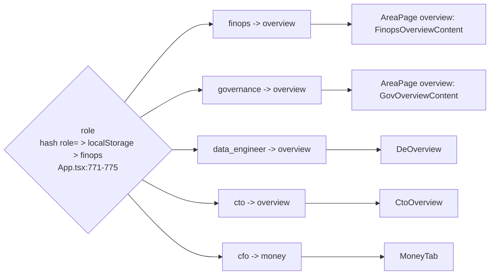

# Role lenses

A lens ("View as") picks which pages the rail lists, their grouping and the landing page. It is a persona, never a permission: every lens reads the same data (`web/src/App.tsx:111-114`, `web/src/App.tsx:205`).

## Lens → home → pages

- Roles: `finops`, `data_engineer`, `governance`, `cto`, `cfo` (`App.tsx:115`). Labels come from `LENS_LABEL` (`web/src/components/lens_nav.ts:10`).
- Home: `cfo` → `money`, every other role → `overview` (`App.tsx:125-128`). Which Overview renders depends on the role: CTO and data engineer get their own pages outside AreaPage (`App.tsx:1105-1145`); finops and governance get `OverviewContent` (`web/src/tabs/tab_overview.tsx:421-423`).
- Stored in the hash as `role=`, left out for finops (`App.tsx:801`), and in localStorage `role` (`App.tsx:786-792`). Switching lens jumps to the new lens's home (`App.tsx:786-792`).

## Pages per lens (`LENS_NAV`, `lens_nav.ts:20-57`)

| Lens | Groups and entries | Evidence |
|---|---|---|
| CTO | top (Overview, Fix these first); Cost: cost, tags, waste, warehouses, serverless, storage; Reliability: tasks, loading; Performance: queries, ai; Security: access, pii, audit, sharing, lineage, activity; Reference | `lens_nav.ts:21-28` |
| CFO | Money, What to do; Explore: cost, Chargeback & tags, Contract & rate, Budgets & guardrails, waste; Reference | `lens_nav.ts:29-36` |
| FinOps | top; Spend: cost, tags, Budgets, Contract; Waste: waste, warehouses, serverless, ai, storage, sharing; Reference | `lens_nav.ts:37-42` |
| Data engineer | top; Pipelines: tasks, loading, activity, Who can access what (access/explorer); Queries & compute: queries, warehouses, serverless; Cost: cost, waste, storage; Reference | `lens_nav.ts:43-49` |
| Governance | top; Access: Roles & grants, Users & sign-ins, Account perimeter, Who can access what; Data: pii, lineage, activity, sharing, storage; Trail: audit; Reference | `lens_nav.ts:50-56` |

- Reference group: Coverage & gaps, All findings, How it works (`lens_nav.ts:16-18`).
- An entry can be a single sub-tab (`sub(tab, subtab, label)`) (`lens_nav.ts:13-14`). `activeNavItem` lights the entry for the open sub-tab, else the area's own entry, else its first entry (`lens_nav.ts:84-89`).
- `pageLabel`: `actions` reads "Fix these first", or "What to do" for the CFO (`lens_nav.ts:71-78`).

## Rules

| Rule | Plain words | Example (test) | Code |
|---|---|---|---|
| Sidebar keys | Each page once, in sidebar order | cfo → `[money, actions, cost, waste, coverage, findings, guide]` (`web/src/test/roles.test.ts:7-10`) | `lensTabs` `lens_nav.ts:63-68`, `sidebarKeysForRole` `App.tsx:142-144` |
| Same frame | Every non-CFO lens starts with overview, actions and ends with coverage, findings, guide | `roles.test.ts:12-19` | `lens_nav.ts:15-18` |
| Groups | Group labels per lens | finops → `[Spend, Waste, Reference]` (`roles.test.ts:21-28`) | `lens_nav.ts:20-57` |
| Role areas | Actions and All findings filter to the lens's content areas. The CFO's also include `ai` | governance → `[actions, access, pii, lineage, activity, sharing, storage, audit, coverage]`; unknown role → finops (`roles.test.ts:30-33`) | `ROLE_AREAS` `App.tsx:131-140`, used by `useActions` `tab_actions.tsx:304-305` |
| Lit entry | The sub-tab entry wins over the area entry | governance + access/users → "Users & sign-ins"; cfo + cost/trend → the plain Cost entry (`roles.test.ts:35-38`) | `activeNavItem` `lens_nav.ts:86-89` |
| Clamp | A tab the lens doesn't list goes to the lens's home | `queries` under finops → `overview`; under data_engineer → `queries`; `tasks` under cfo → `money` (`roles.test.ts:40-44`) | `clampTabForRole` `App.tsx:146-148`; applied on load `App.tsx:780`, on role change `App.tsx:800-806`, as a safety net `App.tsx:795-799` |
| Old links | Old tab keys are still accepted | `roles.test.ts:46-48` | `OLD_TAB_REDIRECTS` `tab_registry.tsx:534-537` |

- `money` and `tags` are accepted in the hash for every lens (`App.tsx:100-104`). The clamp still sends them home in any lens that doesn't list them, so a CFO `money` link pasted under FinOps lands on Overview (`App.tsx:146-148`, `lens_nav.ts:37-42`). The comment "still a real, linkable tab" (`App.tsx:100-101`) only holds within lenses that list it.
- README's lens table matches `LENS_NAV` (`README.md:599-607`).

## Issues

- The comment at `App.tsx:111-113` says the CTO lens decides "whether an area opens its summary or its full drill-down". `summaryOnly` is always `false` (`App.tsx:1123`), so every lens gets the full drill-down. Only the Overview page differs per lens.
