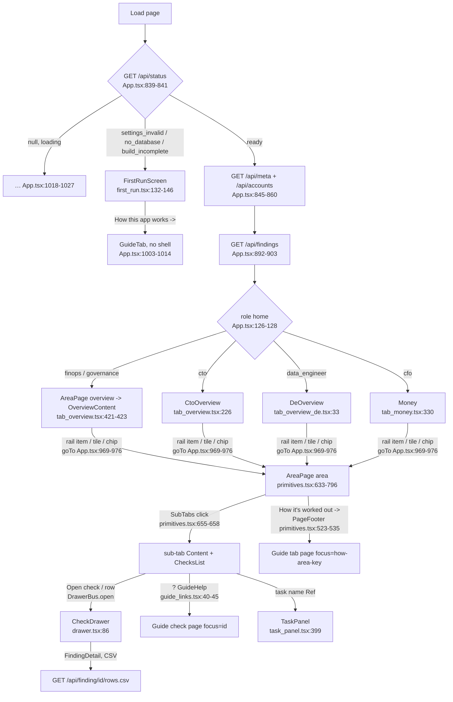
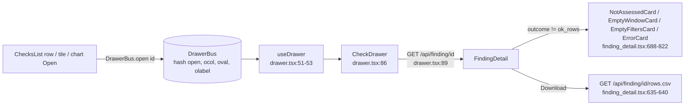

# UI navigation flow

How a reader moves from first load through Overview and an area's sub-tabs to the check drawer and the Guide. For each screen: the component (`path:line`) and the API endpoints it calls.

## Screen flow

- Initial nav: the hash, after old-key redirects and the role clamp. With no hash it is the role's home (`web/src/App.tsx:777-782`).
- Rail click → `setNav({tab, subtab})`, with focus cleared (`web/src/App.tsx:985`). A sub-tab click keeps the tab and clears focus (`web/src/App.tsx:986`).
- A cross-area jump (`onExternalJump`) looks up the check's home in `QUERY_HOME`. Unknown ids fall back to All findings (`web/src/App.tsx:978-983`, `web/src/components/tab_registry.tsx:563-577`).
- A focused check opens the drawer. Closing it clears `focus` (`web/src/components/primitives.tsx:692-707`). Changing area or sub-tab closes the drawer (`primitives.tsx:696-700`).
- AreaPage opens on the hash sub-tab when it is visible, else on the first visible sub-tab (`web/src/components/primitives.tsx:650-653`).
- Org sub-tabs (`org: true`) are hidden when none of their checks ran (`web/src/components/tab_registry.tsx:546-558`).

## Shell (every ready screen)

| Element | Component | Endpoints |
|---|---|---|
| Rail: brand, Lens, grouped pages with one count each, theme | `Rail` `App.tsx:590-607`, `SideNav` `App.tsx:559-587`, `navCountFor` `App.tsx:531-550` | (uses findings and meta) |
| Top bar: window, export status, Filters, Copy link, Save as PDF | `TopBar` `App.tsx:494-523` | `/api/meta` |
| Filters popover: attributes, tag, owner, warehouse/db/schema, accounts | `FiltersControl` `App.tsx:441-491` | `/api/tags` (`api.ts:235`), `/api/rollup` (`tag_picker.tsx:171`), `/api/warehouses`, `/api/databases` (`api.ts:227-228`) |
| Refresh | `RefreshButton` `App.tsx:280-337` | `GET /api/refresh` (polled every 3 s while running), `POST /api/refresh?days=` (`App.tsx:285-293`, `334`) |
| Settings gear (not when HOSTED) | `SettingsGearButton` `settings_panel.tsx:112` | `GET/PUT /api/settings/cost-center`, `GET/PUT /api/settings/privacy` (`api.ts:201-208`) |
| Phone drawer below ~900px | `SideNavDrawer` `App.tsx:611-649` | same as above |
| Tag banner (Cost) | `TagScopeBanner` `tag_picker.tsx:256` | - |
| Task panel | `TaskPanelOverlay` `task_panel.tsx:399` | `/api/finding/{id}?job_id=` |
| Names | `useDims` `hooks.tsx:229-244`, `names.tsx:1-14` | `/api/dims`, `/api/accounts`, `/api/meta` |

All area content calls `GET /api/finding/{query_id}` (via `useFindingData`, `hooks.tsx:89-118`) and/or `GET /api/finding/{query_id}/aggregate` (via `useFindingAgg`, `hooks.tsx:131-158`). The drawer adds `rows.csv` (`api.ts:162-192`).

## Pages without sub-tabs, or with bespoke routes

| Tab (hash `tab=`) | Shown when | Component | Endpoints / checks read |
|---|---|---|---|
| `overview`, finops | role finops | `AreaPage` → `FinopsOverviewContent` `tab_landing.tsx:49` | finding/aggregate: `cost_dollarized_by_service_day`, `cost_period_over_period`, `overview_spend_estimate`, `sf_wh_idle_minutes`, `sf_cost_resource_monitor_coverage`... (`tab_landing.tsx`); `/api/rollup` (cost center, `tab_landing.tsx:11`) |
| `overview`, governance | role governance | `AreaPage` → `GovOverviewContent` `tab_landing.tsx:299` | finding: `access_broad_grants`, `sf_sec_users_without_mfa`, `sf_gov_sensitive_columns_unprotected` (`tab_landing.tsx`) |
| `overview`, cto | role cto (not AreaPage) | `CtoOverview` `tab_overview.tsx:226-419` | aggregate `cost_dollarized_by_service_day`, `query_queuing_waits`; finding `cost_period_over_period`, `sf_task_failures` (`tab_overview.tsx:235-239`); `/api/rollup` |
| `overview`, data_engineer | role data_engineer (not AreaPage) | `DeOverview` `tab_overview_de.tsx:33` | finding/aggregate: `sf_task_failures`, `sf_task_duration_regression`, `query_queuing_waits`, `overview_daily_credits_trend`, `query_top_by_cost`, `sf_wh_state_daily` (`tab_overview_de.tsx`, `de_blocks.tsx`) |
| `money` | CFO home; linkable from any lens | `MoneyTab` `tab_money.tsx:330` | finding/aggregate: `cost_dollarized_by_service_day`, `cost_monthly_actuals`, `sf_cost_month_end_forecast`, `sf_cost_contract_balance_burn`, `sf_cost_invoice_vs_metered`... ; `/api/rollup` |
| `actions` ("Fix these first" / CFO "What to do") | all lenses | `AreaPage` → `ActionsPanel` `tab_actions.tsx:634`, registered `tab_actions.tsx:852` | aggregate `cost_dollarized_by_service_day` (`tab_actions.tsx:643`), finding `sf_cost_contract_balance_burn`; `/api/rollup` (`useActions` `tab_actions.tsx:309`). |
| `findings` (All findings) | all lenses | `AreaPage` → `AllFindingsPanel` `tab_findings.tsx:134`, registered `:277` | none of its own: reads `allFindingsIndex` |
| `tags` | finops, cto | `TagsRoute` `App.tsx:735-751` → `TagsPage` `tab_tags.tsx:285` | `GET /api/tags/compliance`, `GET/PUT /api/settings/required-tags` (`api.ts:230-233`) |
| `guide` (How it works) | all lenses; also before ready | `GuideTab` `guide.tsx:2743-2789` | `GET /api/guide` (`guide.tsx:2749`), `GET /api/guide/sql/{id}` when the SQL is opened (`guide.tsx:2351`) |

### Guide routing (`focus=`)

| `focus` | Page | Evidence |
|---|---|---|
| `how-area-<key>` | tab page | `guide.tsx:2774-2776`, `guide_links.tsx:35-37` |
| `how-troubleshooting`, `how-glossary`, `how-checks` | fixed pages | `guide.tsx:2777-2779` |
| `how-<slug>` in `GUIDE_SECTIONS` | topic page | `guide.tsx:2780-2782` |
| `<query_id>` | check page | `guide.tsx:2783-2786` |
| none | Guide home | `guide.tsx:2788` |

## Area tabs and sub-tabs

Every row: the sub-tab is registered by `registerAreaContent` (`tab_area.tsx:472-491`) → `AreaSubtabContent` (`tab_area.tsx:389-452`). That renders the page component below (from `COMPUTE_PAGES` `area_compute.tsx:1945-1948` or `AREA_CHART_PAGES` `area_pages.tsx:132-141`), then `ChecksList` (`primitives.tsx:777-781`). Sub-tab ownership is in `tab_registry.tsx` at the line given. Endpoints: always `GET /api/finding/{id}`. "+agg" means the page also uses `/aggregate`.

| Area (`tab=`) | Sub-tab (`subtab=`) | Registry line | Page component | Extra endpoints |
|---|---|---|---|---|
| cost (Cost) | trend | `tab_registry.tsx:55` | `CostTrendContent` `tab_cost.tsx:679` (own registration `:890`) | +agg, `/api/rollup` |
| cost | service | `:72` | `ApCostByService` `ap_cost.tsx:123` | +agg |
| cost | who | `:77` | `ApCostWho` `ap_cost.tsx:281` | |
| cost | chargeback | `:82` | `ApCostChargeback` `ap_cost.tsx:555` | `/api/rollup` (inferred; `ap_cost.tsx` uses rollup) |
| cost | before (no own ids) | `:92` | `ApCostBeforeAfter` `cost_before_after.tsx:180` | +agg |
| cost | contract | `:97` | `ApCostContract` `ap_cost.tsx:691` | |
| cost | budgets | `:102` | `ApCostBudgets` `ap_cost.tsx:863` | |
| waste (Waste & savings) | priced | `:489` | `WastePricedContent` `tab_waste.tsx:155` | +agg |
| waste | unpriced | `:490` | `WasteUnpricedContent` `tab_waste.tsx:331` | +agg |
| waste | method | `:491` | `WasteMethodContent` `tab_waste.tsx:447` | |
| warehouses | idle | `:173` | `WhIdle` `area_compute.tsx:209` | +agg |
| warehouses | sizing | `:178` | `WhSizing` `area_compute.tsx:709` | +agg |
| warehouses | load | `:183` | `WhLoad` `area_compute.tsx:929` | +agg |
| serverless | feature | `:192` | `PlServerlessFeature` `area_pipelines.tsx:1289` | |
| serverless | clustering | `:197` | `PlServerlessClustering` `area_pipelines.tsx:1429` | |
| serverless | mvso | `:202` | `PlServerlessMvso` `area_pipelines.tsx:1534` | |
| queries | heavy | `:211` | `QHeavy` `area_compute.tsx:1208` | +agg |
| queries | efficiency | `:216` | `QEfficiency` `area_compute.tsx:1317` | +agg |
| queries | failures | `:225` | `QFailures` `area_compute.tsx:1493` | +agg |
| queries | waiting | `:230` | `QWaiting` `area_compute.tsx:1681` | +agg |
| queries | team | `:236` | `QTeam` `area_compute.tsx:1828` + `QueryTagRollup` `tab_area.tsx:466-468` | `/api/rollup`, `/api/rollup/keys` |
| queries | trend (refIds only) | `:241` | `QTrend` `query_trend.tsx:81` | +agg |
| tasks | failures | `:250` | `PlTasksFailures` `area_pipelines.tsx:194` | +agg |
| tasks | cost | `:255` | `PlTasksCost` `area_pipelines.tsx:351` | |
| tasks | hygiene | `:260` | `PlTasksHygiene` `area_pipelines.tsx:578` | |
| tasks | dynamic | `:265` | `PlTasksDynamic` `area_pipelines.tsx:705` | |
| loading | pipes | `:274` | `PlLoadingPipes` `area_pipelines.tsx:903` | |
| loading | copy | `:279` | `PlLoadingCopy` `area_pipelines.tsx:1068` | |
| ai (AI & apps) | cortex | `:288` | `ApAiCortex` `area_ai_storage.tsx:342` | +agg |
| ai | apps | `:298` | `ApAiApps` `area_ai_storage.tsx:565` | |
| ai | serving | `:307` | `ApAiServing` `area_ai_storage.tsx:722` | |
| access | roles | `:316` | `ApAccessRoles` `area_governance.tsx:175` | |
| access | users | `:326` | `ApAccessUsers` `area_governance.tsx:369` | |
| access | perimeter | `:336` | `ApAccessPerimeter` `area_governance.tsx:485` | |
| access | explorer | `:347` | `ApAccessExplorer` `area_access_explorer.tsx:439` | `GET /api/access/names` (`:451`), `GET /api/access/explore` (`:460`) |
| audit | admins | `:356` | `ApAuditAdmins` `area_governance.tsx:572` | |
| audit | changes | `:361` | `ApAuditChanges` `area_governance.tsx:734` | |
| pii (PII & policies) | sensitive | `:370` | `ApPiiSensitive` `area_governance.tsx:830` | |
| pii | policies | `:375` | `ApPiiPolicies` `area_governance.tsx:922` | |
| pii | reads | `:380` | `ApPiiReads` `area_governance.tsx:1035` | |
| pii | quality | `:385` | `ApPiiQuality` `area_governance.tsx:1120` | |
| lineage | dependencies | `:394` | `ApLineageDeps` `area_governance.tsx:1196` | |
| lineage | explorer | `:399` | `ApLineageExplorer` `area_lineage_explorer.tsx:77` | |
| activity | databases | `:410` | `ApActivityDatabases` `area_activity.tsx:78` | |
| activity | schemas (no own ids) | `:412` | `ApActivitySchemas` `area_activity.tsx:152` | |
| activity | tables | `:413` | `ApActivityTables` `area_activity.tsx:263` | |
| activity | lastactive | `:414` | `ApActivityLastActive` `area_activity.tsx:990` | |
| activity | users | `:415` | `ApActivityUsers` `area_activity.tsx:623` | |
| activity | objects | `:416` | `ApActivityObjects` `area_activity.tsx:772` | |
| sharing (Sharing & org) | shares | `:423` | `ApSharingShares` `area_governance.tsx:1261` | |
| sharing | accounts (org) | `:428` | `ApSharingAccounts` `area_governance.tsx:1370` | |
| sharing | spend (org) | `:433` | `ApSharingSpend` `area_governance.tsx:1480` | |
| sharing | replication | `:442` | `ApSharingReplication` `area_governance.tsx:1579` | |
| storage | growth | `:451` | `ApStorageGrowth` `area_ai_storage.tsx:825` | |
| storage | unused | `:456` | `ApStorageUnused` `area_ai_storage.tsx:931` | |
| storage | retention | `:461` | `ApStorageRetention` `area_ai_storage.tsx:1067` | |
| storage | backups | `:466` | `ApStorageBackups` `area_ai_storage.tsx:1214` | |
| coverage (Coverage & gaps) | sources | `:508` | `CoverageSourcesPanel` `tab_coverage.tsx:231` | `GET /api/coverage` (`tab_coverage.tsx:87-99`), finding `cost_audit_self_usage`, `sf_cost_source_freshness` |
| coverage | couldnt | `:509` | `CoverageCouldntPanel` `tab_coverage.tsx:381` | `/api/coverage` |
| coverage | limits | `:510` | `CoverageLimitsPanel` `tab_coverage.tsx:552` | `/api/coverage` |

- "+agg" comes from counting `useFindingAgg`/`useAgg` in each file (`area_compute.tsx:60`, `area_ai_storage.tsx:58-60`), not from tracing each sub-tab. The edges are marked `inferred` in `graph/extra_web.jsonl`.
- Pages with their own tiles set `ownsTiles`/`ownsLede`, so the generic tile row is skipped (`area_governance.tsx:1967`, `area_ai_storage.tsx:1305`, `area_activity.tsx:1027`, `tab_area.tsx:402-436`).

## Drawer and drill-down

- `ocol`/`oval` narrow the drawer to one object. Then the drawer pages through every row (`allPages`) (`web/src/components/drawer.tsx:25-26`, `89`).

## Issues

- `view=` is read (`nav_hash.tsx:13-17`) but `App` never writes it (`App.tsx:905-910`), and the only writer, `writeNavHash`, is unused.
