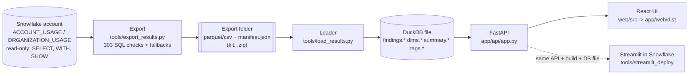

# snowflake-audit-app knowledge graph: index

A read-only Snowflake account audit: 303 SQL checks read `SNOWFLAKE.ACCOUNT_USAGE` / `ORGANIZATION_USAGE`, the export writes the results to a local folder, a loader turns that folder into a DuckDB file, and a FastAPI + React app on the user's machine (or in Streamlit in Snowflake) shows them.

Built at commit `556a877`, cites last updated at commit `8cf5924` (see [README.md](README.md) for counts and how to rebuild).

## Big picture

- Read-only guard on every statement: tools/export_results.py:455-460, applied in run_sql at 724-732.
- Load is atomic (`<db>.tmp` then `os.replace`): tools/load_results.py:497-502, 671-683.
- The app opens `AUDIT_DB`, else the `current_db.txt` pointer, else `audit.duckdb`: app/core/data.py:103-112.

## Entry points

| What | Where |
|---|---|
| One command: venv, sign-in, 7-day export, load, open app | start.py:275 (`main`), args start.py:50-56 |
| First run (export + load, 30 days) | tools/first_run.py:183 |
| Export CLI | tools/export_results.py:1296 (`build_parser`), 1547 (`main`) |
| Load CLI | tools/load_results.py:711 (`build_parser`), 727 (`main`) |
| API server (`python -m app.api`) | app/api/__main__.py:35 (`uvicorn.run`) |
| FastAPI app object and routers | app/api/app.py:128, 736-738 |
| Static UI mount (last, never shadows `/api/*`) | app/api/app.py:1465-1471 |
| React root | web/src/main.tsx:30 |
| Area registry (which checks each sub-tab owns) | web/src/components/tab_registry.tsx:472-503 |
| Check catalog generator | tools/build_manifest.py:105 |
| Export kit generator / kit runner | tools/make_export_kit.py:262 / tools/export_kit/run_export.py:1535 |
| Streamlit deploy / Streamlit app | tools/streamlit_deploy/deploy.py:162 / tools/streamlit_deploy/streamlit_app.py:1-221 |
| Pre-commit check runner | tools/gate.py:52 |
| Demo database builder | tools/build_demo_db.py:121 |

## Where to look for what

| Question | Page |
|---|---|
| How does an export run, step by step? | [flows/export.md](flows/export.md) |
| How does an export folder become a DuckDB file? | [flows/load.md](flows/load.md) |
| How does a page request travel through the backend? | [flows/request.md](flows/request.md) |
| How does a reader move through tabs, sub-tabs, drawer and Guide? | [flows/ui-navigation.md](flows/ui-navigation.md) |
| What do the "View as" lenses do? | [flows/roles.md](flows/roles.md) |
| How do API calls work inside Streamlit in Snowflake? | [flows/streamlit-bridge.md](flows/streamlit-bridge.md) |
| How do credits become dollars? | [logic/pricing.md](logic/pricing.md) |
| What happens when the role can't read ACCOUNT_USAGE? | [logic/fallbacks.md](logic/fallbacks.md) |
| Where does the SQL handle each Snowflake trap? | [logic/snowflake-traps.md](logic/snowflake-traps.md) |
| How are waste, spend and totals kept apart? | [logic/waste-and-totals.md](logic/waste-and-totals.md) |
| Why does a small WARN read OK? | [logic/materiality.md](logic/materiality.md) |
| How does masking work? | [logic/masking.md](logic/masking.md) |
| Tag filter, tag rollup, cost center | [logic/tags-and-cost-center.md](logic/tags-and-cost-center.md) |
| Who can reach what (Access explorer) | [logic/access-explorer.md](logic/access-explorer.md) |
| Who touched an object, off-hours use, tag explorer, suggested tags, downloads, who saw clear text, policy bypass and changes | [logic/access-log.md](logic/access-log.md) |
| Status, outcomes, NOT_ASSESSED reasons | [logic/status-and-reasons.md](logic/status-and-reasons.md) |
| "–", "…", units, today partial, empty text | [logic/ui-number-rules.md](logic/ui-number-rules.md) |
| Every HTTP route | [modules/api.md](modules/api.md) |
| app/core modules | [modules/core.md](modules/core.md) |
| The 303 checks, header format, includes | [modules/queries.md](modules/queries.md) |
| Every tools/ script | [modules/tools.md](modules/tools.md) |
| The React app (`web/src`) | [modules/web.md](modules/web.md) |
| DuckDB data model (diagram) | [data/model.md](data/model.md) (machine-readable: [data/model.json](data/model.json)) |
| One table per check: `findings.f_<query_id>` | [data/f_query_id.md](data/f_query_id.md) |
| `dims.*` name lookups and count bases | [data/dims.md](data/dims.md) |
| `summary.*`, export meta, run_results sidecar | [data/export_meta.md](data/export_meta.md) |
| The two `manifest.json` files | [data/manifest.md](data/manifest.md) |
| Check header schema (`-- field:` lines) | [data/check-header.md](data/check-header.md) |
| `tags_src.*` and `tags.*` | [data/tags.md](data/tags.md) |
| Which `SNOWFLAKE.*` views are read, by how many checks | [data/snowflake-views.md](data/snowflake-views.md) |
| Run it locally | [processes/run-locally.md](processes/run-locally.md) |
| Deploy to Streamlit in Snowflake | [processes/deploy-streamlit.md](processes/deploy-streamlit.md) |
| Build the UI | [processes/build-ui.md](processes/build-ui.md) |
| Tests and the gate | [processes/test.md](processes/test.md) |
| Commit, push, release | [processes/update-and-release.md](processes/update-and-release.md) |
| Export kit (customer runs the SQL) | [processes/export-kit.md](processes/export-kit.md) |
| README.md, STATUS.md, CLAUDE.md summaries | [documents/readme.md](documents/readme.md), [documents/status.md](documents/status.md), [documents/claude-md.md](documents/claude-md.md) |

## Key numbers (computed from the files at this commit)

| What | Count | Source |
|---|---|---|
| Checks | 303 | app/queries/manifest.json; 303 files in app/queries/checks/ |
| By domain | compute 22 · cost 62 · governance_access 99 · jobs_pipelines 35 · performance 35 · serving_ai 19 · storage 31 | app/queries/manifest.json |
| Fallbacks | 85 (80 `-- shim: yes` stubs, 5 hand-written) | app/queries/fallback/ |
| Shims (ACCOUNT_USAGE views rebuilt) | 52 (15 with `each:`) | app/queries/shims/ |
| Shared SQL includes | 21 | app/queries/common/ |
| Dims | 5 | app/queries/dims/ |
| HTTP routes | 41: 29 in app.py, 2 in explorer.py, 5 in access_log.py, 4 in policies.py, 1 in guide.py (40 `/api/*` + the `GET /` no-build fallback) | `@app.get`/`@router.*` in app/api/*.py |
| UI top-level tabs | 19 | web/src/components/tab_registry.tsx:501-504 (`AREA_ORDER`) |
| UI sub-tabs | 68 | [flows/ui-navigation.md](flows/ui-navigation.md) |
| Lenses ("View as") | 5 | [flows/roles.md](flows/roles.md) |
