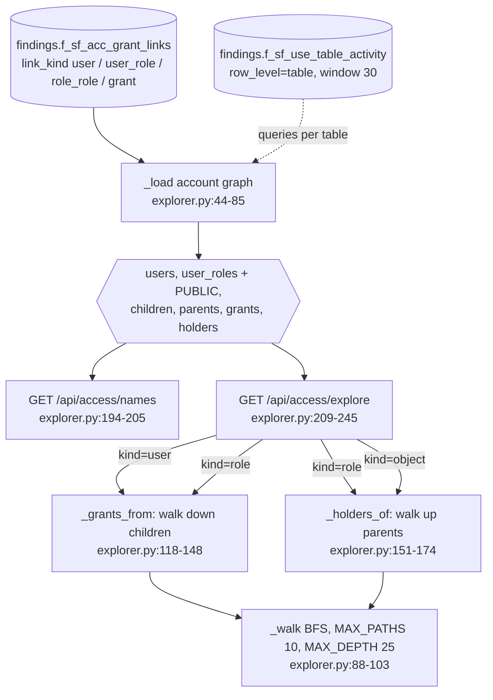

# Access explorer (who can reach what)

GET /api/access/names and /api/access/explore turn the export's grant links into an in-memory role graph per account and answer "what can this user/role reach, by which paths" and "who can use this role/object".

Source: `app/api/explorer.py` (whole file, 1-244); data: `findings.f_sf_acc_grant_links` (check `sf_acc_grant_links`), optional `findings.f_sf_use_table_activity`.

## Loading

- One account at a time: `account_id` if present in the table, else the first account id sorted (explorer.py:50-51).
- Rows by `link_kind` (explorer.py:68-80):
  - `user` -> user info (type, disabled, default role, last login date);
  - `user_role` -> roles granted to a user;
  - `role_role` -> parent role -> child role edges;
  - anything else -> a privilege grant `(privilege, granted_on, object, grant_option)`.
- Every user also holds PUBLIC, because Snowflake has no grant row for it (explorer.py:81-82).
- Activity: total read + write + DDL queries per table over the 30-day window; empty when that check did not run (explorer.py:55-62).
- Cached on (db path, mtime, account); one entry kept (explorer.py:47-49, 83-84).
- Table missing or unreadable -> 503 "No grant links in this export: run it again with sf_acc_grant_links." (explorer.py:63-64).

## Rules

### Privilege badge (priv_class, explorer.py:31-41)
- `own`: OWNERSHIP, anything on ACCOUNT, MANAGE*, APPLY*.
- `read`: SELECT, REFERENCES, READ, or USAGE on a DATABASE/SCHEMA.
- `write`: INSERT, UPDATE, DELETE, TRUNCATE, WRITE, MODIFY, REBUILD, CREATE*.
- `use`: everything else.
- Examples (tests/test_access_explorer.py:46-53):

| privilege | granted_on | badge |
|---|---|---|
| OWNERSHIP | TABLE | own |
| MANAGE GRANTS | ACCOUNT | own |
| SELECT | TABLE | read |
| USAGE | SCHEMA | read |
| INSERT | TABLE | write |
| CREATE TABLE | SCHEMA | write |
| USAGE | WAREHOUSE | use |

### Paths (_walk, explorer.py:88-103)
- Breadth first, so the 10 paths kept per role are the shortest; `path_count` counts every path found and stops growing once past 10 (`capped: true` means "at least").
- A role already on the path is skipped (loop guard); depth capped at 25 hops.
- Example graph (tests/test_access_explorer.py:41-60): user EVA holds BI and ADMIN; ADMIN -> BI -> ANALYST; ANALYST has SELECT on DB.S.T.
  - Walk from EVA reaches ANALYST by `[EVA, BI, ANALYST]` and `[EVA, ADMIN, BI, ANALYST]`, `n = 2`, shortest first.
  - `_grants_from` -> one row SELECT on DB.S.T, `path_count 2`, `depth 2` (user's own roles are depth 1), `direct false`, `cls read` (tests/test_access_explorer.py:79-85).
- `admin: true` on a row when any role on a path is ACCOUNTADMIN, SECURITYADMIN, USERADMIN, SYSADMIN, ORGADMIN or GLOBALORGADMIN (explorer.py:24, 139).
- `queries` on a grant row = the table's 30-day query count from activity, or null (explorer.py:140).

### Who holds a role (_holders_of, explorer.py:151-174)
- Walks parents up from the role; users are every user whose roles appear on those paths; paths printed top first (user -> ... -> role).
- Sorted users first, then by depth and name.

### Users per role (_users_per_role, explorer.py:177-191)
- Users who can use a role directly or through child roles: the blast radius of cutting that role.
- Example (tests/test_access_explorer.py:71-76): ANALYST counts 2 users in the small graph; on the test DB `PUBLIC.users == len(users)` (tests/test_access_explorer.py:99-106).

## Endpoints

| Call | Returns |
|---|---|
| GET /api/access/names?account_id= | account_id, accounts, users (name masked when on, info, role count), roles (admin, privileges, users), objects (name, granted_on). Test DB: 12 users, 16 roles, 46 objects (observed). |
| GET /api/access/explore?kind=user&name= | user info, `grants` rows, `roles` reached with depth/paths; 404 "no user X in this export". |
| ...kind=role | grants, roles below, `holders` above; 404 when the role appears nowhere. |
| ...kind=object | `granted_on`, `holders`: every user/role per privilege with paths ending at the object, depth = hops to the granting role; 404 "no grants on X". |
| ...kind=other | 422 "kind must be user, role or object". |

- Masking: user names go out through `identity.format_identity` when `privacy.mask_user_identities` is on; a masked name sent back is mapped to the real user by recomputing tokens (explorer.py:106-115).

## Issues seen

- `_load` takes a connection from `data._connect()` and never closes it (explorer.py:46-62). In the server it is a cursor on the shared connection (data.py:151-164), so the cost is small; in tools/tests (sharing off) each uncached call opens a new DuckDB connection that is left to garbage collection.
- The cache keeps a single entry and is cleared on every miss (explorer.py:83-84): switching between two accounts rebuilds the graph each time (by design for memory, inferred).
- Roles and privileges are only what the audit role could see in SHOW GRANTS (CLAUDE.md "SHOW ... shows only what the role can see"); the explorer does not mark that limit itself (no visibility field in explorer.py).
