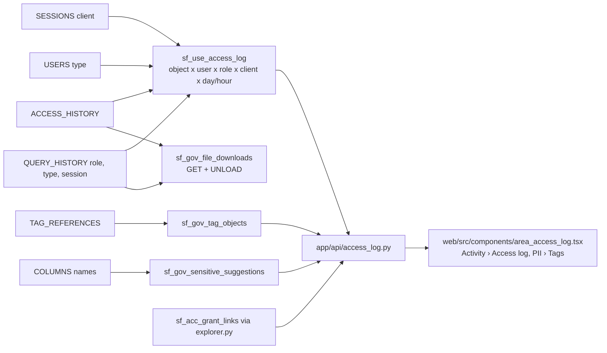

# Access log, off-hours use, tag explorer, suggested tags, downloads, policies in use

Who read, changed or ran DDL on any table, view or stage, when and how often, without query text; which untagged columns look sensitive; which objects a tag sits on and who can read and did read them; and which files left through GET or unloads.

## Checks

| Check | Grain | Notes | Evidence |
|---|---|---|---|
| sf_use_access_log | object x user x role x client x statement type x UTC day | `windowed: no`; `:lookback_days` (90) read once; `:bucket_hours` 24 or 1; `:row_cap` 1,000,000; reads, writes, DDL as distinct queries; a MERGE or INSERT ... SELECT on its own target is a write only; client `task` for tasks and `no session` when SESSIONS has none; a log, never judged | app/queries/checks/sf_use_access_log.sql, include app/queries/common/sf_use_access_rows.sql |
| sf_use_streamlit_access | Streamlit app x user x role x UTC day | QUERY_HISTORY rows whose QUERY_TAG names a Streamlit app (JSON `StreamlitName`, or the older `streamlitName:` text); `runs` = the app's own queries, `child_queries` = `ChildQuery: true`; only the app name is read from the tag | app/queries/checks/sf_use_streamlit_access.sql |
| sf_acc_streamlit_shares | grant on a Streamlit app | GRANTS_TO_ROLES where granted_on = STREAMLIT, revoked rows kept: who it was shared with, by whom, when, and when revoked; WARN while shared with PUBLIC | app/queries/checks/sf_acc_streamlit_shares.sql |
| sf_use_access_hours | person x object x role x client x statement x UTC date and hour | people only (TYPE PERSON, not SYSTEM); `is_off_hours` at `:business_utc_offset` with `:business_start_hour`..`:business_end_hour`, weekends off; WARN off hours | app/queries/checks/sf_use_access_hours.sql |
| sf_gov_sensitive_suggestions | column | name patterns per Snowflake semantic category plus CREDENTIAL; columns already sensitive-tagged left out; WARN for identifiers, sensitive and credentials at high or medium confidence | app/queries/checks/sf_gov_sensitive_suggestions.sql |
| sf_gov_tag_objects | tag value x database / schema / table / columns of a table | direct tags only; a database or schema row stands for every table in it | app/queries/checks/sf_gov_tag_objects.sql |
| sf_gov_policy_hits | day x user x role x policy x protected object | `windowed: no`, 90 days, one ACCESS_HISTORY scan keeping only rows with POLICIES_REFERENCED; masking policies per column read, row access per object; names only, never the body | app/queries/checks/sf_gov_policy_hits.sql |
| sf_gov_file_downloads | day x user x role x client x kind x stage | GET_FILES and UNLOAD from QUERY_HISTORY; stage and source tables from ACCESS_HISTORY; WARN when a person unloads a sensitive table or GETs from a stage such an unload wrote to | app/queries/checks/sf_gov_file_downloads.sql |

## Rules with examples

- **Row cap per check.** A check that declares `:row_cap` gets that cap instead of the export's 50,000 (tools/export_results.py `_run_check`, tools/export_kit/run_export.py `run_windows`).
- **Window.** The log is exported once; the API cuts it to `[as_of_date - window, as_of_date)` (app/api/access_log.py `_range`), and a missing as-of date is a 503, never today.
- **Row cap reached.** The export keeps the newest buckets; the API returns `truncated` and `complete_from` (`_cut`) and the page says from when counts are complete.
- **SESSIONS bound.** Sessions are read from `lookback_days + 7` days back, so the export never scans a year of them.
- **Masking.** The new value columns (client, statement_types, ddl_operations, categories, kind, level, grain, user_type, confidence, apply_method) are fixed words, never masked as names (app/core/masking.py `_FIXED_WORDS`). A user stage reads `(user stage)`, so the user's name sits only in the masked user_name.
- **Chart.** Every day (or hour) of the window is drawn, zero when quiet (web/src/components/area_access_log.tsx `allBuckets`).
- **Tests.** tests/test_access_log.py covers the five routes; tests/test_masking.py `test_fixed_values_stay_when_a_name_equals_them` the masking fix.
- **Sensitive.** A table is `tagged` when `f_sf_gov_sensitive_columns_unprotected` lists it, else `suggested` when `f_sf_gov_sensitive_suggestions` does (app/api/access_log.py `_sensitive`).
- **UTC hours and the slider.** Every hours row keeps its UTC date and hour, so the page shifts them by any offset (UTC-12 to UTC+14) and recounts off hours without a new export (app/api/access_log.py `_off`). The findings use the offset in config/thresholds.yml; the slider starts there and says when it differs. Example on the fake account: 124 off-hours queries at UTC+0, 327 at UTC+6.
- **Page.** Activity › Access log has a left panel with three sections (Overview, One object, One person) and the offset slider (web/src/components/access_log_page.tsx). Test: web/src/test/subtabs.test.ts checks every sub-tab has a page.
- **Person.** The raw `USERS.TYPE` is PERSON and the user is not SYSTEM. A user with no TYPE reads `NOT_SET` and is not flagged, because older service users often have none; dropped users read `UNKNOWN`.
- **Name patterns.** FIRST_NAME, CUSTOMER_NAME_X, LASTNAME match NAME; TABLE_NAME, CLASSNAME do not; USAGE and PAGE do not match AGE; MAC_ADDRESS and WALLET_ADDRESS are not street addresses (fake rows in tests/fake_snowflake/new_checks_data.py `sensitive_names`).
- **No result downloads.** Snowflake logs no Snowsight or driver result downloads; the log's `client` shows which client read the data.
- **Who saw clear text.** A masking hit under a role the policy body lets through (sf_secx_policy_body_exemptions): CURRENT_ROLE matches the primary role only, IS_ROLE_IN_SESSION also roles it inherits, PUBLIC lets everyone through, a lookup or no role check reads unknown. Secondary roles are not in ACCESS_HISTORY (app/api/policies.py `_verdict`). Example on the fake account: ADMIN_ALICE as ACCOUNTADMIN reads CUSTOMERS.EMAIL under MASK_PII_TAG in clear; ANALYST_DAN as ANALYST_ROLE reads it masked.
- **Who can bypass.** Users who can use an exempt role, through the grant walk of explorer.py; per table from direct masks, tag masks (sf_gov_sensitive_columns_unprotected `masked_via`) and row filters.
- **Policy changes.** Access-log DDL rows whose object domain names a policy. Attaching a policy to a table shows as that table's ALTER, not here.
- **Pages.** PII › Masking & row policies (`PolicyUse`) and Audit › Changes (`PolicyChanges`) in web/src/components/area_policies.tsx. Tests: tests/test_policies.py.
- **Fake account.** tests/fake_snowflake/new_checks_data.py `access_extras`: ANALYST_CARA unloads ANALYTICS_DB.CORE.CUSTOMERS (sensitive) to ANALYTICS_DB.PUBLIC.EXPORT_STAGE on a Saturday night and downloads it with GET (both WARN); ANALYST_EVA downloads from her user stage (reads `(user stage)`); LEGACY_LOADER, a user with no TYPE, loads ORDERS at 02:00 (`NOT_SET`, never in the hours check); DEV_HUGO alters CUSTOMERS late on Saturday (off-hours DDL, WARN). `policy_hits` and `sensitive_names` add the policy and suggestion rows.
- **How it works.** The Activity, PII and Audit pages of the Guide describe the new screens and their troubles (web/src/components/guide.tsx, `screen` and `troubles` of each area).
- **Via.** Each access row carries `via`: `procedure DB.S.P` when the query ran inside a CALL (its ACCESS_HISTORY `root_query_id` is the CALL, whose base objects name the procedure), else `streamlit DB.S.APP` from the query's QUERY_TAG (app/queries/common/sf_use_access_rows.sql). A procedure's page lists what its own queries read and wrote; an app's page lists what it touched. Root query ids exist from January 2024.
- **Streamlit viewer.** Snowflake's docs do not say whether `user_name` on a Streamlit query is the viewer or the app owner; the page says so until a live account confirms it.
- **Rollup.** Schema and database totals are sums of the per-object rows; kinds come from `objectDomain` (`KINDS` in app/api/access_log.py).
- **Fake account.** `access_extras` also adds LOAD_ORDERS_SP (SVC_ETL calls it daily; it reads ORDERS_RAW and merges into ORDERS), a FORMAT_PHONE function call, and the SALES_DASH app opened by four people (one with the older text tag).
- **Streamlit, owner's rights.** Apps run with owner's rights: inside the app CURRENT_USER and CURRENT_ROLE are the owner (Snowflake docs, Streamlit personalization). The app's own queries (ChildQuery true) therefore carry the owner; the open, the top-level ExecuteStreamlit query from the viewer's session, is read as the viewer, with that session's client and sign-in IP (SESSIONS, LOGIN_HISTORY). Not yet confirmed on a live account.
- **Tab.** The Access log is its own top-level tab (`accesslog`, one page `log`) in the governance, data-engineer and CTO menus; Activity keeps its other sub-tabs. One object starts with a type; Streamlit apps are one of the types. One user or role switches between a user and a role.
- **How a viewer reaches an app.** Each viewer row shows the role the open ran under (QUERY_HISTORY.role_name) and up to three grant paths from the user through role grants to a role the app is shared with (USAGE or OWNERSHIP), from the grant walk of explorer.py; "no path today" when the grant was revoked since. Example on the fake account: ANALYST_CARA opens SALES_DASH with ANALYST_ROLE, which holds USAGE on it.
- **Sources.** All from SNOWFLAKE.ACCOUNT_USAGE: QUERY_HISTORY (Streamlit query tag, user, role, session), SESSIONS (client), LOGIN_HISTORY (sign-in IP), GRANTS_TO_ROLES and GRANTS_TO_USERS (shares and paths). INFORMATION_SCHEMA is not used for this; Snowflake has no separate "app opened" event.
- **Source of a write.** ACCESS_HISTORY lists the objects an `INSERT ... SELECT` reads as accessed by a query of type INSERT. The shared rows (`common/sf_use_access_rows.sql`) label such a read `<type> (source)`, so a view never shows a plain INSERT; the write is on the target in objects_modified.
- **Owner's or caller's rights.** `/api/access/apps` sets `rights`: `owner` when the app's own queries all ran as the owning role, `caller` when they ran under the viewers' own users (container runtime with restricted caller's rights). With `caller`, each viewer row adds the app queries run as them. Fake data: SALES_DASH is owner's rights, MARKETING_APP caller's rights.
- **Look into first.** `/api/access/flags` reads the exported rows, with no extra check: ACCOUNTADMIN, SECURITYADMIN, ORGADMIN or GLOBALORGADMIN used for data work by anyone (high); SYSADMIN or USERADMIN used by people (medium; pipelines often run as SYSADMIN); an app opened with an admin role; an app shared with PUBLIC (high) or owned by an admin role; a SERVICE or LEGACY_SERVICE user whose session client is Snowsight (medium); people writing or changing sensitive objects off hours at the page's offset (medium). High before medium, then by count. `object=` keeps one object's flags (an app's with `kind=streamlit`), `kind=` one type's; the object and app pages show them with a This object / All of its type switch.
- **Owner and who can grant.** From the grant links (explorer.py): the OWNERSHIP holder, roles holding a privilege on the object WITH GRANT OPTION, and roles with MANAGE GRANTS on the account, with the users behind them. For an app this is who can share it.
