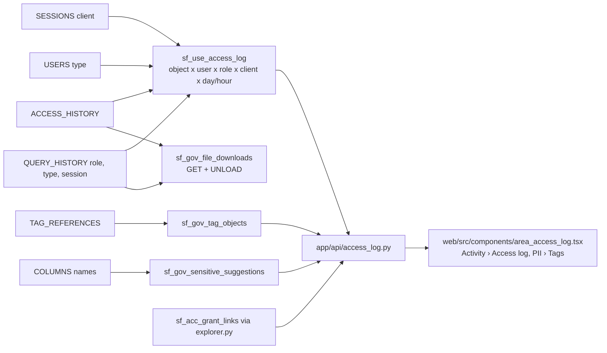

# Access log, off-hours use, tag explorer, suggested tags, downloads

Who read, changed or ran DDL on any table, view or stage, when and how often, without query text; which untagged columns look sensitive; which objects a tag sits on and who can read and did read them; and which files left through GET or unloads.

## Checks

| Check | Grain | Notes | Evidence |
|---|---|---|---|
| sf_use_access_log | object x user x role x client x bucket | `windowed: no`; reads `:lookback_days` (90) once; `:grain` day or hour; `:row_cap` 1,000,000; reads, writes, DDL counted as distinct queries; a MERGE or INSERT ... SELECT on its own target counts as a write only; `statement_types`, `ddl_operations`; `off_hours_queries` against `:business_tz`, `:business_start_hour`, `:business_end_hour`, weekends off; WARN for a person with off-hours queries | app/queries/checks/sf_use_access_log.sql |
| sf_gov_sensitive_suggestions | column | name patterns per Snowflake semantic category plus CREDENTIAL; columns already sensitive-tagged left out; WARN for identifiers, sensitive and credentials at high or medium confidence | app/queries/checks/sf_gov_sensitive_suggestions.sql |
| sf_gov_tag_objects | tag value x database / schema / table / columns of a table | direct tags only; a database or schema row stands for every table in it | app/queries/checks/sf_gov_tag_objects.sql |
| sf_gov_file_downloads | day x user x role x client x kind x stage | GET_FILES and UNLOAD from QUERY_HISTORY; stage and source tables from ACCESS_HISTORY; WARN when a person unloads a sensitive table or GETs from a stage such an unload wrote to | app/queries/checks/sf_gov_file_downloads.sql |

## Rules with examples

- **Row cap per check.** A check that declares `:row_cap` gets that cap instead of the export's 50,000 (tools/export_results.py `_run_check`, tools/export_kit/run_export.py `run_windows`).
- **Window.** The log is exported once; the API cuts it to `[as_of_date - window, as_of_date)` (app/api/access_log.py `_range`), and a missing as-of date is a 503, never today.
- **Row cap reached.** The export keeps the newest buckets; the API returns `truncated` and `complete_from` (`_cut`) and the page says from when counts are complete.
- **SESSIONS bound.** Sessions are read from `lookback_days + 7` days back, so the export never scans a year of them.
- **Masking.** The new value columns (client, statement_types, ddl_operations, categories, kind, level, grain, user_type, confidence, apply_method) are fixed words, never masked as names (app/core/masking.py `_FIXED_WORDS`). A user stage reads `(user stage)`, so the user's name sits only in the masked user_name.
- **Chart.** Every day (or hour) of the window is drawn, zero when quiet (web/src/components/area_access_log.tsx `allBuckets`).
- **Tests.** tests/test_access_log.py covers the five routes; tests/test_masking.py `test_fixed_values_stay_when_a_name_equals_them` the masking fix.
- **Sensitive.** A table is `tagged` when `f_sf_gov_sensitive_columns_unprotected` lists it, else `suggested` when `f_sf_gov_sensitive_suggestions` does (app/api/access_log.py `_sensitive`).
- **Person.** The raw `USERS.TYPE` is PERSON and the user is not SYSTEM. A user with no TYPE reads `NOT_SET` and is not flagged, because older service users often have none; dropped users read `UNKNOWN`.
- **Name patterns.** FIRST_NAME, CUSTOMER_NAME_X, LASTNAME match NAME; TABLE_NAME, CLASSNAME do not; USAGE and PAGE do not match AGE; MAC_ADDRESS and WALLET_ADDRESS are not street addresses (fake rows in tests/fake_snowflake/new_checks_data.py `sensitive_names`).
- **No result downloads.** Snowflake logs no Snowsight or driver result downloads; the log's `client` shows which client read the data.
