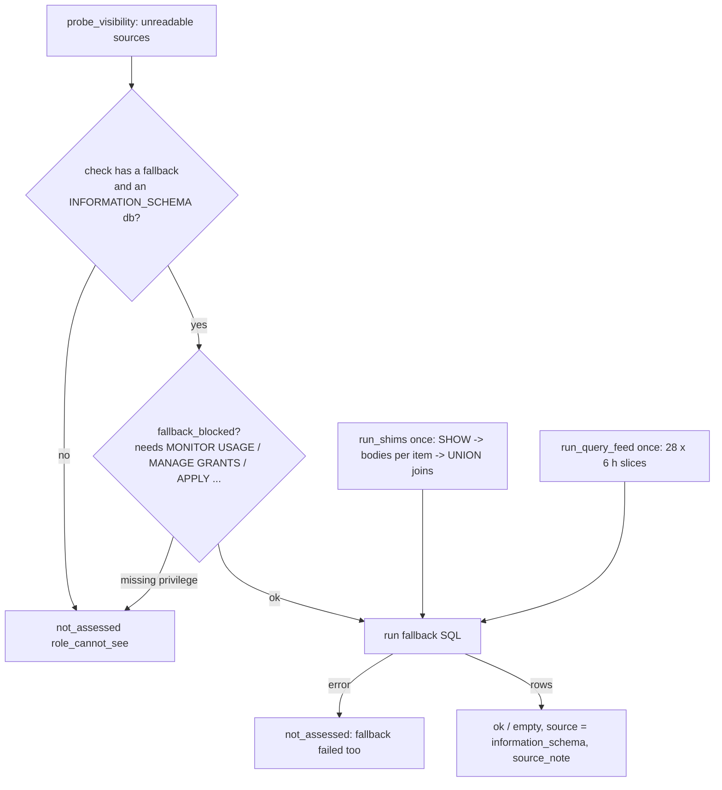

# Fallbacks: when the role cannot read ACCOUNT_USAGE

When a check's `ACCOUNT_USAGE` view is unreadable, the export runs a second version of the check from `INFORMATION_SCHEMA` table functions, per-database views and `SHOW`, through "shims" (stand-ins that rebuild the view with the same columns). Privilege "gates" make sure a partial answer never reads as "nothing found". A separate setting, `sources:`, swaps the `SNOWFLAKE` views for your own copies.

Counts (from the files): 85 fallbacks in `app/queries/fallback/`, 80 of them `-- shim: yes` stubs, 5 hand-written; 52 shims in `app/queries/shims/`, 15 with `each:`, 18 with `show:`. Matches STATUS.md ("INFORMATION_SCHEMA fallbacks").

## 1. When a fallback runs

- Selected fallbacks: those whose check has an unreadable source, or all with `--use-fallbacks` (tools/export_results.py:1202-1207).
- Per check: `(blocked or use_fallbacks) and qid in fallbacks and ctx["info_schema_db"]` (tools/export_results.py:1246).
- The entry gets `source = information_schema`, `source_reads`, `source_note` (the shim notes plus any lost hours or objects) and the `unreadable` list (tools/export_results.py:1248-1254, 1254-1256).
- Any fallback error reads `not_assessed` / `role_cannot_see` with "the INFORMATION_SCHEMA fallback failed too", never `empty` (tools/export_results.py:1266-1271).
- Which database: the session's current one, else the first from `SHOW TERSE DATABASES` that is not `SNOWFLAKE`; none means no fallback (tools/export_results.py:197-212).

## 2. Shim stubs: the check's own SQL with views swapped

- A fallback file with `-- shim: yes` (e.g. app/queries/fallback/access_broad_grants.sql:1-2) is expanded by `expand_shims`: includes pasted in, each `SNOWFLAKE.ACCOUNT_USAGE.<VIEW>` outside strings and comments replaced by `__SHIM_<VIEW>__`; a view with no shim stops the run (tools/export_results.py:120-180).
- The generated header carries `shims:`, merged `reads:`, `fallback_note:` and `needs: MONITOR USAGE` if any shim needs it, plus the check's `pre:` (tools/export_results.py:167-180).
- Example: a check reading `SNOWFLAKE.ACCOUNT_USAGE.COPY_HISTORY` becomes `... FROM __SHIM_COPY_HISTORY__ ...`; at render time that token becomes the shim's literal rows or `(SELECT * FROM TABLE(RESULT_SCAN('<id>')))` (tools/export_results.py:647-653).
- Shim date range tokens: `__SHIM_6_MONTHS__` = 6 months back + 1 day, `__SHIM_14_DAYS__` = 14 days back (tools/export_results.py:122-126).

## 3. Shim headers

| Header | Meaning | Cite |
|---|---|---|
| `shim:` / `reads:` / `note:` | view rebuilt, source, what is lost | app/queries/shims/COPY_HISTORY.sql:1-4 |
| `columns:` | typed empty result when `each:` finds no objects | tools/export_results.py:413-416, 532-534 |
| `each:` | run once per database / warehouse / role / database_role / policy | tools/export_results.py:373-402 |
| `show:` | a SHOW run first; body reads it via `__SHOW__` | app/queries/shims/AGGREGATION_POLICIES.sql:3; tools/export_results.py:484-504 |
| `needs:` | privilege gate (section 5) | app/queries/shims/AGGREGATION_POLICIES.sql:4 |

## 4. `each:` and how the parts are joined (`run_shims`)

`run_shims` (tools/export_results.py:457-558), all statements async through `run_all` (max 40 in flight, tools/export_results.py:304-346):

1. Skip a shim whose `needs` the role lacks (tools/export_results.py:469-472).
2. List items with `shim_items`: own STANDARD databases (not shared/app), warehouses, roles, database roles per database, or masking/row access/projection/aggregation policies; cached per kind (tools/export_results.py:379-402).
3. Fill per item `__ITEM__`, `__ITEM_LITERAL__`, `__ITEM_NAME__`, `__ITEM_DB__`, `__ITEM_KIND__` (tools/export_results.py:405-410).
4. Run all `show:` statements at once; bodies then read their SHOW with `RESULT_SCAN`, 50 per UNION statement (tools/export_results.py:483-517, 406).
5. Join each shim's parts 100 results per statement until one id is left; a failed join loses the whole shim (tools/export_results.py:526-540, 407).
6. A part that fails drops only that object; `shim_gaps` says e.g. "3 of 40 (database) could not be read: ..." and the check's `source_note` repeats it (tools/export_results.py:554-556, 547-550).
7. Small results (<= 5,000 rows) are passed as literal `VALUES`, because Snowflake aborts with internal error 300010 when one statement reads table-function rows through a CTE used twice (tools/export_results.py:567-602; README.md:440-442).

Example (COPY_HISTORY, `each: database`): 3 databases -> 3 `LOAD_HISTORY` statements -> one UNION join -> one result id the COPY checks read; if database 2 fails: note "1 of 3 (database) could not be read" (logic from tools/export_results.py:474-556; header app/queries/shims/COPY_HISTORY.sql:1-5).

## 5. Gates (privileges that make a fallback honest)

Not to be confused with `tools/gate.py`, the pre-commit check runner (tools/gate.py:1-13).

- **MONITOR USAGE:** the metering/storage table functions return no rows without it, not an error. Tested once: a `DATABASE_STORAGE_USAGE_HISTORY` count over 3 days > 0 (tools/export_results.py:215-224). Recorded as manifest `monitor_usage` (tools/export_results.py:1366).
- **MANAGE GRANTS:** SHOW lists only objects the role holds a privilege on. `account_privileges` returns `{"ACCOUNTADMIN"}` if active, adds MANAGE GRANTS for SECURITYADMIN, plus account grants from `SHOW GRANTS ON ACCOUNT` to the session's roles (tools/export_results.py:227-242). Manifest `manage_grants` (tools/export_results.py:1367).
- **APPLY MASKING / ROW ACCESS / PROJECTION / AGGREGATION POLICY:** for policy references (one shim, `needs:` lists all four; see `grep needs: app/queries/shims`).
- `fallback_blocked(head, ctx)`: any `needs` item missing and not ACCOUNTADMIN -> "role_cannot_see: the INFORMATION_SCHEMA fallback (...) needs ACCOUNTADMIN or the X privilege, and without it returns only part or nothing" (tools/export_results.py:245-257).
- Example: role without MONITOR USAGE, check `sf_cost_*` with fallback reading METERING_DAILY_HISTORY shim (`needs: MONITOR USAGE`, app/queries/shims/METERING_DAILY_HISTORY.sql:3) -> fallback header gets `needs: MONITOR USAGE` -> `not_assessed`, never $0.

## 6. The shared query history feed

- One read of `INFORMATION_SCHEMA.QUERY_HISTORY` for all query fallbacks: 28 six-hour slices with one fixed end, the oldest clamped 5 minutes inside the 7-day limit (`-10075` minutes), all async (tools/export_results.py:300-301, 410-441).
- Fallbacks read them via `__IS_QUERY_HISTORY_SCANS__` -> `UNION ALL` of `RESULT_SCAN`s; no slice at all -> render raises (tools/export_results.py:640-646).
- Missing slices -> note "N x 6 of the last 168 hours are missing" (tools/export_results.py:605-611).
- Example: 2 slices time out -> 26 ids kept, note "12 of the last 168 hours are missing".
- A slice that hits the 10,000-row limit is not flagged, so busy accounts can undercount (README.md:448-449).

## 7. Your own copies (`sources:`)

- Settings `sources:` maps a SNOWFLAKE schema or one view to a copy; only plain or double-quoted identifiers pass, because the names are spliced into SQL (app/core/config.py:363-385).
- `apply_sources` swaps `SNOWFLAKE.<schema>.<view>`: the view's own entry first, then its schema's (app/core/config.py:388-404). Applied in `render`, `run_sql` and the probe (tools/export_results.py:657, 725, 952).
- Example (tests/test_sources.py:22-30): `{ACCOUNT_USAGE: MY_DB.AU, ACCOUNT_USAGE.QUERY_HISTORY: 'MY_DB.AUDIT."Q H"'}` -> `QUERY_HISTORY` -> `MY_DB.AUDIT."Q H"`, `TABLES` -> `MY_DB.AU.TABLES`, `ORGANIZATION_USAGE.RATE_SHEET_DAILY` unchanged, `QUERY_HISTORY_X` -> `MY_DB.AU.QUERY_HISTORY_X`.
- Refused (tests/test_sources.py:33-43): schema -> 3-part name, view -> 2-part name, `A.B; DROP TABLE X`, a key with a space, a list.
- The full export reads it from settings only; the kit takes `--source VIEW=COPY` only (tools/export_kit/run_export.py:1501-1503, 1466-1469). Not yet run live (STATUS.md).

## 7b. When the fallback itself fails

- A role gap (a `fallback_blocked` reason, or `role_cannot_see`) reads `not_assessed` / `role_cannot_see`; a timeout or SQL fault reads `failed` with `cause` and `error_code` (tools/export_results.py:1266-1278). The kit does the same, adding `is_access_error` (tools/export_kit/run_export.py:1191, 1367).
- A skipped shim records why in `ctx["shim_errors"][view]`, so each check that needs it names the missing privilege (tools/export_kit/run_export.py:621).
- `info_schema_db` prefers a STANDARD-kind database, not a shared or imported one (tools/export_results.py:197; tools/export_kit/run_export.py:1051).

## 8. What fallbacks cannot cover

22 coverable checks left out on purpose (spill, password age, IP lists, policy settings, revoked grants, Snowpipe loads), and views with no equivalent (access history, query attribution, tag references, table storage metrics, warehouse events, AI usage, org views) (README.md:422-438; STATUS.md).

## Issues found

- A shim's `MANAGE GRANTS` or `APPLY ... POLICY` need is not copied into the expanded fallback header; only MONITOR USAGE is (tools/export_results.py:176-177). The shim is still skipped (tools/export_results.py:469), so the check still reads `not_assessed`, but its message is "the INFORMATION_SCHEMA stand-in for X did not run: not started" (tools/export_results.py:649-651) instead of naming the missing privilege.
- No unit test calls `fallback_blocked`, `run_shims`, `expand_shims` or `run_query_feed` directly (grep over tests/ finds none); coverage comes from tests/test_sql_smoke.py:111-116, tests/test_load_results.py:160 and the live run in STATUS.md.
