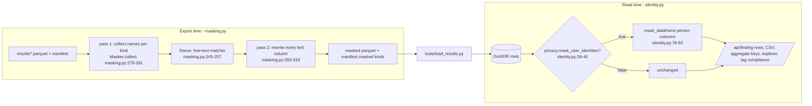

# Masking (on screen and in the export)

Two independent switches, both off by default: on-screen masking of user names and emails at API output time (`identity.py`), and export-time masking of chosen kinds of names into salted tokens before any file is written (`masking.py`).

## Settings and API

- `privacy.mask_user_identities: false` and `privacy.mask_fields: []` (config/settings.yml:43-48). Never on by default (CLAUDE.md rule; identity.py:3-6).
- GET/PUT `/api/settings/privacy` (app.py:369-410): PUT accepts a bool and a kinds list (validated by `masking.parse_kinds`), writes `config/settings.local.yml`; the body also says what the loaded export masked (`loaded_masked`, from `direct_export_meta.masked`, app.py:382-383; data.py:1664-1665).
- `mask_user_identities` applies on the next page refresh; `mask_fields` on the next export or Refresh (config/settings.yml:42-48).

## On-screen rule (identity.py)

- Person column: matches `user_name`, `*_user_name`, `login_name`, `executed_by`, `actor`, `email`, `top_user`, `requester`, `identity_run_as`, `principal`, `resized_by`, `created_by`, and the list columns `users`, `sample_users`, `blocked_users`, `idle_users`, `writing_users` (identity.py:21-28). Never a warehouse, database, role, task or account name.
- `format_identity(v)` = `<first 8 hex of sha256(lower(trim(v)))> <first 2 chars>***` (identity.py:43-60).
  - Example (tests/test_identity_masking.py:43-48): `"person@example.com"` -> `"<8 hex> pe***"`; masking it again returns the same string; `None` -> `None`; with `real_id="42"` -> `"42 pe***"`.
  - Placeholders such as `(warehouse idle)` stay (identity.py:34-35, 54-55).
- `grantee` is masked only on rows where `grantee_type` is USER (identity.py:84-92).
- List cells are masked name by name: `"a, b"` -> `"<h1> a***, <h2> b***"` (identity.py:73-74).
- Where it runs:
  - finding rows (`service.records`, service.py:964);
  - CSV (`service.rows_csv`, service.py:1006);
  - aggregate group keys and `pick` values (service.py:544; app.py:1245);
  - Access explorer user names (explorer.py:106-115, 196, 211);
  - missing-tag user examples (tag_compliance.py:220-221).
- The explorer accepts a masked name back: `_real_user` maps a masked name to the real user so links still work (explorer.py:110-115).

## Export rule (masking.py)

- Kinds: user, warehouse, database, schema, object, role, task, account, or `all` (masking.py:33, 112-123).
  - Example (tests/test_masking.py:28-33): `"warehouse, USER"` -> `["user", "warehouse"]`; `"all"` -> every kind; `"warehouse,colour"` -> ValueError "unknown mask kind".
- Token: `<prefix>_<8 hex of sha256(salt|kind|lower(name))>`, prefixes wh, db, sch, obj, role, task, acct; a user keeps the identity format (masking.py:34-35, 171-181).
- Salt: random per export unless given, never written (masking.py:18-19, 165). Example: two Maskers with no salt give different tokens for `ETL_WH`; the same salt gives the same token (tests/test_masking.py:83-87).
- Which column holds what: `column_rule` (masking.py:188-207) -> keep (fixed words like `status`), grantee (by `grantee_type`/`granted_to`), one, list, fqn (part by part), or text.
- System names are never masked: SNOWFLAKE, SNOWFLAKE_SAMPLE_DATA, INFORMATION_SCHEMA, ACCOUNT_USAGE, PUBLIC, ACCOUNTADMIN, SECURITYADMIN, SYSADMIN, USERADMIN, ORGADMIN, GLOBALORGADMIN (masking.py:99-107).
- Free text: every known name of 3+ characters is replaced as a whole word; dotted `DB.SCHEMA.NAME` by position (masking.py:84-86, 107-108, 246-260).
- Worked example (tests/test_masking.py:41-72), kinds `all`, salt `"fixed"`:
  - `warehouse_name "ETL_WH"` -> `wh_xxxxxxxx`; `"(warehouse idle)"` stays.
  - `grantee_name "LOADER"` with `granted_to ROLE` -> `role_xxxxxxxx`; `role_name "loader"` in another file -> the same token (case ignored, across files).
  - `reasons "ETL_WH idle for role LOADER on SALES"` -> `"<wh> idle for role <role> on <db>"`.
  - `table_fqn 'SALES.RAW."Orders.2024"'` -> three tokens; `SNOWFLAKE.ACCOUNT_USAGE.QUERY_HISTORY` stays.
  - `warehouse_id "1"` and `credits 1.5` stay (ids and numbers are never masked).
  - manifest `{"account": {"id": "AB12345"}}` -> `acct_...`.
- A masked export has the same statuses, row counts, columns and numbers as the plain one and loads; `direct_export_meta.masked` lists the kinds (tests/test_masking.py:135-147).
- Refresh uses `privacy.mask_fields` (tests/test_masking.py:172-176).

## Notes

- With on-screen masking on, tag coverage matches users by their masked token too, because the loader masks user names in the tag rows (app/core/tag_compliance.py:78). Test: tests/test_access_explorer.py, tests/test_masking.py.
- The person-column regex is duplicated in `masking._PERSON_RE` (masking.py:89-93) and `identity._PERSON_COLUMN_RE` (identity.py:23-27); a test keeps them equal (tests/test_masking.py:36-38) because the export kit carries its own copy of masking.py (masking.py:5-6).
- Settings that name objects (env words, cost-center tags) cannot match a token after export masking (README.md:816-817).
