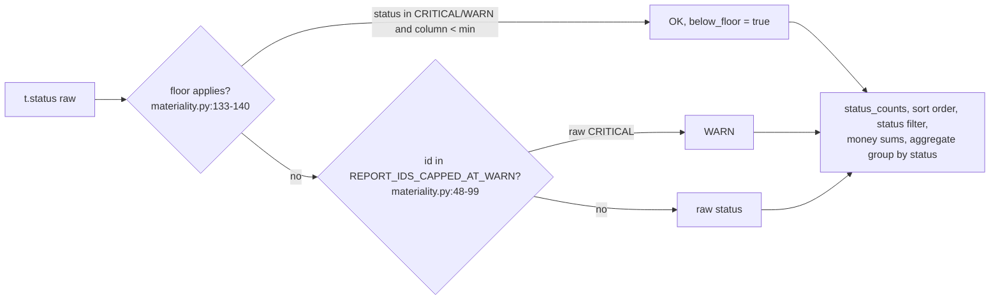

# Materiality floors and the report severity cap

A CRITICAL or WARN row smaller than its check's floor reads OK at read time, and trend/chargeback reports never read worse than WARN; both are one SQL expression every status read shares.

## Where it applies

- `status_expr` builds `CASE WHEN floor ... THEN 'OK' WHEN t."status" = 'CRITICAL' THEN 'WARN' ELSE t."status" END` (materiality.py:154-177).
- Used by:
  - the SELECT list: `status` = effective, `status_raw` = raw, `below_floor` always present (data.py:258-280);
  - the status filter (data.py:612-616);
  - the ORDER BY (worst effective status first, data.py:676-685);
  - findings-list status counts, money and floor info (data.py:1086-1110);
  - aggregate `group=status`, `below_floor=true` and `pick=status` (data.py:1438-1456, 1490-1496).
- The exported `status` column on disk is never rewritten (config/materiality.yml:1-6).

## Rules

### Floor applies only when it can
- `applicable_floor` returns None unless the check has an entry, the table has `status`, and the table has the floor's column (materiality.py:133-140).
- Examples (tests/test_materiality.py:76-82): `sf_wh_idle_minutes` with `["status","est_wasted_usd_list"]` -> floor; with `["est_wasted_usd_list"]` -> None; with `["status"]` -> None.

### Only CRITICAL/WARN move, and only to OK
- Example table (tests/test_materiality.py:172-218), floor `est_wasted_usd_list < 10`:

| id | raw status | $ | effective status | below_floor |
|---|---|---|---|---|
| crit_above | CRITICAL | 264 | CRITICAL | false |
| crit_below | CRITICAL | 5 | OK | true |
| warn_below | WARN | 2 | OK | true |
| na_below | NOT_ASSESSED | 1 | NOT_ASSESSED | false |
| ok_below | OK | 3 | OK | false |

- Sorted result: crit_above < na_below < crit_below (tests/test_materiality.py:220-237).

### A USD floor is per 30 days
- `_min_sql`: for unit USD and a table with `window_days`, the min is `min x window_days / 30` (materiality.py:143-151); count, bytes and seconds floors are absolute.
- Example (tests/test_materiality.py:132-151): floor $50, row $30 -> at 30d OK (30 < 50), at 7d still CRITICAL (30 > 50 x 7/30 = 11.67).
- Example (tests/test_materiality.py:153-169): count floor 20, row 15 at 7d -> OK (never scaled).

### Shipped floors (config/materiality.yml:17-36)

| Check | Column | Min | Unit |
|---|---|---|---|
| sf_wh_idle_minutes | est_wasted_usd_list | 50 | USD (per 30 days) |
| query_pruning_effectiveness | read_bytes_sum | 100,000,000,000 | bytes (100 GB) |
| query_warehouse_pressure | total_duration_s_sum | 3600 | seconds |
| query_cache_coldstart | query_count | 20 | count |

- Left out on purpose: checks already gated by their own `:min_*` param, governance/existence checks, and checks whose status already uses that column (config/materiality.yml:10-15).
- Validation: unknown query_id, missing/unknown field, non-positive min and bad column are rejected (tests/test_materiality.py:242-293; config.py:585-628).
- Cached on the file's (mtime, size); a change is picked up on the next request (materiality.py:102-130; tests/test_materiality.py:103-122).

### Severity cap for reports
- 45 ids in `REPORT_IDS_CAPPED_AT_WARN` (materiality.py:48-95): period-over-period, chargebacks, spikes, spend-only checks. Reason: CRITICAL means broken, wasting money or exposing data; a spend swing is WARN at most (materiality.py:20-24).
- Example (tests/test_materiality.py:404-421): `cost_period_over_period` has raw CRITICAL rows in the fixture -> `status_counts` has no CRITICAL; rows read `status: WARN`, `status_raw: CRITICAL`; `/api/findings` row carries `severity_cap: "WARN"` (app.py:844-846).

## What the API reports

- `/api/findings` row `floor`: `{column, min, unit, label, rows_below}`; `rows_below` = rows moved from CRITICAL/WARN to OK (data.py:1100-1108).
  - Example (test DB): `sf_wh_idle_minutes` -> `{"min": 50, "unit": "USD", "label": "$50 possible waste per 30 days", "rows_below": 0}`.
- `/api/finding/{id}`: `floor` with `rows_below` out of `rows_total` (service.py:988-1000; data.py:741-752).
- `/aggregate?below_floor=true`: sums only the hidden rows; a check with no floor matches nothing (data.py:1438-1443; tests/test_materiality.py:359-371).
- Guide adds the "floors" trap line to a check with a floor (guide.py:45, 355-356).
