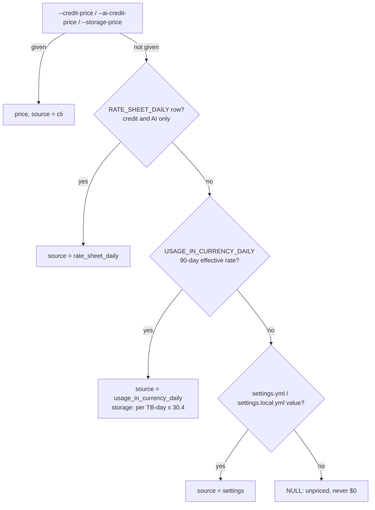

# Pricing: how credits become dollars

The export fixes three prices once per run (USD per credit, per AI credit, per TB-month of storage), records where each came from, and pastes them into the SQL as `__CREDIT_PRICE__`, `__AI_CREDIT_PRICE__` and `__STORAGE_PRICE_TB_MONTH__`; the app later only adds a discount what-if on top.

## 1. Price source order

Code: `account_context` (tools/export_results.py:623-675); the kit has the same with `index.json` defaults in place of settings (tools/export_kit/run_export.py:1108-1152).

- Each price is filled independently; a CLI price for one never blocks the invoice for another (tools/export_results.py:637-639, 638-648).
- The org views are read only when some price is still missing (tools/export_results.py:642). No access is normal and prints a note (tools/export_results.py:646-647).
- Rate sheet wins over the invoice for credit and AI, never for storage (`key != "storage"`, tools/export_results.py:660-661).
- Invoice storage rate is per TB-day, so it is multiplied by `DAYS_PER_MONTH = 30.4` (tools/export_results.py:56, 644-646).
- Settings defaults: `credit_price_usd: 3.0`, `ai_credit_price_usd: 2.0`, `storage_price_usd_tb_month:` empty (config/settings.yml:20-22). Code defaults are all `None` (app/core/config.py:162-164). So storage is unpriced unless the CLI or invoice gives it.
- No price anywhere stays `None` and `main` warns that $ columns are empty (tools/export_results.py:1389-1391).

Examples (tests/test_export_more.py, fake cursor returns compute rate 3.0, storage 0.75/TB-day, tests/test_export_more.py:60-62):

| Input | Output | Test |
|---|---|---|
| no CLI, invoice readable | credit 3.0 `usage_in_currency_daily`; storage 0.75 x 30.4 = 22.8 `usage_in_currency_daily`; `rate_basis.compute = {days: 90, usage: 1000}` | tests/test_export_more.py:104-110 |
| `credit_price=4.0` | credit 4.0 `cli`; storage still from invoice | tests/test_export_more.py:113-118 |
| settings credit 2.5, invoice readable | invoice 3.0 wins | tests/test_export_more.py:121-127 |
| settings 2.5 / 21.0, invoice denied (error 2003) | 2.5 `settings`, 21.0 `settings` | tests/test_export_more.py:128-130 |
| nothing anywhere | `credit_price_usd = None`, `source = None` | tests/test_export_more.py:133-139 |

## 2. The rate SQL

- **Rate sheet** (`rate_sheet_sql`, tools/export_results.py:677-677): latest `effective_rate` before as-of, USD, `billing_type = consumption`, not an adjustment; `rating_type = ai_compute` -> AI, `compute` with `service_type = WAREHOUSE_METERING` -> credit.
- **Invoice** (`org_rate_sql`, tools/export_results.py:680-702): `SUM(usage_in_currency) / SUM(usage)` over the 90 days before as-of, per `rating_type` in compute/storage/ai_compute; consumption only, no adjustments, no `overage` balance; service types matching `(^|_)(AI|CORTEX)(_|$)` are left out of the compute rate.
  - Example (tests/test_export_more.py:93-101): `CORTEX_FUNCTIONS` and `AI_SERVICES` match, `CLOUD_SERVICES`, `WAREHOUSE_METERING`, `SNOWPIPE_STREAMING` don't.

## 3. Invoice-derived prices and the discount what-if

- A price from `rate_sheet_daily` or `usage_in_currency_daily` is marked `invoice_derived`; the discount what-if never applies to it (app/core/data.py:2197-2217; README.md:395-396).
- `pricing.apply(df, discount_pct)` adds `<col>_disc = col x (1 - discount_pct)` only for list-price $ columns matched by `_LIST_COL_RE`; `*_share`/`*_pct`, `app_credit_price_usd`, `monthly_budget_usd` and invoice-currency amounts are never scaled (app/core/pricing.py:24-33, 75-84).
  - Example: `est_usd_list = 100`, `discount_pct = 0.15` -> `est_usd_list_disc = 85`; `est_usd_list_share` unchanged (app/core/pricing.py:24-33, 75-84; inferred from the regex, no direct test opened).
- Org-check amounts in invoice currency (`amount`, `est_cost`, `prepaid_balance`, ...) are money but labelled "invoice currency (not discounted)" (app/core/pricing.py:35-49, 66-72).

## 4. Cloud services: the daily 10% adjustment

Rule: each day, cloud services up to 10% of that day's warehouse compute are free; only the rest is billed. The billed figure comes from `METERING_DAILY_HISTORY` (`credits_billed`, `credits_adjustment_cloud_services`), never from raw warehouse rows.

- `cost_lines` (shared by every money check, so totals agree) prices `credits_billed` per day and service (app/queries/common/cost_lines.sql:1-20).
- Warehouse rows carry cloud services before the adjustment; `sf_cs_billed_ratio` gives a per-day ratio `max(cs + adj, 0) / cs` for `WAREHOUSE_METERING`, so billed = `compute + cs x ratio`; a day with no row reads 1 (app/queries/common/sf_cs_billed_ratio.sql:1-11). `sf_cs_window_ratio` is the same over the whole window (app/queries/common/sf_cs_window_ratio.sql:1-9).
- `sf_cost_cloud_services_billed`: allowance against the day's `WAREHOUSE_METERING` compute only; billed = `max(cs - adjustment, 0)`, priced at `__CREDIT_PRICE__` (app/queries/checks/sf_cost_cloud_services_billed.sql:28-60).
- The INFORMATION_SCHEMA stand-in rebuilds the adjustment as `-LEAST(day_cloud, 0.1 x day_compute)` (app/queries/shims/METERING_DAILY_HISTORY.sql:6-10). The fake account uses the same rule (tests/fake_snowflake/data.py:938-942).
- Example (rule as in tests/fake_snowflake/data.py:939): compute 100, cloud services 15 -> adjustment -10, billed 105 credits; billed ratio = (15 - 10) / 15 = 0.333; at $3.00 the billed cloud services are 5 x 3 = $15.

## 5. AI credits

- In `cost_lines`, a service type matching `(^|.*_)(AI|CORTEX|COCO|COWORK)(_.*|$)` is priced at `__AI_CREDIT_PRICE__`, every other at `__CREDIT_PRICE__` (app/queries/common/cost_lines.sql:16-18).
- The price comes from rate sheet `ai_compute`, else invoice `ai_compute`, else `ai_credit_price_usd` (tools/export_results.py:677-702, 636-648).
- First live run read $3.00/credit and $2.00/AI credit from `RATE_SHEET_DAILY` (STATUS.md, "First live run").

## 6. Storage and data transfer $

- Storage TB-days = `(storage + stage + failsafe + hybrid) bytes / 1024^4` per day, rate = `__STORAGE_PRICE_TB_MONTH__ / 30.4` (app/queries/common/cost_lines.sql:25-30).
  - Example: 10 TB on one day at $23/TB-month -> 10 x 23 / 30.4 = $7.57 for that day.
- Archive (cool/cold) tiers have rate NULL: unpriced, never $0 (app/queries/common/cost_lines.sql:32-38).
- Data transfer is an estimate per TB: same cloud, other region, or other cloud (app/queries/common/cost_lines.sql:42-46). The two $/TB rates come from the `sf_cost_data_transfer_egress` check's params (`EGRESS_CHECK`, `transfer_rates` tools/export_results.py:222-225), default 20 and 90 (tools/export_results.py:426-427); the Guide SQL fills the same values (app/api/guide.py).

## 7. Waste $ only on flagged rows

`blank_unflagged_waste` NULLs `wasted`/`saving`/`est_idle_usd` columns on rows whose status is not WARN or CRITICAL, so a sum never counts an OK row (tools/common.py:68-85).
- Example (tests/test_export_show.py:152-157): status `[OK, WARN, NOT_ASSESSED, CRITICAL]`, `est_saving_usd_list [5,6,7,8]` -> `[None, 6, None, 8]`; `est_compute_usd_list` untouched.

## Open points

- The invoice AI exclusion regex `(AI|CORTEX)` (tools/export_results.py:700) is narrower than the AI pricing regex `(AI|CORTEX|COCO|COWORK)` (app/queries/common/cost_lines.sql:17). A `*_COCO_*` or `*_COWORK_*` service's invoice dollars would sit in the compute rate while its credits are priced at the AI rate. Inferred; not tested.
- `account_context` docstrings say "CLI, else invoice, else settings" and omit the rate sheet step (tools/export_results.py:625-627; tools/export_kit/run_export.py:1108-1109). Code and README.md:379-389 include it.
