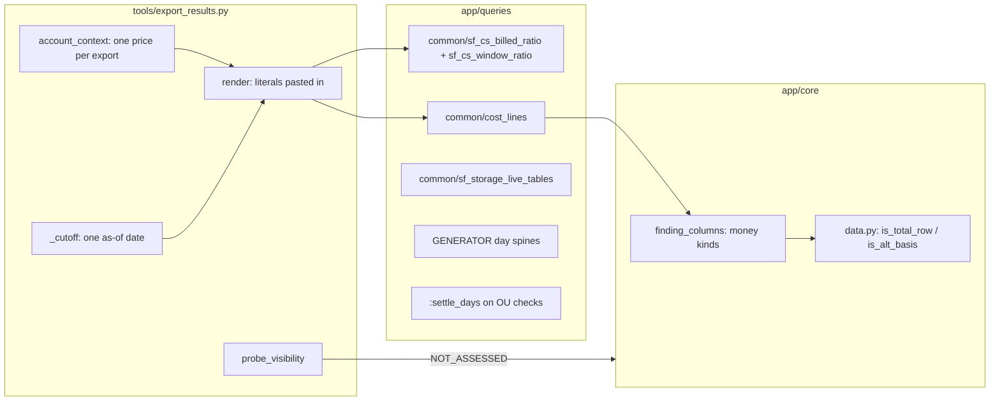

# Snowflake traps: where the SQL handles each one

How the checks defend against each money bug class and Snowflake trap listed in `CLAUDE.md` (Rules > Data and SQL), with the exact file and lines, a worked example, and "not found" / "partial" where the defence is missing.

Background catalog: `.claude/skills/snowflake-account-usage/SKILL.md:17-69`, `.claude/skills/snowflake-account-usage/references/traps.md:1-223`.

## Summary

| Trap | Handled? | Main place |
|---|---|---|
| Price joined twice | Yes, by design | `tools/export_results.py:409-423` (price is a pasted literal) |
| Units added together | Yes | `common/cost_lines.sql:4-9`, `app/core/finding_columns.py:15-56` |
| Days with zero usage skipped | Partly | `checks/cost_daily_spikes.sql:47-65` (9 checks with a GENERATOR spine) |
| Two "todays" | Yes in checks; doc gap in `verify/` | `tools/export_results.py:409-418, 805-809` |
| Cloud services 10% | Yes | `common/sf_cs_billed_ratio.sql:1-12` |
| Attribution is not a total | Yes | `checks/sf_cost_warehouse_idle_credits_daily.sql:28-65`, `common/sf_chg_query_credits.sql:1-30` |
| Role visibility | Yes | `tools/export_results.py:721-768, 979-1034` |
| Fail-safe NULL names | Yes | `common/sf_storage_live_tables.sql:25-28`, `checks/sf_storage_dropped_not_purged.sql:41-68` |
| POLICY_REFERENCES gaps | Yes | `checks/sf_secx_session_policy_coverage.sql:13-14, 64-78`, `checks/sf_secx_password_policy_posture.sql:6-22` |
| TABLE_ID / BASE_TABLE_ID | Yes | `checks/sf_storage_search_optimization_value.sql:38-46` |
| Org billing lag 72 h | Yes in OU checks; not in the export's own price lookup | `checks/sf_org_warehouse_spend_across_accounts.sql:41-69` |

## 1. Price joined twice

- **Rule:** a $/credit is multiplied in once. It never comes from a join that can repeat rows.
- **How:**
  - The export resolves each price once per run, in this order: CLI, `RATE_SHEET_DAILY`, 90-day `USAGE_IN_CURRENCY_DAILY` average, `config/settings.yml` (`tools/export_results.py:623-675`, `STATUS.md:40`).
  - `render` pastes it as a literal (`__CREDIT_PRICE__`, `__AI_CREDIT_PRICE__`, `__STORAGE_PRICE_TB_MONTH__`) (`tools/export_results.py:417-423`). The 96 checks that use `__CREDIT_PRICE__` (grep) never join a price table.
  - OU checks that price per account first reduce the rate to one row per account, then LEFT JOIN it (`checks/sf_org_warehouse_spend_across_accounts.sql:62-77`: `rate` is `GROUP BY account_locator`).
- **Example** (`tests/test_totals_agree.py:21-55`): on the fake account, `cost_chargeback_by_account.usd_list`, `cost_chargeback_by_service.usd_list`, `cost_period_over_period.est_current_usd_list` and `cost_daily_spikes.est_day_usd_list` must give the same total at 7, 30 and 90 days (`rel=1e-6`). They do because all of them read `common/cost_lines.sql`, which has one rate per line (`common/cost_lines.sql:1-3, 13-16`).

## 2. Units added together (credits + $, spend + waste)

- **Rule:** credits, TB and $ stay in separate columns. Spend, change, waste, saving and balance are different kinds of $ and are never summed together.
- **SQL:**
  - `cost_lines` carries `usage_unit` and `qty` and turns each line into `usd = qty * rate` before anything is summed (`common/cost_lines.sql:4-9`).
  - `overview_spend_estimate` sums credits only where `usage_unit = 'CREDITS'`, and sums $ separately (`checks/overview_spend_estimate.sql:22-27`).
- **App:**
  - One headline column per check, with one kind (`app/core/finding_columns.py:15-56, 135-152`).
  - Total and tie-out rows (`is_total_row`) and second-basis rows (`is_alt_basis`) are left out of the money sum (`app/core/finding_columns.py:61-68`, `app/core/data.py:1113-1129`).
- **Example** (`tests/test_totals_agree.py:151-165`): `cost_period_over_period` has current, previous and change columns. Its headline is `est_change_usd_list` (kind `change`), and the test asserts the headline is not change + current.
- **Example** (`checks/overview_spend_estimate.sql:24-25`): one row with 1,000 credits and 2 TB-days of storage gives `total_net_credits = 1000` and `net_list_cost_usd = 1000*3.00 + 2*23/30.4 = 3001.51`. The credits column never includes TB.

## 3. Days with zero usage skipped

- **Rule:** a day with no usage is a $0 day. It counts in averages, baselines and spikes.
- **Handled where it matters (9 checks use `GENERATOR`):** `cost_daily_spikes`, `sf_ai_provisioned_throughput_use`, `sf_cost_anomalies_vs_spikes`, `sf_cost_native_app_spend`, `sf_org_cloud_services_billed_by_account`, `sf_perf_table_pruning_regression`, `sf_qry_daily_by_warehouse`, `sf_use_table_daily`, `sf_use_table_perf_daily` (grep).
  - Pattern: build 400 days with `GENERATOR(ROWCOUNT => 400)`, CROSS JOIN them with every product, LEFT JOIN `cost_lines`, and write `COALESCE(SUM(c.usd), 0)` (`checks/cost_daily_spikes.sql:47-65`). The baseline is the `MEDIAN` over those filled days (`checks/cost_daily_spikes.sql:70-80`).
  - Same pattern per warehouse: `checks/sf_qry_daily_by_warehouse.sql:89-90`.
- **Left to the reader:** `cost_daily_by_resource` emits only days with usage. Its header tells the reader to "average over the window's days, not over the rows" (`checks/cost_daily_by_resource.sql:20-23`). **Partial:** a consumer that averages its rows overstates the average day.
- **Cloud-services ratio on a day with no daily row** reads 1, so the full cloud services amount is billed, never 0 (`common/sf_cs_billed_ratio.sql:3`; `checks/cost_daily_by_resource.sql:38`).
- **Example:** a product with $10 on day 1 and no rows on days 2 to 5. The spine gives `[10, 0, 0, 0, 0]`, so the median baseline is 0, not 10.

## 4. Two "todays" (as-of vs CURRENT_DATE)

- **Rule:** every window ends at one `__AS_OF_DATE__`, which is exclusive.
- **How:**
  - `as_of = _cutoff(now, include_today)` is computed once per export (`tools/export_results.py:822-826, 912`). With `include_today: true` (the default, `config/settings.yml:9-12`) it is tomorrow, so today's partial day is in. With `false` it is `(now - 8 h).date()`.
  - `render` turns `__AS_OF_DATE__` into `CAST('<as_of>' AS DATE)` (`tools/export_results.py:418`). The window filter is `>= DATEADD(day, -:period_days, __AS_OF_DATE__) AND < __AS_OF_DATE__` (`README.md:52`).
- **Deliberate uses of "now" in the checks** (inferred safe):
  - `DATEADD(hour, -8, CURRENT_TIMESTAMP())` as the attribution-lag guard, e.g. `checks/sf_cost_warehouse_idle_credits_daily.sql:33-34`.
  - `LEAST(CURRENT_TIMESTAMP(), CAST(__AS_OF_DATE__ AS TIMESTAMP))` for ages, e.g. `checks/sf_repl_group_health.sql:91`.
  - No check filters a window on `CURRENT_DATE` (grep of `checks/*.sql`).
- **Fallbacks and shims:** INFORMATION_SCHEMA function ranges use now, because the functions' limits are relative to now (`tools/export_results.py:125-129`, `fallback/access_login_concentration.sql:9-28`). The rows are still filtered on `__AS_OF_DATE__` (`fallback/access_login_concentration.sql:35`).
- **Example** (`tests/test_totals_agree.py:85-88`): the test DB's `/api/meta` `cost_cutoff` is `data_through 2026-09-20` with no partial day.
- **Doc gap:** `verify/cost.sql:3-4` says "(the app counts up to midnight of that day; today is left out)" and uses `CURRENT_DATE()` as `end_date`. With the default `include_today: true`, the app includes today, so the hand check covers one day less than the app.

## 5. Cloud services priced after the 10% adjustment

- **Rule:** the billed cloud services for a day are usage minus the adjustment (the part above 10% of that day's warehouse compute). Hourly `CREDITS_USED` is gross.
- **How:**
  - Daily billed ratio for `WAREHOUSE_METERING`: `GREATEST(SUM(cs + adj), 0) / NULLIF(SUM(cs), 0)` (`common/sf_cs_billed_ratio.sql:4-12`). Warehouse rows are priced as `credits_used_compute + credits_used_cloud_services * billed_ratio` (`checks/cost_daily_by_resource.sql:38-41`). 12 checks include it.
  - Window-level ratio for per-query cloud services: `common/sf_cs_window_ratio.sql:1-9` (2 checks).
  - Service totals use `METERING_DAILY_HISTORY.CREDITS_BILLED` directly (`common/cost_lines.sql:15`). 8 checks include `cost_lines`.
  - README rule: "Cloud services are priced billed only ... never as `credits_used_cloud_services` alone" (`README.md:64-65`).
  - Hand check: `verify/cost.sql:44-60`.
- **Example:**
  - The fake data sets `adj = -min(cs, 0.1 * compute)` for `WAREHOUSE_METERING` (`tests/fake_snowflake/data.py:938-942`).
  - For a day with compute 100 and cs 15: adj = -10, billed = 105, `billed_ratio` = 5/15 = 0.333.
  - A warehouse hour that day with compute 4 and cs 0.6 is priced at 4 + 0.6 x 0.333 = **4.2 credits**, not 4.6.

## 6. Query attribution is not a total

- **Rule:** `QUERY_ATTRIBUTION_HISTORY` leaves out idle time and queries under about 100 ms, is NULL on adaptive warehouses, and lags 8 h. It is never treated as the warehouse bill, and a NULL split never reads as idle.
- **How:**
  - Idle = compute minus attributed, only for hours older than 8 h with a non-NULL `credits_attributed_compute_queries` (`checks/sf_cost_warehouse_idle_credits_daily.sql:28-41`). A day with no attributed hours reads `NOT_ASSESSED`, `no_query_attribution` (`checks/sf_cost_warehouse_idle_credits_daily.sql:61-65`). 6 checks emit `no_query_attribution` and 17 read `credits_attributed_compute_queries` (grep).
  - README rule: sum it without COALESCE, so NULL stays NULL (`README.md:60-61`).
  - The per-query credit include keeps every attributed query with an OUTER join to QUERY_HISTORY, and labels the missing context `(no query history row)` (`common/sf_chg_query_credits.sql:1-30`).
  - Chargeback shares idle back as a remainder row, `(unallocated idle)` (`checks/sf_chg_idle_allocation.sql:16-18, 54-61`). The app keeps remainder rows in the $ but not in the entity count (`app/core/data.py:1191-1199`).
  - The INFORMATION_SCHEMA stand-in returns NULL attribution, which reads "not assessed", never idle (`shims/WAREHOUSE_METERING_HISTORY.sql:5-8`).
  - The export's default cut-off already trails by `LAG_HOURS = 8` when today is excluded (`tools/export_results.py:818-826`).
- **Example:** an hour with compute 2.0 and attributed 1.5 gives idle 0.5. The same hour on an adaptive warehouse (attributed NULL) gives idle NULL, and the day reads NOT_ASSESSED.

## 7. SHOW and role-filtered views show only what the role can see

- **Before the run:** `probe_visibility` opens every source with `SELECT 1 ... LIMIT 0`, runs each `pre:` SHOW, and compares the warehouses that billed in the last 30 days with SHOW WAREHOUSES (`tools/export_results.py:721-758`).
- **Per check** (`tools/export_results.py:1002-1059`):
  - edition too low -> `not_assessed`, `edition_too_low`;
  - unreadable with a fallback -> run the INFORMATION_SCHEMA version;
  - unreadable with no fallback -> `not_assessed`, `role_cannot_see`, never "empty".
- **In SQL:** checks detect a hidden object from other evidence and read NOT_ASSESSED:
  - `sf_task_silent_failures` emits a `(tasks not visible to this role)` row when TASKS is empty but TASK_HISTORY has runs (`checks/sf_task_silent_failures.sql:98-108`);
  - `sf_cost_resource_monitor_coverage` emits `monitor_not_visible` (`checks/sf_cost_resource_monitor_coverage.sql:103-105`).
  - 98 checks declare `empty_if: role_cannot_see` (grep; vocabulary at `tools/header_schema.py:51-59`).
- **Test:** `tests/test_sql_smoke.py:214` (`test_not_assessed_rows_say_why`).
- **Example:** the role lacks MONITOR on 2 of 10 billing warehouses. The probe records `metered: 10, missing_from_show: 2` (`tools/export_results.py:744-754`), and `sf_cost_resource_monitor_coverage` rows for those warehouses read NOT_ASSESSED.

## 8. Fail-safe tables have NULL names and can pass as live

- **Live tables** (19 checks via the include) need all of these: `NOT COALESCE(deleted, FALSE) AND table_dropped IS NULL AND schema_dropped IS NULL AND catalog_dropped IS NULL AND table_name IS NOT NULL AND table_entered_failsafe IS NULL` (`common/sf_storage_live_tables.sql:25-28`).
- **Dropped tables:** a row counts as dropped if `table_entered_failsafe IS NOT NULL OR table_name IS NULL`, even when `deleted = FALSE` (`checks/sf_storage_dropped_not_purged.sql:65-68`). It is labelled `Fail-safe table (<id>)`, with the database and schema looked up by id (`checks/sf_storage_dropped_not_purged.sql:41-53`).
- **Example:** a TABLE_STORAGE_METRICS row with id 123, `table_name` NULL, `deleted` FALSE and 50 GB of Fail-safe is left out of live-table checks and appears in `sf_storage_dropped_not_purged` as `Fail-safe table (123)`.

## 9. POLICY_REFERENCES misses session, password and authentication policies

- **Session:** `sf_secx_session_policy_coverage` counts the session policies defined. If any exist, every row reads `NOT_ASSESSED` with `policy_attachment_not_listed`; if none exist, it flags WARN, or CRITICAL for users who can use an admin role (`checks/sf_secx_session_policy_coverage.sql:13-14, 39-41, 64-78`).
- **Password:** read from `SHOW PASSWORD POLICIES ON ACCOUNT` plus `AU.PASSWORD_POLICIES`, never from POLICY_REFERENCES (`checks/sf_secx_password_policy_posture.sql:6-7, 15-17, 22`).
- **Authentication:** read from `SHOW AUTHENTICATION POLICIES ON ACCOUNT`, with `NOT_ASSESSED` when nothing is listed (`checks/sf_secx_authentication_policy_posture.sql:6-7, 11, 80`).
- POLICY_REFERENCES is used only for masking and row access, filtered to `POLICY_STATUS = 'ACTIVE'` (`common/sf_gov_sensitive_columns.sql:34-43`).
- **Example:** an account with 1 session policy and 40 people who signed in gives 40 rows, all NOT_ASSESSED. It never shows "40 OK".

## 10. TABLE_ID and BASE_TABLE_ID (SEARCH_OPTIMIZATION_HISTORY rename)

- The checks read the row as `OBJECT_CONSTRUCT(*)` and take `COALESCE(o:BASE_TABLE_ID, o:TABLE_ID)`, so the SQL compiles before and after the rename:
  - `checks/sf_storage_search_optimization_value.sql:38-46`;
  - `checks/sf_cost_serverless_features.sql:44-49`;
  - `checks/sf_storage_clustering_candidates.sql:75-77`.
- The other two readers only sum `credits_used` by service or database, and never touch the id columns (`checks/sf_chg_allocation_reconciliation.sql:65`, `checks/sf_chg_by_database_schema.sql:60`).
- **Example:** an account still on the old columns has `o:BASE_TABLE_ID` NULL, so `table_id` falls back to `o:TABLE_ID`. On a new account it is `BASE_TABLE_ID`.

## 11. Org billing views lag up to 72 h

- **How:** 18 checks take `:settle_days` (default 3) and end their window at `__AS_OF_DATE__ - settle_days` (grep). For example, `checks/sf_org_warehouse_spend_across_accounts.sql:11, 41, 48-57, 68-69`, and `checks/sf_org_replication_cost.sql:35-41`.
- **Not settled:**
  - The export's own price lookups use rows up to the day before as-of: the rate sheet takes the latest rate (`tools/export_results.py:677-677`), and the invoice rate averages 90 days (`tools/export_results.py:680-705`). Both are ratios, so the lag barely moves them (inferred).
  - `sf_cost_contract_balance_burn`, `sf_cost_rate_sheet`, `sf_org_login_activity_by_account` and `sf_org_security_posture_by_account` read OU without `settle_days` (grep). They are balances, rates or logins, not window spend.
- **Example:** with as-of 2026-09-21 and a 30-day window, the OU window is 2026-08-19 up to, but not including, 2026-09-18.
- **Effect:** OU pages carry their own cut-off, three days earlier than the account pages (inferred from the SQL; how the UI labels it is not checked here).

## Possible issues found

- **Cortex in-progress rows:** no check filters `IS_COMPLETED` on `CORTEX_AI_FUNCTIONS_USAGE_HISTORY` (grep `IS_COMPLETED` = 0 hits in `checks/`). `references/traps.md:23` says to "filter IS_COMPLETED or dedupe". `sf_ai_functions_spend_by_user` sums the hourly rows per query (`checks/sf_ai_functions_spend_by_user.sql:44-50, 65-72`). Whether in-progress rows double count is unclear; verify on a live account.
- **`verify/cost.sql` query 1 prices every credit at one rate** (`verify/cost.sql:9-12`). The app prices AI service types at `__AI_CREDIT_PRICE__` (`common/cost_lines.sql:16-18`), so the hand check differs from the app wherever AI credits exist.
- **`sf_org_replication_cost` reads `OU.REPLICATION_USAGE_HISTORY`** (`checks/sf_org_replication_cost.sql:39`). `references/traps.md:190` lists `REPLICATION_USAGE_HISTORY` as deprecated (the schema is not stated there); verify.
