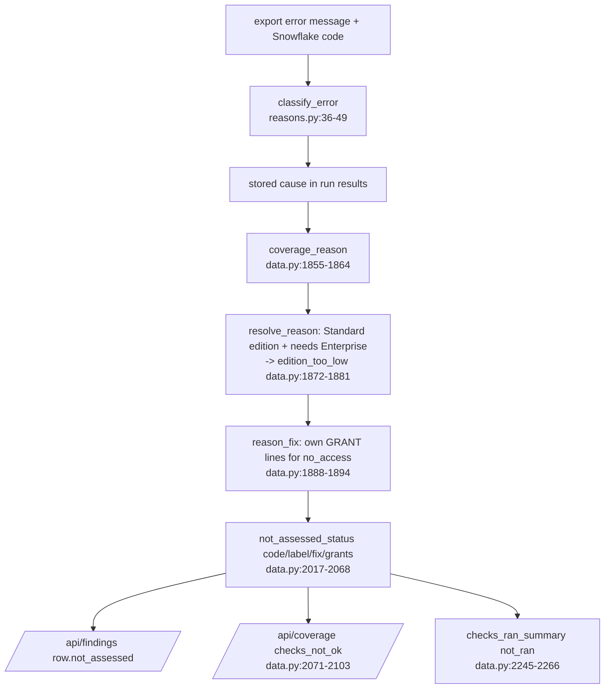

# Status, outcomes and NOT_ASSESSED reasons

One vocabulary for "is the app ready", "what did this check find" and "why could it not run": app state (`/api/status`), five request outcomes (`service.py`), row statuses (CRITICAL/WARN/NOT_ASSESSED/OK) and reason codes with a fix (`reasons.py`, `data.py`).

## 1. App state (GET /api/status, app.py:449-476)

| state | When | Source |
|---|---|---|
| settings_invalid | `config/settings.yml` (+ local) fails to load; wins over every db state | app.py:458-469 |
| no_database | db file missing | data.py:201-219 |
| build_incomplete | file unreadable/corrupt, or no `dims.dim_account` | data.py:201-219 |
| ready | otherwise | data.py:201-219 |

- Examples (tests/test_api.py:228-273): unknown key `default_windw` on line 2 -> `settings_invalid`, `key "default_windw"`, `line 2`; a YAML syntax error on line 3 -> `line 3`, `key null`; a missing dim_account -> `build_incomplete` with "dim_account" in the detail.
- Every other route answers a broken settings file with 503 `{state: "settings_invalid", key, line}` (app.py:181-191).

## 2. Request outcome (one check, service.load_outcome service.py:277-425)

- Vocabulary: `ok_rows`, `ok_empty_window`, `ok_empty_filters`, `not_assessed`, `error` (service.py:65-69; tests/test_api.py:37-38).
- Order and examples: see logic/waste-and-totals.md "NOT_ASSESSED vs empty". Internal NA codes: `model_failed`, `not_built`, `not_exported`, `tag_models_not_built` (service.py:227-234).
- Docstring note: the module header says "four-outcome" (service.py:3) while five outcomes are returned (service.py:65-69).

## 3. Row status

- Exported per row: `CRITICAL`, `WARN`, `NOT_ASSESSED`, `OK`; order worst first `["CRITICAL","WARN","NOT_ASSESSED","OK"]` (service.py:71).
- Read-time status is the effective one: materiality floor -> OK, report cap -> WARN (logic/materiality.md). Raw kept as `status_raw`.
- `status_counts` on the findings list count effective status (data.py:1086-1099).
- Example (test DB): `sf_wh_idle_minutes` 30d -> `{NOT_ASSESSED: 7, CRITICAL: 4, WARN: 1}`; 7 warehouses NOT_ASSESSED because the role sees only 6 of 12 billed warehouses (observed via /api/findings).
- A check whose every row in scope is NOT_ASSESSED gets `not_assessed.code = "all_rows_not_assessed"` (service.py:778-786; data.py:2051-2053; tests/test_api.py:504-511).

## 4. Why a check did not run (reason codes)

### classify_error (reasons.py:36-49), first match wins
1. `timeout`: code 630, or "timed out / timeout / statement reached its".
2. `edition_too_low`: "edition / enterprise / not supported in this account" and no access words.
3. `no_access`: codes 2003, 3001, 2043, 2014, or "not authorized / insufficient privileges / access denied / permission / forbidden / not allowed to".
4. `view_missing`: "does not exist / no such view|table / unknown table|view / not found".
5. `sql_error`: anything else (a real fault).

- Example (tests/fixtures/build_fixtures.py:46-48): "SQL access control error: Insufficient privileges to operate on view 'ORGANIZATION_USAGE.ACCOUNTS'" -> `no_access`.
- Example (tests/fixtures/build_fixtures.py:49-50): "SQL compilation error: no such view 'ACCOUNT_USAGE.ICEBERG_TABLES' in this account" -> `view_missing`.
- Note: "Object does not exist or not authorized" matches the no_access words before view_missing, so it reads no_access (reasons.py:26-29, 45-48).

### Reason -> label and fix (data.py:1833-1849)

| reason | label on screen | fix |
|---|---|---|
| no_access | the role can't see it | the check's own GRANT lines (reason_fix), else IMPORTED PRIVILEGES + README MONITOR grants |
| view_missing | not available in this account | may need a higher edition or an org account |
| edition_too_low | needs a higher Snowflake edition | needs Enterprise; no grant changes that |
| timeout | timed out reading it | re-run with a shorter window |
| not_exported | not run in this export | re-run the export |
| unknown (sql_error) | failed in the export | re-run, read the export's error output |

- Stored cause wins over the message; a check with no run-result entry is `not_exported`, never `unknown` (data.py:1855-1864).
- Edition override: `no_access` or `view_missing` on a known Standard account for a check that needs Enterprise -> `edition_too_low` (data.py:1872-1881; reasons.py:63-75).
  - Example (inferred from code): edition `STANDARD`, header `requires: Enterprise Edition`, message "insufficient privileges" -> `edition_too_low`; edition unknown -> stays `no_access`.

### GRANT line per source (grant_for, reasons.py:93-112)

| source | GRANT (role shown as `<audit_role>`) |
|---|---|
| ACCOUNT_USAGE.* / READER_ACCOUNT_USAGE.* / DATA_SHARING_USAGE.* | GRANT IMPORTED PRIVILEGES ON DATABASE SNOWFLAKE |
| ORGANIZATION_USAGE.RATE_SHEET_DAILY, USAGE_IN_CURRENCY_DAILY, REMAINING_BALANCE_DAILY, CONTRACT_ITEMS | DATABASE ROLE SNOWFLAKE.ORGANIZATION_BILLING_VIEWER (+ application role note for the org account) |
| other ORGANIZATION_USAGE.* | DATABASE ROLE SNOWFLAKE.ORGANIZATION_USAGE_VIEWER |
| TRUST_CENTER.* | APPLICATION ROLE SNOWFLAKE.TRUST_CENTER_VIEWER |
| LOCAL.* | APPLICATION ROLE SNOWFLAKE.DATA_QUALITY_MONITORING_VIEWER |
| SHOW WAREHOUSES | MONITOR ON WAREHOUSE <warehouse>, one per warehouse |
| SHOW TASKS | MONITOR EXECUTION ON ACCOUNT |
| other SHOW X | "Use a role that owns or can MONITOR the objects SHOW X lists." |

- Example (test DB): `sf_org_dormant_accounts` -> `not_assessed.code "build_failed"`, label "the role can't see it", fix "Run: GRANT DATABASE ROLE SNOWFLAKE.ORGANIZATION_USAGE_VIEWER TO ROLE <audit_role>; ..." (observed via /api/findings; tests/test_api_features.py:296-306 asserts requires/grants/cause).

## 5. not_assessed_status order (data.py:2017-2068)

1. `not_built`: no run-result entry and the table is not there. Label "not in this export".
2. `build_failed`: the export errored; label/fix from the resolved reason; `reason` carried as `cause`.
3. `not_exported`: a windowed check whose window was never exported.
4. `all_rows_not_assessed`: every row in scope is NOT_ASSESSED.
5. Partial: `{code: null, partial: true}` when the export covered fewer days than the window; still counts as assessed.

- Same function feeds `/api/findings` rows and `/api/coverage` `checks_not_ok`, so one gap is never named two ways (data.py:2071-2075).
- Test DB counts: `checks_ran.not_ran = {build_failed: 2, all_rows_not_assessed: 6}` of 298 (observed via /api/meta).

## 6. Visibility (what the role cannot see)

- `visibility_summary` compares billed warehouses with SHOW-listed ones (data.py:2274-2300); `finding_visibility` attaches a per-check note (data.py:2303-2312).
- Example (test DB): "Role sees 6 of 12 billed warehouses" on `sf_wh_idle_minutes` (observed).

## Issues seen

- `NO_ACCESS_CODES` comment names three Snowflake codes (2003, 3001, 2043) but the set has four, adding 2014 without a note (reasons.py:19-21).
- GET /api/guide/sql/{query_id} docstring says the SQL is filled with "defaults", but `sql_text` fills the values in effect (thresholds.yml overrides) (guide.py:497-503 vs 453-489).
