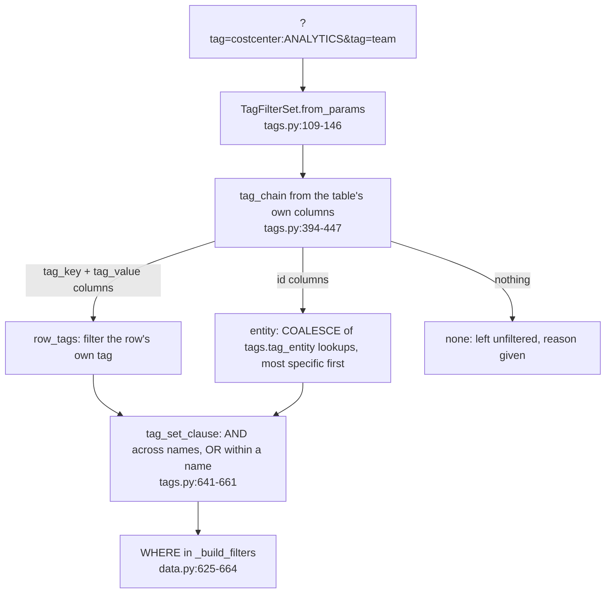
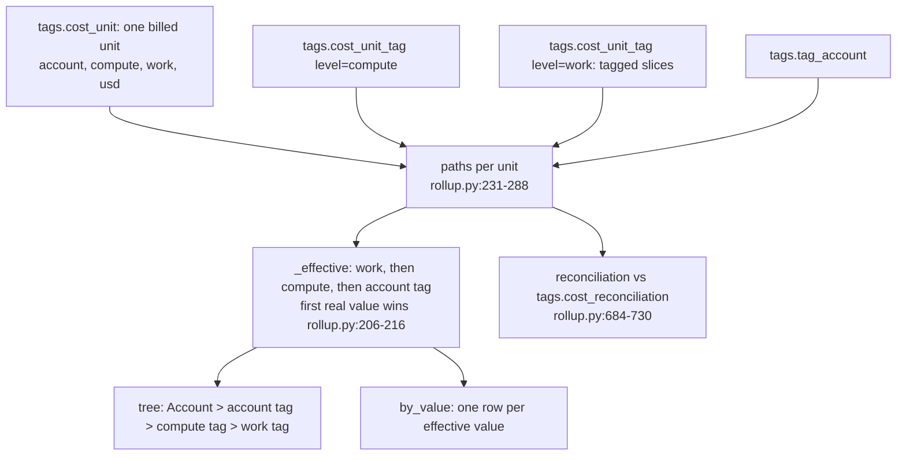

# Tags, the tag filter, the tag rollup and cost center

How a tag filter narrows a check's rows, how the nested tag rollup splits spend by one tag key, how "cost center" is resolved to a real tag key, and how required-tag compliance is priced.

## Vocabulary (tag_keys.py)

- Key normalisation: lower-case, remove every run of space, `_` and `-` (tag_keys.py:35-44).
  - Example: `"Cost Center"`, `"cost-center"`, `"cost_center"` -> `"costcenter"`; `"__"` -> `""` (rejected by the API).
- Sentinels: `__untagged__` (object exists, no value), `__mixed__` (inferred level, no dominant value), `__none__` (no object at that level), `__empty__` (URL spelling of a key-only tag stored as `""`) (tag_keys.py:9-13, 47-55). `is_real_value` is False for None and every sentinel (tag_keys.py:58-60).

## 1. Tag filter on checks (/api/findings, /api/finding, /aggregate, rows.csv)

- Parameter rules (tags.py:109-146):
  - `tag=<key>` = any real value of the key; `tag=<key>:<value>` = one value; split on the first `:`.
  - Same normalised key repeated = OR; different keys = AND; "All" on a key swallows specific values.
  - `tag_value` without `tag_key`, or a key that normalises to empty -> 422 (app.py:219-232).
  - Example: `tag=Cost-Center:ANALYTICS&tag=cost_center:DATA_SCIENCE&tag=team` -> groups `[costcenter: (ANALYTICS, DATA_SCIENCE)] AND [team: All]`.
- Chain order, most specific first (tags.py:416-445): query tag -> object tags (task, or table -> schema -> database) -> warehouse tag -> user tag -> role tag -> account tag (no account column: the warehouse's account from dims.dim_warehouse).
  - Example (tests/test_core_changes.py:154-162): columns `query_tag, table_name, database_name, schema_name, warehouse_id, user_name, role_name, account_id` -> `chain_words = ["query","object","object","object","compute","user","role","account"]`.
  - Example: `sf_wh_idle_minutes` under `tag_key=costcenter&tag_value=ANALYTICS` -> `ok_rows`, chain starts `compute`, ends `account`, at least one warehouse flagged (tests/test_core_changes.py:154-158).
- Matching (tags.py:468-576): the first non-NULL allocating `tags.tag_entity.tag_value` along the chain wins; no match = `__untagged__`. Value None -> `<> '__untagged__'`; `__untagged__` -> `= '__untagged__'`.
- Never half-applied:
  - row_tags with `__untagged__`, or with more than one tag name -> not applicable, finding unfiltered, reason given (tags.py:653-660; data.py:642-652);
  - tags.tag_entity missing under an entity chain -> NOT_ASSESSED `tag_models_not_built`, never unfiltered rows (data.py:627-635; service.py:369-374, 735-739).
- Every row gets `tag_match_value`, `tag_match_level`, `tag_match_source` columns when a filter applies (tags.py:521-538).
- `tag_spend.py` is a stub (tag_spend.py:1-27): no check is re-priced over the tagged dollars, so a filtered spend check lists its rows whose entity carries the tag, it does not split shared dollars.

## 2. Nested tag rollup (GET /api/rollup, rollup.py)

- Per unit: the compute value applies to the whole unit; the work-level slices partition the unit's usd, and the remainder becomes an untagged (query/job/pipeline) or none slice (rollup.py:262-277).
  - Example (inferred from code): unit usd 100, work tags A=60, B=30 -> slices A 60, B 30, `__untagged__` 10; if the compute tag is X, the 10 falls back to X at compute level.
- A unit with no real value at any level is attributed to `__untagged__` at level account (rollup.py:206-216); `untagged` bubbles to every ancestor (rollup.py:811-818).
- Filters: account/env/attributes through `dims.dim_account` (rollup.py:378-405); the tag filter on other keys narrows by unit, on the rollup's own key per path (rollup.py:419-483, 519-530).
- Outcome: `not_assessed` when any of the six tags.* tables is missing (rollup.py:66-72, 509-510); `ok_empty_filters` / `ok_empty_window` / `ok_rows` (rollup.py:567-569).
- Example (test DB, `tag_key=cost_center`, 30 days): resolves to `costcenter`, display `COST_CENTER`; by_value DATA_PLATFORM $24,185, ANALYTICS $2,696, DATA_SCIENCE $696; `total.usd 27,577.18`; `reconciliation.billing_usd = rollup_usd = 27,577.18`, `reconciled: true` (observed; tests/test_core_changes.py:164-170 asserts reconciled).

## 3. Which key means "cost center" (cost_center.py)

- Setting `cost_center_tag_keys` (default `["cost_center"]`, 1-5 non-empty strings; tests/test_config_cost_center.py:26-42). PUT /api/settings/cost-center writes only `config/settings.local.yml` (app.py:355-363; tests/test_config_cost_center.py:50-60).
- Default and `dims.dim_account.cost_center` exists -> nothing overridden (cost_center.py:77-112).
- Otherwise, per account, the first configured key that has a `tags.tag_account` row wins; `__untagged__` -> `not_tagged`, `__mixed__` -> `mixed` (cost_center.py:115-148).
  - Example (inferred from code): keys `["cc", "costcentre"]`, account A has rows for both -> the `cc` value; account B has neither and its base value is not `no_usage` -> `not_tagged` with reason "no usage row on this workspace carried any of the configured cost-center tag key(s)" (cost_center.py:168-183).
- The same rule drives:
  - the `cost_center=` filter (SQL ROW_NUMBER over the configured key order, cost_center.py:186-210; used at data.py:543-551 and data.py:888-893);
  - `/api/accounts` columns (`apply_alias`, data.py:1562);
  - the rollup when asked for `cost_center` (rollup.py:78-98).
- Example (test DB): `/api/accounts[0].cost_center == "DATA_PLATFORM"` (tests/test_core_changes.py:164-166).
- `suggestions` lists tag keys from tags.tag_index by credits then object count (cost_center.py:213-248).
- An attribute key's filter is offered only if at least one account has a real value or `mixed` (not `not_tagged`/`no_usage`) (app.py:310-330).

## 4. Required-tag compliance (GET /api/tags/compliance, tag_compliance.py)

- Keys: request `keys`, else setting `required_tag_keys` (max 20, config.py:145); none -> coverage mode with the 10 most used keys (tag_compliance.py:146-148, 193-200).
- Per object type (account, database, schema, table, warehouse, task, user, role):
  - `total` (null when no full inventory is exported), `tagged`, `missing`, `coverage_pct`;
  - up to 10 `missing_examples` as `name (id)`, masked for users when masking is on;
  - `missing_usd` for warehouses (tag_compliance.py:204-228).
- $ block: total priced spend from tags.cost_unit; per key, covered $ (a warehouse tag covers its whole unit, a query tag only its slice, a real account tag covers everything) and untagged $; discount applied (tag_compliance.py:100-141).
- Example (tests/test_api_features.py:176-192): keys `["cost_center","team","cost-center"]` -> two keys `costcenter`, `team`; `team` tagged 0 so `untagged_usd == total_usd`; `costcenter` covered + untagged = total and 0 < untagged < total.
- tags.tag_entity missing -> `available: false` with "the tag tables were not built ..." and no `object_types` (tag_compliance.py:154-157; tests/test_api_features.py:203-222).
- Unpriced -> `total_usd: null`, `reason: "unpriced"`, never $0 (tag_compliance.py:107-110).

## Issues seen

- `tag_chain` docstring says query, then warehouse, then object cascade, then account (tags.py:405-409); the code puts object tags before the warehouse tag and adds user and role tags (tags.py:416-445). The code comment at tags.py:416 and the test match the code.
- `compliance(account_ids=...)` narrows `tags.tag_entity` only (tag_compliance.py:159-167); the object universes and the $ block are not narrowed by account, so in an org export `total` and `missing` can mix accounts (inferred).
- `/api/tag_origins` always returns `usd: 0.0, keys: []` because `tag_spend.origins` is a stub (app.py:818-819; tag_spend.py:22-23). The UI hides it on empty keys, so no $0 is shown today (web/src/components/primitives.tsx:776).
