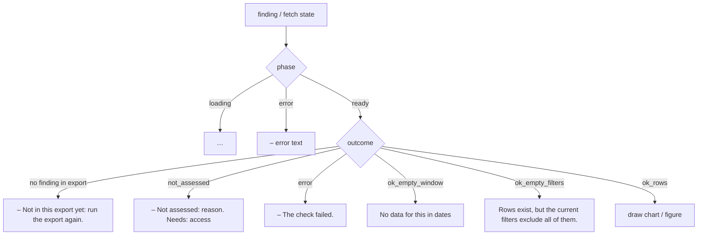

# UI number rules

How the UI shows a number it doesn't have: "–" and the reason when a check did not run, "…" while loading, a unit on every count, today marked partial, and a fixed empty-state sentence. Each rule comes with its code and a test or input → output example.

## Outcome → what the reader sees

Code: `ApPanel` (`web/src/components/area_pages.tsx:71-104`). Page helpers do the same through `chkOf` (`web/src/components/area_ai_storage.tsx:63-80`), and tiles through `tileFromFinding` (`web/src/components/overview_tile.tsx:237-274`).

### Rule 1: a check that did not run reads "–" and why, never $0

- `ApPanel` writes `– ` plus the reason for a missing finding, a fetch error, `not_assessed` and `error` (`area_pages.tsx:84-89`).
- The reason text comes from `notAssessedText`, in this order: not built → the API's `not_assessed.label` (+ `Needs: requires`) → a blocking source ("not readable by the audit role" / "not in this export") → failed or edition/role messages → unpriced aggregate → "Not in this export." (`web/src/components/scope.tsx:21-53`).
- Tiles: a `NOT_ASSESSED`/`ERROR` band gives value `"-"`, reading `"Not assessed: <why>"` and a Why fact (`overview_tile.tsx:241-250`). `SummaryTile` turns `"-"` into an en dash and hides the unit (`overview_tile.tsx:138-140`, `156`).
- The drawer's figure boxes show "–" when the figure is missing (`web/src/components/drawer.tsx:63-71`). `NotAssessedCard` says "Unknown for now: not a clean result, and not $0." and lists the GRANTs (`web/src/components/finding_detail.tsx:693-715`).
- Tests (`web/src/test/honesty.test.tsx:27-49`):

| Input fetch body | Screen text |
|---|---|
| `{outcome:"not_assessed", not_assessed:{label:"needs Enterprise edition"}}` | `– Not assessed: needs Enterprise edition.` |
| `{outcome:"error", error:"The check failed."}` | `– The check failed.` |
| `{outcome:"ok_empty_filters"}` | `Rows exist, but the current filters exclude all of them.` |
| finding missing from `findings` | `– Not in this export yet: run the export again.` |

  In every case the chart's `build` is never called (`honesty.test.tsx:34-35`).
- Bands: `bandOf` maps the outcome and `status_counts` to a band. Rows that are all unjudged (`NOT_ASSESSED > 0` and `OK = 0`) are NOT_ASSESSED, never OK (`web/src/components/primitives.tsx:226-247`).
  - Example: `{outcome:"ok_rows", status_counts:{NOT_ASSESSED:3}}` → `NOT_ASSESSED`. `{outcome:"ok_rows", status_counts:{OK:5}}` → `OK`. `{outcome:"ok_rows"}` with no `status_counts` → `INVENTORY`.
- Sub-tab badge: "–" when no check on the tab ran (`primitives.tsx:522-525`). A rail entry for Waste reads "–" when there is no waste figure (`web/src/App.tsx:545-548`).
- Waste totals are `null`, never 0, when none of their checks ran, or when the checks that ran have no price (`web/src/components/waste_total.tsx:146-151`).
  - Example: every waste-kind check is NOT_ASSESSED → `waste.usd = null` → the UI shows "–".

### Rule 2: "…" while loading, never interim values

- `ApPanel` shows `…` while `state.phase === "loading"` (`area_pages.tsx:85`). Test: a fetch that never resolves shows `…` (`honesty.test.tsx:51-55`).
- Tiles show `…` while loading or while the finding is missing (`overview_tile.tsx:239`). Page ledes show `…` while their checks load (`area_ai_storage.tsx:326-330`).
- The checks-ran count shows `…` until `/api/meta` answers. It is never worked out from findings (`primitives.tsx:258-270`, `App.tsx:245-252`).
- Shell: `…` before `/api/status` and before `/api/findings` (`App.tsx:1023-1032`, `1108`). Guide: `…` before `/api/guide` (`guide.tsx:2759-2761`).
- Partial totals are held back until they are complete. The below-floor waste note stays `null` until every item has settled (`waste_total.tsx:169-184`).
- Exceptions: the unused `StateNote` (`primitives.tsx:396-404`), the Settings popover (`settings_panel.tsx:81`, `189`) and "Load more" (`finding_detail.tsx:1048`) say `Loading...`.

### Rule 3: counts name their unit

- Checks ran: `"12 of 48 checks ran"`, with the unit from `meta.checks_ran.unit` (default "checks") (`primitives.tsx:261-270`).
- Rail: Coverage shows `"N not run"`, with title `"N of M checks did not run"`. A critical count's title says "N critical checks" (`App.tsx:539-554`).
- Tile: `value=flagged`, reading `"of <total> <noun> flagged"`, plus `" · N not judged"`. Rows that name no object read `"rows flagged · no single <noun>"` (`overview_tile.tsx:253-266`).
  - Example: `affected={flagged:3,total:48,noun:"warehouses"}` → `3` / `of 48 warehouses flagged`.
- The "Also flagged on this tab" tile reads `N` plus ` of M checks` (`tab_area.tsx:432-436`). The account picker footer reads `"X shown · N of M accounts selected"` (`App.tsx:405`).
- A capped chart reads `"Top N of M rows"` (`area_pages.tsx:98-102`).

### Rule 4: today is partial, with one money cut-off

- `GET /api/meta.cost_cutoff` is stored once, through `setCostCutoff` (`App.tsx:854`, `overview_tile.tsx:283-287`). Every range label and partial bar reads it, so a page never has two "todays".
- `windowSpan`: the last day is `cost_cutoff.data_through`, else the day before the export date. The window is capped at `snapshot_days` (`overview_tile.tsx:316-326`).
- `windowRangeLabel` → `"16 Sep - 22 Sep 2026"`, plus `" and today (23 Sep, partial)"` when today was taken in, plus `" -- partial, export covers 10d of 30d"` (`overview_tile.tsx:338-348`).
  - Example: `data_through=2026-09-22`, `partial_day=2026-09-23`, window 7 → `16 Sep - 22 Sep 2026 and today (23 Sep, partial)`.
- `partialBarKeys` fades today's bar, and in monthly charts the current month (`overview_tile.tsx:289-302`). A daily chart's note then reads "The faded bar is today (<day>): partial." (`area_pages.tsx:149-153`).
- The top bar's `SnapshotStatus` shows `Export <when> UTC · today partial · N of M checks ran`. Its tooltip says billing can lag a few hours (`App.tsx:245-268`).
- A partial window shows `30d partial` on the window button (`App.tsx:348-366`) and `"30d: partial, 10 of 30 days"` under the page title (`primitives.tsx:703-715`).
- Snapshot sub-tabs, where every check has `windowed === false`, say "snapshot at export, <day> — the N-day window does not apply" (`primitives.tsx:932-934`).

### Rule 5: empty-state text

- `noDataText` → `"No data for this in <windowRangeLabel>"`. Before meta has loaded it falls back to `"the last N days"` (`primitives.tsx:579-587`). `App` stores the label for tiles through `setAuditRange` (`App.tsx:1037-1038`, `range_store.ts:1-4`). Tiles then read `"No data for this in <range>"` (`overview_tile.tsx:251`).
- `ApPanel`/`chkOf` use the shorter `windowShortLabel` → `"No data for this in 16–22 Sep, 7 days of data"` (`area_pages.tsx:90-93`, `overview_tile.tsx:328-336`, `area_ai_storage.tsx:73-76`). Test: the text matches `/^No data for this in /` (`honesty.test.tsx:38-42`).
- An empty window is "Not a verified zero", with "A longer window may have rows" on windowed checks (`finding_detail.tsx:752-790`).
- A fallback source says so in one line: checks read from INFORMATION_SCHEMA (`primitives.tsx:717-728`).
- Filters that don't apply are named: "Not narrowed by your Account filter…" (`primitives.tsx:744-754`) and "The Account filter doesn't apply to N of these M checks" (`scope.tsx:67-85`).

### Rule 6: kinds are never added

- `wasteTotal` returns three separate totals (`waste`, `saving`, `month`). The flagged-only list is kept apart (`waste_total.tsx:139-193`). An entry counts only if its money `kind` matches its unit and `basis === "flagged"` (`waste_total.tsx:96-100`).
  - Example: `sf_wh_idle_minutes` (dollarCol `est_wasted_usd_list`, `tab_registry.tsx:118`) with band WARN and `money={kind:"waste", basis:"flagged", column:"est_wasted_usd_list", usd:120}` → adds 120 to `waste.usd`. `sf_wh_oversized` (savingCol, `tab_registry.tsx:131`) with `usd:80` → goes to `saving.usd`, never to waste.
- When two storage checks name the same table, it is counted once: `usd = sum − overlap_usd` (`waste_total.tsx:155-158`).
- Labels: `MONEY_KIND_WORD` ("possible waste", "possible saving per month", "context, not counted as waste"...) (`tab_area.tsx:38-41`). Tiles carry `KINDS_NOTE` (`overview_tile.tsx:176`).

## Inconsistencies

- **Two glyphs for "missing":** `format.tsx` formatters return ASCII `"-"` (`web/src/format.tsx:1`, `43-44`, `135-136`). `SummaryTile` converts it (`overview_tile.tsx:139`), but table cells such as `NotPricedNote` show `-` (`findings_table.tsx:211`), and `scope.tsx` comments say "-" (`scope.tsx:7`). CLAUDE.md asks for "–".
- **Two date styles in empty-state text:** `noDataText` uses `"16 Sep - 22 Sep 2026"` and `ApPanel` uses `"16–22 Sep, 7 days of data"`. CLAUDE.md's example is `"16–22 Sep 2026"`.
- **`Loading...` in a few places** instead of `…` (see Rule 2).
