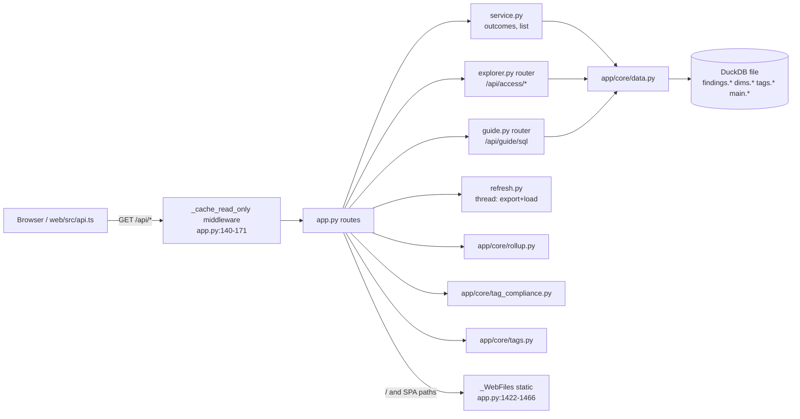

# API layer (app/api)

Every HTTP route the local app serves: FastAPI in `app/api/app.py` plus two routers (`explorer.py`, `guide.py`); routes only read the DuckDB file, except the three Settings PUTs and POST /api/refresh.

Sources opened: `app/api/app.py`, `app/api/service.py`, `app/api/explorer.py`, `app/api/guide.py`, `app/api/refresh.py`, `app/api/__main__.py`, `start.py`, `web/src/api.ts` (caller check only).

## Structure



## Cross-cutting behaviour

- **App object**: `FastAPI(title="Crosshire API")` app.py:124. Routers included at app.py:732-733.
- **Response cache**: GETs under `/api/finding/`, `/api/rollup`, `/api/tags/` (not `.csv`) are cached by `(data_stamp, path, query)`; bounded by bytes (`load.response_cache_mb`, 0 = off); one oversized body is served, not kept; over the cap the whole cache is cleared. app.py:126-171, service.py:597-611.
  - Example: `response_cache_mb: 64` (config/settings.yml:71) -> cap 67,108,864 bytes (app.py:135).
  - Note: `/api/tags` itself is not under `/api/tags/`, so only `/api/tags/compliance` is cached (inferred from the prefix tuple, app.py:128).
- **Broken settings.yml**: any `ConfigError` becomes a 503 `{detail, state:"settings_invalid", key, line}` (app.py:177-187); `/api/status` reports it instead of failing (app.py:445-472).
- **Window**: `window` must be 7, 30 or 90 (`service.WINDOW_CHOICES`, service.py:72); missing -> `settings.default_window`; anything else is a 422 (app.py:190-200).
- **Account scope**: repeated `account_ids` app.py:265-268.
- **Dim scope**: repeated `warehouse`, `database`, `schema` -> `DimFilter` (data.py:370-385) app.py:271-277.
- **Attribute filters**: one query param per canonical key of `config/tag_aliases.yml` (`team`, `cost_center`, `business_unit`, `domain`, tag_aliases.yml:12-16) read by name, app.py:293-306.
- **Tag filter**: `tag_key`/`tag_value` and repeated `tag=<key>` or `tag=<key>:<value>`; same key ORs values, different keys AND; bad combination is a 422 (app.py:220-233, tags.py:95-146).
- **Status filter**: values must be in `["CRITICAL","WARN","NOT_ASSESSED","OK"]` else 422 (app.py:212-217, service.py:71).
- **Errors**: unknown `query_id` -> 404 via `QueryNotFoundError` (service.py:75-84); a locked/corrupt DB is `outcome:"error"` with 200 (docstring app.py:77-80; service.py:347-350).

## Endpoints

| Method | Path | Handler (path:line) | Returns |
|---|---|---|---|
| GET | /api/status | `get_status` app.py:445-472 | `{state, settings_error, database, brand}`; state = `settings_invalid` (wins) or `data.db_state()` -> `no_database` / `build_incomplete` / `ready` (data.py:201-219). Never raises. |
| GET | /api/meta | `get_meta` app.py:494-557 | as_of, as_of_date, export_days, window_options, default_window, `windows` (per-window availability, data.py:1720-1735), `open_window` (app.py:203-209), discount, price_basis, edition, brand, privacy, attribute_keys_populated, max_chart_categories, `cost_cutoff` (data.py:2149-2183), direct_export, db_path, `checks` counts + `checks_ran` (data.py:2245-2266). |
| GET | /api/accounts | `get_accounts` app.py:568-592 | `dims.dim_account` rows: account_id, legacy workspace_id, name, url, env, env_source, env_reason + every `<key>/<key>_share/<key>_reason` column; 503 if the dim cannot be read. |
| GET | /api/dims | `get_dims` app.py:637-669 | `{tasks, warehouses}` from dims.dim_task / dim_warehouse; ids as strings; one missing dim -> `[]` for it; cached on (db path, mtime) app.py:634. |
| GET | /api/coverage | `get_coverage` app.py:680-719 | export_mode, per-source state (`direct_source_states`, data.py:1907-1975), run-result checks, `checks_not_ok` (data.py:2071-2103), `checks_ran`, `visibility` (data.py:2274-2300), edition, truncated_query_ids. |
| GET | /api/guide | `get_guide` app.py:727-729 -> `build_guide` guide.py:506-564 | Guide feed: one entry per executable check (header prose cleaned, params with value and source, docs keys, columns + kinds, money column, tag reach, grants, traps) + docs and concept-doc links. |
| GET | /api/guide/sql/{query_id} | `get_guide_sql` guide.py:497-503 -> `sql_text` guide.py:453-494 | The check's own SQL with includes expanded and params filled with the values in effect (thresholds.yml, else header default; `period_days` defaults to 30); 404 for unknown id. |
| GET | /api/access/names | `get_names` explorer.py:194-205 | users (masked when on), roles (admin flag, privileges, users who can use it), objects; 503 if `findings.f_sf_acc_grant_links` is missing (explorer.py:64-65). |
| GET | /api/access/explore | `get_explore` explorer.py:209-245 | `kind=user|role|object`, `name`: grants with every path (max 10 kept, count kept), roles reached, holders; 404 unknown name, 422 bad kind. |
| GET | /api/rollup | `get_rollup` app.py:744-774 -> `rollup.rollup` rollup.py:481-618 | Nested cost or performance tree for one tag key (account -> account tag -> compute tag -> work tag), by_value, paths, reconciliation, `cut_sources`; 422 on `RollupError`. |
| GET | /api/rollup/keys | `get_rollup_keys` app.py:777-787 -> rollup.py:933-933 | Tag keys with compute/work $ (or statements) and allocating account count; `[]` when tag tables were not built. |
| GET | /api/tags | `get_tags` app.py:795-805 -> `tags.read_tag_index` tags.py:171 | Tag keys/values seen, `search`, `tag_key`, limits; 503 when tags.tag_index is missing. |
| GET | /api/findings | `get_findings` app.py:870-908 | One row per executable check (`_finding_json` app.py:821-867): outcome, status_counts, money, affected, not_assessed, floor, partial, visibility, source, dim/owner applied; plus `checks_ran`, price_basis, discount. |
| GET | /api/finding/{query_id} | `get_finding` app.py:926-1071 | Header (params substituted), outcome-specific body: `status_info` (not_assessed), `error`, `window_coverage` (empty window), `rows_in_window`+`row_cap`+`excluded_no_account` (empty by filters), or rows page with columns+kinds, `floor`, discount, truncated. |
| GET | /api/finding/{query_id}/aggregate | `get_finding_aggregate` app.py:1082-1214 | Server-side sum / count / count_distinct over every matching row, grouped, top-N + `other`, `total_value` RAW (undiscounted) + `discount_pct` for the caller, `null_value_rows`, `excluded_no_account`, `floor`; optional `also`/`pick` columns (app.py:1217-1242). |
| GET | /api/finding/{query_id}/rows.csv | `get_finding_rows_csv` app.py:1252-1298 | Every row (cap 1,000,000, app.py:1249) as CSV, discount applied, user masking applied; 409 when not assessed; header-only CSV when nothing matches; headers X-Rows, X-Rows-Matching, X-Truncated. |
| GET | /api/warehouses | `get_warehouses` app.py:1310-1346 | Warehouse picker: SHOW-listed (`source:"listed"`) plus billed-but-hidden ones from `f_sf_cost_warehouse_idle_credits_daily` (`source:"billing"`), label `name (id)`. |
| GET | /api/databases | `get_databases` app.py:1357-1398 | Database picker with schemas (`fqn` = DATABASE.SCHEMA) from three finding tables and dims.dim_task (app.py:1350-1354). |
| GET | /api/tags/compliance | `get_tags_compliance` app.py:1406-1415 -> `tag_compliance.compliance` tag_compliance.py:148-244 | Required-tag compliance (or coverage when no keys) per object type, plus the $ block. |
| GET/PUT | /api/settings/cost-center | app.py:349-362 | `{keys, default, suggestions}`; PUT writes `config/settings.local.yml`, 422 on a bad list (1-5 non-empty keys, tests/test_config_cost_center.py:38-42). |
| GET/PUT | /api/settings/privacy | app.py:383-406 | `{mask_user_identities, mask_fields, mask_kinds, loaded_masked, default}`; PUT validates bool and kinds (`masking.parse_kinds`). |
| GET/PUT | /api/settings/required-tags | app.py:421-436 | `{keys, default, max}` (max = 20, config.py:145). |
| GET | /api/refresh | `get_refresh` app.py:480-482 -> refresh.py:26-29 | `{running, step, days, started_at, finished_at, error, elapsed_s}`. |
| POST | /api/refresh | `post_refresh` app.py:485-488 -> refresh.py:32-39 | Starts one background export + load (`days` 1-90, default 30); a second call while running returns the running state. |
| GET | / and any non-file page path | `_WebFiles` app.py:1422-1442, `_branded_index` 1522-1534 | `app/web/dist/index.html` with brand in `<title>` and `window.APP_BRAND`, `Cache-Control: no-cache`; `/api/*` and missing files keep 404. Without a build: plain-text 404 (app.py:1462-1466). |

## Refresh (POST /api/refresh)

```mermaid
sequenceDiagram
  participant UI
  participant API as app.py:485
  participant RF as refresh.py
  participant EX as tools/export_results.py
  participant LD as tools/load_results.py
  UI->>API: POST /api/refresh?days=30
  API->>RF: start(30) (lock, thread) refresh.py:32-39
  RF->>EX: --windows 30 --out results/<stamp> [+ CLI prices] refresh.py:76
  RF->>LD: results/<stamp> --db audit-<stamp>.duckdb refresh.py:78
  RF->>RF: set_current_db + AUDIT_DB; delete older dbs and results refresh.py:80-83
  UI->>API: GET /api/refresh (poll) -> step export | load | done | failed
```

- A new db file per refresh because the server holds the current one open (refresh.py:1-6).
- Only prices that came from the CLI are passed on; invoice prices are re-read (refresh.py:49-66).
  - Example: manifest `pricing = {credit_price_usd: 2.5, source: "cli"}` -> `["--credit-price", "2.5"]`; `source: "rate_sheet_daily"` -> `[]`.
- Keeps the newest two `results/<stamp>` folders (refresh.py:99-103).

## Start-up

- `python start.py` (start.py:1-13): makes `.venv`, installs requirements when their sha256 changes (start.py:71-85), asks for account/user/role/warehouse/key into `.env` (start.py:37-43), checks sign-in (start.py:163-177), runs `tools/first_run.py --windows N` (default 7, start.py:52, 248-249), then `python -m app.api` on the first free port from 8000 (start.py:199-208, 267-272).
- `python -m app.api` (app/api/__main__.py:27-35): prints the db path, sets `data.share_connection = True` (one shared read-only connection per db file), warms `list_findings` for the default window and every exported window in a thread (__main__.py:14-24), runs uvicorn on `AUDIT_API_HOST`/`AUDIT_API_PORT` (default 127.0.0.1:8000).
