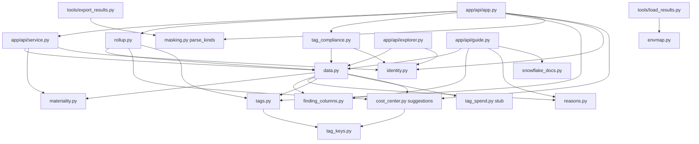

# Core modules (app/core, backend slice)

What each `app/core` module the API depends on does, its key functions with `path:line`, and who calls it (config, pricing, registry and datasource are documented by other slices).

## app/api/service.py (business layer between routes and data.py)

- Purpose: the five outcomes, the findings list, column kinds, JSON-safe rows (service.py:1-36).
- Key functions:
  - `load_outcome` service.py:277-425: one check's outcome in a fixed order (failed -> not exported -> table missing -> empty window -> empty by filters -> rows).
  - `load_aggregate` service.py:460-525: reruns `load_outcome(limit=1)` so the aggregate and the detail never disagree, then `data.aggregate_finding`.
  - `list_findings` service.py:623-637 (cached per data stamp, max 65 entries) -> `_list_findings_uncached` service.py:640-806.
  - `_mark_storage_overlap` service.py:811-856: sets `money.overlap_usd` / `overlap_tables` so a table priced by two storage checks counts once.
  - `classify_columns` service.py:904-924; `records` service.py:957-974 (masks person columns); `rows_csv` service.py:1002-1007.
  - `resolve_params` service.py:99-121 and `substitute_header_params` service.py:172-205: `:param` tokens in header prose -> `"<value> (<source>)"`.
- Calls out: data.py, materiality.py, identity.py, pricing.py, registry.py, tags.py (service.py:57-63).
- Called by: app.py routes, guide.py (`classify_columns`, `resolve_params`), `__main__._warm`.

## data.py (read-only DuckDB store)

- Purpose: every read of the db file; filters pushed into SQL with bound params; one money cut-off, one price basis, one checks-ran count (data.py:1-40).
- Connection: `_db_path` = `AUDIT_DB`, else the refresh pointer, else the data folder db (data.py:103-112). `_connect` shares one read-only connection per file identity when `share_connection` (server) is on (data.py:120-164). `_file_cached` memoizes on (file, mtime, size, args) (data.py:167-191).
- Key functions:

| Function | Lines | What it does |
|---|---|---|
| `db_state` | data.py:201-219 | `no_database` / `build_incomplete` (unreadable or no dims.dim_account) / `ready`. |
| `_select_list` | data.py:258-280 | `status` becomes the effective (floored, capped) status, raw kept as `status_raw`, plus `below_floor`. |
| `_build_filters` | data.py:482-666 | WHERE text for window, accounts, env, attributes (whitelisted keys), legacy tag, task, owner, warehouse/database/schema, status (effective), tag chain. |
| `_order_by_clause` | data.py:676-685 | Worst effective status first, then export row order, so the row cap never drops a CRITICAL row. |
| `read_finding` | data.py:688-793 | Rows page + `rows_total` + `rows_below_floor` + `excluded_no_account` + applicability flags. |
| `count_finding(_ex)` | data.py:796-849 | Row count with the same filters (owner and dims not passed). |
| `finding_window_counts` | data.py:938-1257 | Bulk counts for the findings list on one connection: rows_in_window, rows_total, status_counts, money (data.py:1119-1187), affected (data.py:1189-1238), floor. |
| `aggregate_finding` | data.py:1336-1550 | GROUP BY sum/count/count_distinct over every matching row; top-N fold; `total_value` None when every value is NULL. |
| `direct_export_info` | data.py:1624-1668 | Export metadata row (`main.direct_export_meta`). |
| `exported_window_coverage` / `window_status` / `window_coverage` | data.py:1701-1735, 2131-2149 | Days actually covered per window label; `partial` flag. |
| `run_results`, `finding_status` | data.py:1809-1826, 1986-2006 | Per-check ok/failed from the loader sidecar. |
| `coverage_reason`, `resolve_reason`, `reason_fix` | data.py:1855-1894 | Error text -> reason code -> fix text (GRANT lines for no_access). |
| `not_assessed_status`, `checks_not_ok` | data.py:2017-2103 | One NOT_ASSESSED vocabulary for /api/findings and /api/coverage. |
| `cost_cutoff` | data.py:2149-2183 | The one money cut-off. |
| `price_basis`, `effective_discount_pct`, `discount_info` | data.py:2198-2237 | Where $/credit came from; discount what-if is 0 on an invoice rate. |
| `checks_ran_summary` | data.py:2245-2266 | THE checks-that-ran count. |
| `visibility_summary`, `finding_visibility` | data.py:2274-2312 | Role-visibility probe; billed vs listed warehouse gap. |

- Calls out: config, cost_center, datasource, finding_columns, materiality, reasons, registry, tags, tag_spend (data.py:62-70).
- Called by: service.py, app.py, explorer.py, guide.py, rollup.py, tag_compliance.py, tags.py (lazy), cost_center.py (lazy).

## rollup.py (nested tag rollup)

- Purpose: per request, walk each cost/perf unit from work tag -> compute tag -> account tag; the first real value wins (rollup.py:1-19).
- Key functions: `_effective` rollup.py:200-210; `_fetch_cost_paths` rollup.py:225-282 (untagged remainder = unit usd minus tagged work usd); `_resolve_cost_center_alias` rollup.py:72-92; `_resolve_account_scope` rollup.py:372-400; `_matching_unit_ids` rollup.py:414-459; `rollup` rollup.py:481-618; `_reconciliation` rollup.py:682-728; `_build_tree` rollup.py:819-873; `_build_by_value` rollup.py:876-908; `rollup_keys` rollup.py:933-933.
- Reads: `tags.cost_unit`, `cost_unit_tag`, `cost_reconciliation`, `perf_unit`, `perf_unit_tag`, `tag_account` (rollup.py:60-66) and `findings.f_cost_dollarized_by_service_day` (rollup.py:665-679).
- Stubs: `_source_status` and `_degraded_effect` always return "nothing degraded" (rollup.py:106-113).
- Called by: app.py:770, 802, 822, 835.

## materiality.py (floors and severity cap)

- Purpose: a CRITICAL/WARN row under its floor reads OK; trend/chargeback reports never read CRITICAL (materiality.py:1-29).
- Key functions: `severity_cap` materiality.py:98-99 (ids at materiality.py:48-95); `_floors` cache materiality.py:114-124; `applicable_floor` materiality.py:133-140; `_min_sql` (USD scales by window/30) materiality.py:143-151; `status_expr` materiality.py:154-177; `below_floor_expr` materiality.py:180-187.
- Config: config/materiality.yml:17-36 (4 floors).
- Called by: data.py (`_select_list`, `_build_filters`, `_order_by_clause`, counts, aggregate), service.py (`floor_json`), app.py (`severity_cap` in `_finding_json`). See logic/materiality.md.

## reasons.py (why a check could not run)

- `classify_error` reasons.py:36-49: timeout > edition_too_low > no_access > view_missing > sql_error.
- `edition_at_least` reasons.py:63-68, `needs_enterprise` reasons.py:71-75.
- `grant_for` / `grants_for` reasons.py:93-122: the GRANT line that opens a source, naming `<audit_role>`.
- Called by: data.py (coverage reasons, not-assessed grants, visibility), guide.py (`grants_for`, `needs_enterprise`), tools (export, validate; inferred from the module docstring reasons.py:1-12).

## finding_columns.py (money column and entity)

- `MONEY_COLUMN_KIND` finding_columns.py:25-51; `FLAGGED_KINDS = {waste, saving, saving_month, gap}` finding_columns.py:55.
- `money_column` finding_columns.py:135-152: declared `-- money:` wins; else a named column by kind priority (finding_columns.py:132); else first money-shaped column (not `prev_*`) as "spend".
- `entity_spec` finding_columns.py:169-190; `row_noun` finding_columns.py:119-125; `TOTAL_ROW_COLUMN` / `ALT_BASIS_COLUMN` finding_columns.py:63, 68.
- Called by: data.py (`finding_window_counts`, `aggregate_finding`), guide.py (`_money_column`).

## identity.py (on-screen user masking)

- `masking_enabled` identity.py:38-40 (`privacy.mask_user_identities`, default false config/settings.yml:44).
- `format_identity` identity.py:43-60 -> `"<8 hex of sha256(lower(trim))> <first 2 chars>***"`; idempotent; placeholders `(…)` kept.
- `mask_dataframe` identity.py:78-93, `mask_group_key` identity.py:96-100, `is_person_column` identity.py:63-65.
- Called by: service.records / rows_csv / aggregate_group_json, app._group_json, explorer.py, tag_compliance.py.

## masking.py (export-time masking)

- Purpose: replace chosen kinds of names with salted tokens in every parquet file and the manifest before anything is written (masking.py:1-22).
- `parse_kinds` masking.py:116-127; `Masker.token` masking.py:175-185; `Masker.column_rule` masking.py:188-207; `Masker.cell` masking.py:213-233; `freeze`/`text` masking.py:245-265; `mask_folder` masking.py:335-354.
- Called by: app.py `put_privacy_settings` (validation only, app.py:403) and `_privacy_body` (`MASK_KINDS`, app.py:381); the export (`tools/export_results.py`, tests/test_masking.py:172-176).

## tags.py (tag filter and tag index)

- `TagFilter.from_params` tags.py:62-80; `TagFilterSet.from_params` tags.py:109-146.
- `read_tag_index` tags.py:171 (GET /api/tags); 503 path via `TagModelsNotBuiltError` tags.py:45-48.
- `tag_chain` tags.py:386-439: which tag lookups reach a finding's rows (row_tags / entity / none).
- `tag_clause` tags.py:533-568, `tag_group_clause` tags.py:580-630, `tag_set_clause` tags.py:633-653.
- Called by: data.py `_build_filters`, app.py `_parse_tag_filter`, rollup.py, guide.py `_tag_reach`.

## tag_keys.py (tag vocabulary)

- Sentinels `__untagged__`, `__mixed__`, `__none__`, `__empty__` tag_keys.py:9-13; `normalize_tag_key` tag_keys.py:38-44 ("Cost Center" -> "costcenter"); `api_value_to_model` / `model_value_to_api` tag_keys.py:47-55; `is_real_value` tag_keys.py:58-60.

## tag_spend.py (stub)

- Every function returns "not available": `has_variant` False, `available` False, `origins` None, `table_sql` None (tag_spend.py:14-22). Kept so data.py and guide.py keep one code path (tag_spend.py:1-7). All `tag_prefiltered` branches in data.py are therefore never taken today (data.py:619-624).

## tag_compliance.py (required tags)

- `compliance` tag_compliance.py:148-244; `_universes` tag_compliance.py:49-93; `_spend` tag_compliance.py:104-145.
- Reads tags.tag_entity, tags.tag_account, tags.cost_unit, tags.cost_unit_tag, dims.*, findings.f_sf_chg_tag_coverage. Called by app.py:1420. See logic/tags-and-cost-center.md.

## cost_center.py (which tag key means cost center)

- `configured_keys` cost_center.py:28-35; `normalized_keys` cost_center.py:37-46; `is_default` cost_center.py:49-53; `_should_override` cost_center.py:74-84; `account_values` cost_center.py:87-120; `apply_alias` cost_center.py:123-155; `attribute_filter_sql` cost_center.py:158-182; `suggestions` cost_center.py:185-220.
- Called by: data.read_dim_account (data.py:1565), data._build_filters (data.py:543-551), rollup._resolve_cost_center_alias, app._cost_center_body.

## envmap.py (account name -> env)

- `classify_env` envmap.py:31-42: lower-case, collapse `-_./` to a space, whole-word match in order prod, uat, dev; else `unknown`.
  - Example (config/settings.yml:54-57): `"ACME-PRD-EU"` -> "acme prd eu" -> `prod`; `"FAKE_ACCOUNT"` -> `unknown` (tests/test_api.py:324-328 asserts env "unknown" for the fake account).
- Called by: tools/load_results.py only (grep); the app reads the stored `env` column.

## snowflake_docs.py (docs links)

- `parse_docs` snowflake_docs.py:29-45 (only `https://docs.snowflake.com/` URLs, unique keys); `load_docs` snowflake_docs.py:51-64 (cached on mtime/size).
- Called by: guide.py:520, registry.py:251.

## config/*.yml read by these modules

| File | Read by | Key facts |
|---|---|---|
| config/settings.yml | config.load_settings (merged with settings.local.yml) | discount_pct 0.0 (l.7), default_window 30 (l.9), include_today true (l.12), credit 3.0 / AI 2.0 fallback prices (l.20-21), ui.max_rows 500 (l.28), privacy off (l.43-48), env_patterns (l.54-57), load caps + response_cache_mb 64 (l.68-71). |
| config/materiality.yml | materiality._floors | 4 floors; USD min is per 30 days (l.6-8). |
| config/thresholds.yml | service.resolve_params, guide._param_json | Overrides only; empty is valid (l.1-5). |
| config/tag_aliases.yml | data._attribute_canonical_keys, app._canonical_keys | Canonical keys team, cost_center, business_unit, domain (l.12-16). |
| config/snowflake_docs.yml | snowflake_docs.load_docs, guide._concept_docs | `sources` and `concepts` lists of docs.snowflake.com links. |
