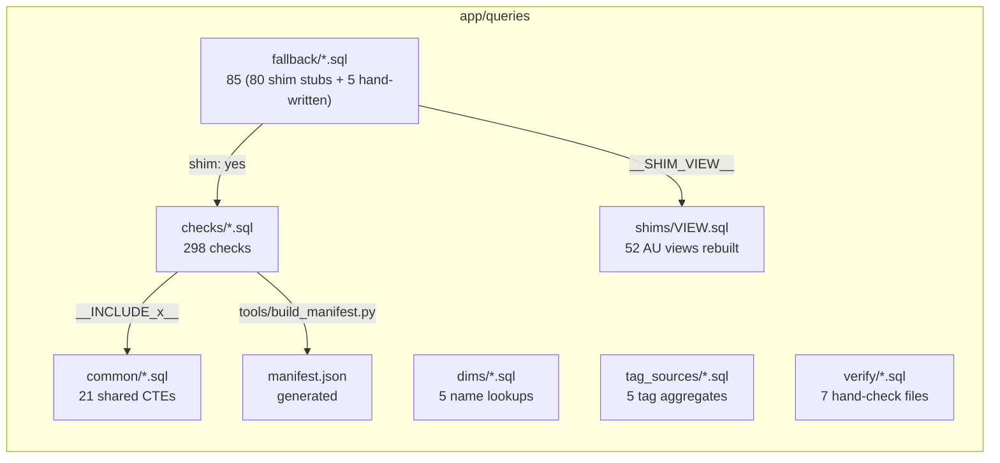
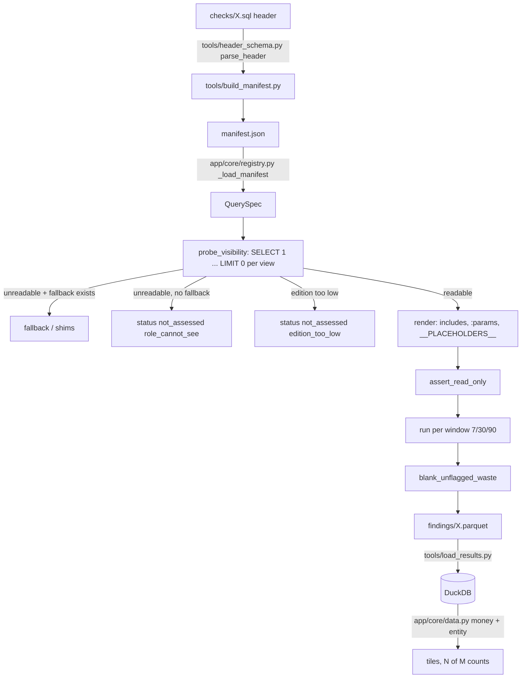
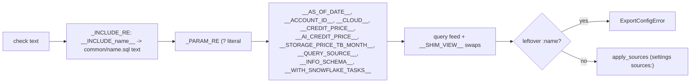
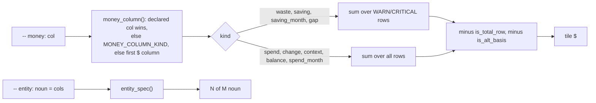

# SQL checks (app/queries)

298 read-only SQL checks over `SNOWFLAKE.ACCOUNT_USAGE` / `ORGANIZATION_USAGE`, each one file with a comment header that drives the export, the manifest and every number the app shows.

Sources opened: `app/queries/README.md:1-74`, `tools/header_schema.py:1-272`, `tools/build_manifest.py:20-100`, `tools/export_results.py:55-660, 985-1045, 1129-1275`, `tools/common.py:20-86`, `app/core/registry.py:1-60, 100-130, 239-301`, `app/core/finding_columns.py:1-198`, `app/core/data.py:1105-1236`, `tools/check_queries.py:1-72`, `tools/sql_smoke.py:1-517`, `tools/check_registry_ids.py:1-70`, every `app/queries/common/*.sql`, samples of `checks/`, `fallback/`, `shims/`, `verify/`.

## Folder layout



| Folder | What it holds | Evidence |
|---|---|---|
| `checks/<query_id>.sql` | One check; file name = `query_id` (export refuses a mismatch). `sf_*` = Snowflake-only; other names are ports of the Databricks app's checks with the same columns. | `README.md:7-8`, `tools/export_results.py:97-106` |
| `dims/` | `dim_account`, `dim_database`, `dim_task`, `dim_user`, `dim_warehouse` name lookups | `README.md:9`, `ls app/queries/dims` |
| `common/<name>.sql` | Shared CTE fragments pasted in with `__INCLUDE_<name>__` | `README.md:10` |
| `fallback/<query_id>.sql` | Same check from INFORMATION_SCHEMA, same columns; run when the role cannot read AU (or `--use-fallbacks`). 80 are `-- shim: yes` stubs, 5 are hand-written (`access_login_concentration`, `query_failed_queries_daily`, `query_queuing_waits`, `sf_qry_daily_by_warehouse`, `sf_storage_growth_by_database`). | `README.md:11-15`, `tools/export_results.py:109-117` |
| `shims/<VIEW>.sql` | An AU view rebuilt from IS table functions / views / SHOW, with the view's columns (NULL where missing). Header: `reads`, `needs`, `note`, optional `each`, `show`, `columns`. | `README.md:16-23`, `shims/WAREHOUSE_METERING_HISTORY.sql:1-9`, `shims/TABLES.sql:1-5` |
| `tag_sources/` | 5 aggregates written to `tags_src/` for the tag filters | `README.md:69-74` |
| `verify/<section>.sql` | Paste-into-worksheet queries that recompute app figures by hand (ai, cost, governance, pipelines, queries, storage, warehouses) | `verify/cost.sql:1-5`, `STATUS.md:21` |
| `manifest.json` | Domain-keyed list of every check's parsed header; never hand-edited | `tools/build_manifest.py:2-8, 83-98` |

## Lifecycle of one check



- Edition gate, role gate, fallback branch: `tools/export_results.py:1211-1266`.
- Probe: `tools/export_results.py:938-975`.
- Run per window and overwrite `window_days` with the label: `tools/export_results.py:989-1003`.

## Header format

One `-- key: value` per line; a line starting `--   ` continues the field above (`tools/header_schema.py:90-113`). Required fields (14): `query_id, title, domain, reads, requires, params, confidence, confidence_note, read_this, healthy, investigate_if, actions, next, caveats` (`tools/header_schema.py:15-30`). `tier` rides on the domain line: `domain: cost   tier: standard` (`tools/header_schema.py:74, 215-220`). Optional: `runnable, empty_if, not_assessed_reasons, windowed, pre, money, entity` (`tools/header_schema.py:32-46`).

Real example, `app/queries/checks/cost_daily_by_resource.sql:1-34` (abridged):

```sql
-- query_id: cost_daily_by_resource
-- title: Daily credits and dollars per warehouse, serverless task and Snowpipe
-- domain: cost   tier: standard
-- entity: resources = resource_key
-- windowed: yes
-- reads: SNOWFLAKE.ACCOUNT_USAGE.WAREHOUSE_METERING_HISTORY, SNOWFLAKE.ACCOUNT_USAGE.METERING_DAILY_HISTORY,
--   SNOWFLAKE.ACCOUNT_USAGE.SERVERLESS_TASK_HISTORY, SNOWFLAKE.ACCOUNT_USAGE.PIPE_USAGE_HISTORY
-- requires: IMPORTED PRIVILEGES on the SNOWFLAKE database
-- empty_if: role_cannot_see, no_activity
-- params: :period_days (default 30) days of history ...; :top_n (default 100) resources: per type, ...
-- confidence: needs_confirmation
-- read_this: One row = one day's credits for one resource ...
-- healthy: n/a - inventory
-- next: cost_chargeback_by_warehouse
-- caveats: ... a warehouse row is its compute plus billed cloud services (the daily 10% adjustment is taken off) ...
WITH __INCLUDE_sf_cs_billed_ratio__,
wh AS ( ... )
```

Field rules:
- `params:` grammar is `:name (default X) meaning; ...` (`tools/header_schema.py:75, 116-137`). A chunk that does not match is skipped silently (`tools/header_schema.py:125-127`); `render` then fails on the unresolved `:name` (`tools/export_results.py:636-638`).
- `empty_if:` vocabulary: `edition_too_low, role_cannot_see, org_account_only, view_missing, retention_window, no_activity, ingestion_lag` (`tools/header_schema.py:50-59`).
- `entity:` is `<noun> = <col>[, <col>]`; malformed raises (`tools/header_schema.py:167-177`).
- `reads:` is validated against `SOURCE_CONTRACT` at load; unknown source = `RegistryError` (`app/core/registry.py:11-13, 33-60`).
- `confidence`: all 298 checks are `needs_confirmation` (manifest.json; enum at `tools/header_schema.py:61`).

## Includes and params



- Implementation: `tools/export_results.py:600-639` (`render`).
- **Includes** are CTE fragments (`name AS (...)`), pasted once, not recursive; no `common/*.sql` file contains another include. A check writes `WITH __INCLUDE_a__, __INCLUDE_b__, own AS (...)` (`checks/cost_daily_by_resource.sql:34`). Order matters: `sf_use_query_metrics` and `sf_use_query_roles` read `sf_use_ah`, which only `sf_use_access_events` defines (`common/sf_use_query_metrics.sql:2, 13`, `common/sf_use_access_events.sql:4-10`).
- Include use across checks (grep of `checks/*.sql`, 124 checks use one): `warehouse_config` 22, `sf_sec_users` 22, `sf_sec_user_roles` 22, `sf_storage_live_tables` 19, `sf_gov_sensitive_columns` 12, `sf_cs_billed_ratio` 12, `sf_task_dim` 10, `sf_use_access_events` 9, `cost_lines` 8, `sf_chg_query_credits` 7, `sf_dt_dim` 5, `sf_storage_table_use` 4, `sf_chg_cost_tags` 3, `sf_wh_size_rate` / `sf_use_query_roles` / `sf_use_query_metrics` / `sf_use_object_inventory` / `sf_cs_window_ratio` 2 each, `sf_cost_object_reads` 1. `is_query_history*` are fallback-only.
- **Params**: values = header defaults overridden by `config/thresholds.yml` per check or `_all` (`tools/export_results.py:267-274`); `period_days` comes from the window, not the header (`tools/export_results.py:606`). The lookbehind `(?<![:\w])` keeps `::NUMBER` casts and `o:COL` variant paths untouched (`tools/export_results.py:59`).
  - Example: `:top_n` in `cost_daily_by_resource` -> `100`; `:period_days` -> `7`, `30` or `30` again for the 90 label when the export has 30 days.
- Literal rules: `None` -> `CAST(NULL AS DOUBLE)`, bool -> `TRUE/FALSE`, string quoted (`tools/export_results.py:277-284`). So an unpriced export renders `__CREDIT_PRICE__` as `CAST(NULL AS DOUBLE)` and every `credits * price` is NULL, never 0.
- Read-only guard: one `SELECT`/`WITH`/`SHOW`, no `;` outside quotes (`tools/export_results.py:642-648`).
- `pre:` SHOW lines run first on the same cursor; the check reads them with `RESULT_SCAN(LAST_QUERY_ID())`, pinned to the SHOW's id (`tools/export_results.py:993-995, 713`; `common/warehouse_config.sql:8-10`).

## Windows

- `WINDOW_LABELS = (7, 30, 90)`; `window_plan(30)` -> `[(7,7),(30,30),(90,30)]`; `window_sources` runs each distinct day count once at its smallest label (`tools/common.py:18, 24-34`).
- Export default `--windows 30` (`tools/export_results.py:1502`). Windowed checks run per source; others once with label 0 (`tools/export_results.py:1214`).
- Body rule: first column `:period_days AS window_days` (or `0`), window filter `col >= DATEADD(day, -:period_days, __AS_OF_DATE__) AND col < __AS_OF_DATE__` (`README.md:51-52`). The export overwrites `window_days` with the label (`tools/export_results.py:997-999`).
- 219 of 298 checks are `windowed: yes` (manifest.json).

## Money and entity fields drive the app



- `money:` names the one headline column (59 of 298 checks declare one); others fall back to name maps (`app/core/finding_columns.py:25-51, 135-152`).
- Kinds are never added together; waste/saving/gap count flagged rows only (`app/core/finding_columns.py:15-24, 55`; `app/core/data.py:1119-1129`).
- Unpriced: no non-null amount -> `reason: unpriced`, `usd: None`, never $0 (`app/core/data.py:1157-1172`).
- Export blanks `est_wasted_*`, `est_saving_*`, `est_idle_usd*` on rows that are not WARN/CRITICAL (`tools/common.py:66-85`, called at `tools/export_results.py:1002`).
- `is_total_row` rows are left out of sums and entity counts; `is_alt_basis` rows are left out of the money sum only (`app/core/finding_columns.py:61-68`; `app/core/data.py:1113-1118, 1128-1129`). 10 checks set `is_total_row`, 3 set `is_alt_basis` (grep).
- `entity:` gives the "N of M" count; with no header the most specific id column wins (task before warehouse, table before schema) (`app/core/finding_columns.py:72-100, 169-190`). Rows named `(...)` (remainders such as `(unallocated idle)`) stay in money but are not entities (`app/core/data.py:1188-1196`). When a check lists only flagged rows, M comes from the dim table (`app/core/data.py:1207-1217`).
  - Example: `sf_secx_password_policy_posture` declares `entity: password policies = policy_name` (`checks/sf_secx_password_policy_posture.sql:4`).
- `status` in OK / WARN / CRITICAL / NOT_ASSESSED, with `not_assessed_reason` (`README.md:57`).

## Tooling

| Tool | What it checks | Evidence |
|---|---|---|
| `tools/check_queries.py` | Renders every check, dim, fallback and shim with sample values, runs `assert_read_only` and `sqlglot.parse_one(read="snowflake")`; exit 1 on any failure | `tools/check_queries.py:20-68` |
| `tools/sql_smoke.py` | Runs every check through `export_results.run_export` against fake Snowflake data in DuckDB (sqlglot transpile + macros for FLATTEN, OBJECT_CONSTRUCT(*), RESULT_SCAN); writes `data/sql_smoke.md` with ok / empty / failed and a failure hint | `tools/sql_smoke.py:1-10, 44-96, 373-446, 489-512` |
| `tools/check_registry_ids.py` | Every manifest id sits in exactly one `ids`/`refIds` list of `web/src/components/tab_registry.tsx`; every `WASTE_ITEMS` id has a home | `tools/check_registry_ids.py:1-65` |
| `tools/build_manifest.py --check` | manifest.json in sync with headers | `tools/build_manifest.py:105-122` |

## Checks per domain

Generated by `snowflake-audit-app-knowledge-graph/_scripts/gen_queries_tables.py` from `app/queries/manifest.json`. "main views read" is the header `reads:` list (AU = ACCOUNT_USAGE, OU = ORGANIZATION_USAGE, DSU = DATA_SHARING_USAGE, RAU = READER_ACCOUNT_USAGE, TC = TRUST_CENTER).

| domain | checks | with `money:` | windowed |
|---|---|---|---|
| compute | 22 | 6 | 19 |
| cost | 62 | 30 | 56 |
| governance_access | 94 | 2 | 43 |
| jobs_pipelines | 35 | 6 | 31 |
| performance | 35 | 3 | 33 |
| serving_ai | 19 | 7 | 18 |
| storage | 31 | 5 | 19 |

<!-- generated below -->

### compute (22 checks, 6 with a `money:` column)

| query_id | title | money | windowed | main views read |
|---|---|---|---|---|
| `sf_org_warehouse_spend_across_accounts` | Top warehouses across the organization | `est_cost` | yes | OU.WAREHOUSE_METERING_HISTORY, OU.METERING_DAILY_HISTORY, OU.USAGE_IN_CURRENCY_DAILY |
| `sf_wh_adaptive_attribution` | Adaptive warehouse spend by user, from the per-query hourly meter | `est_usd_list` | yes | AU.QUERY_METERING_HISTORY, AU.WAREHOUSE_METERING_HISTORY, AU.METERING_DAILY_HISTORY |
| `sf_wh_auto_suspend_tuning` | Auto-suspend options, idle gaps, resume wait and cache per warehouse | `est_saving_usd_list` | yes | AU.QUERY_HISTORY, AU.WAREHOUSE_EVENTS_HISTORY, AU.WAREHOUSE_METERING_HISTORY, SHOW WAREHOUSES |
| `sf_wh_config_current` | Warehouse configuration (current) | - | no | SHOW WAREHOUSES, AU.WAREHOUSE_METERING_HISTORY |
| `sf_wh_config_posture` | Warehouse setup risk - auto-suspend off or too high, no resource monitor, auto-resume off, Snowpark-optimized size | - | no | SHOW WAREHOUSES, AU.WAREHOUSE_METERING_HISTORY |
| `sf_wh_consolidation_candidates` | Same-size warehouses lightly loaded at the same hours | - | yes | AU.WAREHOUSE_METERING_HISTORY, AU.WAREHOUSE_LOAD_HISTORY, SHOW WAREHOUSES |
| `sf_wh_gen2_fit` | Gen1 or Gen2: which warehouses to test, and whether a conversion paid off | - | yes | AU.QUERY_HISTORY, AU.WAREHOUSE_EVENTS_HISTORY, AU.WAREHOUSE_METERING_HISTORY, SHOW WAREHOUSES |
| `sf_wh_idle_minutes` | warehouse idle minutes - compute credits that ran no query (possible waste) | - | yes | AU.WAREHOUSE_METERING_HISTORY, SHOW WAREHOUSES |
| `sf_wh_keepalive_pollers` | Warehouses kept awake by tiny repeated polls | `est_idle_context_usd_list` | yes | AU.QUERY_HISTORY, AU.WAREHOUSE_METERING_HISTORY, SHOW WAREHOUSES |
| `sf_wh_last_activity` | Warehouses with no recent activity | - | no | SHOW WAREHOUSES, AU.QUERY_HISTORY, AU.WAREHOUSE_EVENTS_HISTORY, AU.WAREHOUSE_METERING_HISTORY |
| `sf_wh_load_utilization` | Warehouse load per billed hour (running, queued, blocked) | - | yes | AU.WAREHOUSE_LOAD_HISTORY, AU.WAREHOUSE_METERING_HISTORY, SHOW WAREHOUSES |
| `sf_wh_mixed_workload_contention` | Pipeline writes that make interactive queries queue on a shared warehouse | - | yes | AU.QUERY_HISTORY, SHOW WAREHOUSES, AU.WAREHOUSE_METERING_HISTORY |
| `sf_wh_multicluster_scaling` | Multi-cluster settings versus clusters actually used | - | yes | AU.WAREHOUSE_LOAD_HISTORY, AU.WAREHOUSE_EVENTS_HISTORY, AU.QUERY_HISTORY, AU.WAREHOUSE_METERING_HISTORY, SHOW WAREHOUSES |
| `sf_wh_oversized` | Large warehouses that mostly run small queries | - | yes | AU.QUERY_HISTORY, AU.WAREHOUSE_METERING_HISTORY, SHOW WAREHOUSES |
| `sf_wh_query_acceleration_eligible` | Warehouses where Query Acceleration would help but is off | - | yes | AU.QUERY_ACCELERATION_ELIGIBLE, AU.QUERY_HISTORY, SHOW WAREHOUSES, AU.WAREHOUSE_METERING_HISTORY |
| `sf_wh_query_acceleration_spend` | Query Acceleration spend per warehouse | - | yes | AU.QUERY_ACCELERATION_HISTORY, AU.WAREHOUSE_METERING_HISTORY, AU.QUERY_HISTORY, SHOW WAREHOUSES |
| `sf_wh_resize_left_upsized` | Warehouses resized up and left at the bigger size | - | yes | AU.WAREHOUSE_EVENTS_HISTORY, AU.WAREHOUSE_METERING_HISTORY |
| `sf_wh_resume_churn` | Warehouse runs shorter than the 60-second billing minimum | `est_idle_context_usd_list` | yes | AU.WAREHOUSE_EVENTS_HISTORY, AU.WAREHOUSE_METERING_HISTORY, SHOW WAREHOUSES |
| `sf_wh_snowpark_optimized_fit` | Snowpark-optimized warehouses that run plain SQL | `est_saving_usd_list` | yes | AU.QUERY_HISTORY, AU.WAREHOUSE_METERING_HISTORY, SHOW WAREHOUSES |
| `sf_wh_starts_resumes` | Warehouse resumes, suspends and cluster starts | - | yes | AU.WAREHOUSE_EVENTS_HISTORY, AU.QUERY_HISTORY |
| `sf_wh_state_daily` | Warehouse hours per day: busy, idle and queued | - | yes | AU.WAREHOUSE_METERING_HISTORY, AU.WAREHOUSE_LOAD_HISTORY, SHOW WAREHOUSES |
| `sf_wh_undersized` | Warehouses too small for their queries (remote spill, long runs) | - | yes | AU.QUERY_HISTORY, AU.QUERY_ATTRIBUTION_HISTORY, SHOW WAREHOUSES, AU.WAREHOUSE_METERING_HISTORY |

### cost (62 checks, 30 with a `money:` column)

| query_id | title | money | windowed | main views read |
|---|---|---|---|---|
| `cost_audit_self_usage` | Cost of running this audit itself, by warehouse | - | yes | AU.QUERY_HISTORY, AU.QUERY_ATTRIBUTION_HISTORY, AU.METERING_DAILY_HISTORY, AU.WAREHOUSE_METERING_HISTORY |
| `cost_by_hour_of_day` | When you spend - list-priced dollars by weekday x hour-of-day x service, with task runs and queries running in the same slot | `usd_list` | yes | AU.WAREHOUSE_METERING_HISTORY, AU.QUERY_HISTORY, AU.TASK_HISTORY, AU.METERING_DAILY_HISTORY |
| `cost_chargeback_by_account` | Chargeback by account, with change vs the previous period | `usd_list` | yes | AU.METERING_DAILY_HISTORY, AU.STORAGE_USAGE, AU.DATA_TRANSFER_HISTORY |
| `cost_chargeback_by_service` | Chargeback by service type, with change vs the previous period | `usd_list` | yes | AU.METERING_DAILY_HISTORY, AU.STORAGE_USAGE, AU.DATA_TRANSFER_HISTORY |
| `cost_chargeback_by_warehouse` | Chargeback by warehouse, with change vs the previous period | `usd_list` | yes | AU.WAREHOUSE_METERING_HISTORY, AU.QUERY_HISTORY, AU.METERING_DAILY_HISTORY |
| `cost_daily_by_resource` | Daily credits and dollars per warehouse, serverless task and Snowpipe | - | yes | AU.WAREHOUSE_METERING_HISTORY, AU.METERING_DAILY_HISTORY, AU.SERVERLESS_TASK_HISTORY, AU.PIPE_USAGE_HISTORY |
| `cost_daily_spikes` | Days an account or service's spend jumped well above its own recent trailing baseline | - | yes | AU.METERING_DAILY_HISTORY, AU.STORAGE_USAGE, AU.DATA_TRANSFER_HISTORY |
| `cost_dollarized_by_service_day` | Dollarized cost by service and day (list price) | - | yes | AU.METERING_DAILY_HISTORY, AU.STORAGE_USAGE, AU.DATA_TRANSFER_HISTORY |
| `cost_failed_statement_waste` | Failed SQL statements and the compute they used (possible waste) | - | yes | AU.QUERY_HISTORY, AU.QUERY_ATTRIBUTION_HISTORY |
| `cost_monthly_actuals` | Dollars per calendar month, by account and service | - | no | AU.METERING_DAILY_HISTORY, AU.STORAGE_USAGE, AU.DATA_TRANSFER_HISTORY |
| `cost_period_over_period` | Spend this period versus the equal-length period before it, by account and service | - | yes | AU.METERING_DAILY_HISTORY, AU.STORAGE_USAGE, AU.DATA_TRANSFER_HISTORY |
| `overview_credits_by_service` | Where the credits go - net credits by account and service type | - | yes | AU.METERING_DAILY_HISTORY |
| `overview_daily_credits_trend` | Daily net-credit trend by account | - | yes | AU.METERING_DAILY_HISTORY |
| `overview_spend_estimate` | Estimated net spend - net credits x credit price by account | - | yes | AU.METERING_DAILY_HISTORY, AU.STORAGE_USAGE, AU.DATA_TRANSFER_HISTORY |
| `overview_warehouse_vs_serverless` | Warehouse vs serverless split - net credits and shares by account | - | yes | AU.METERING_DAILY_HISTORY |
| `sf_acct_budgets` | Budgets covering serverless and non-warehouse spend | - | yes | SHOW SNOWFLAKE.CORE.BUDGET INSTANCES IN ACCOUNT, AU.METERING_HISTORY |
| `sf_acct_observability_cost` | Data quality monitoring and event table spend | - | yes | AU.DATA_QUALITY_MONITORING_USAGE_HISTORY, AU.METERING_HISTORY |
| `sf_chg_allocation_reconciliation` | How much of the bill can be charged back, per service | - | yes | AU.METERING_DAILY_HISTORY, AU.QUERY_ATTRIBUTION_HISTORY, AU.QUERY_HISTORY, AU.AUTOMATIC_CLUSTERING_HISTORY, AU.MATERIALIZED_VIEW_REFRESH_HISTORY, AU.SEARCH_OPTIMIZATION_HISTORY, AU.SERVERLESS_TASK_HISTORY, AU.PIPE_USAGE_HISTORY, AU.SERVERLESS_ALERT_HISTORY, AU.SNOWPARK_CONTAINER_SERVICES_HISTORY, AU.DATA_QUALITY_MONITORING_USAGE_HISTORY, AU.REPLICATION_GROUP_USAGE_HISTORY, AU.DATABASE_REPLICATION_USAGE_HISTORY |
| `sf_chg_bi_dashboards` | BI tool spend per tool and per dashboard | - | yes | AU.SESSIONS, AU.QUERY_HISTORY, AU.QUERY_ATTRIBUTION_HISTORY |
| `sf_chg_by_database_schema` | Full cost per database and schema | `est_total_usd_list` | yes | AU.QUERY_ATTRIBUTION_HISTORY, AU.QUERY_HISTORY, AU.AUTOMATIC_CLUSTERING_HISTORY, AU.MATERIALIZED_VIEW_REFRESH_HISTORY, AU.SEARCH_OPTIMIZATION_HISTORY, AU.SERVERLESS_TASK_HISTORY, AU.PIPE_USAGE_HISTORY, AU.PIPES, AU.DATABASE_STORAGE_USAGE_HISTORY |
| `sf_chg_by_role` | Warehouse spend by role, and roles with no cost owner | - | yes | AU.QUERY_ATTRIBUTION_HISTORY, AU.QUERY_HISTORY, AU.TAG_REFERENCES |
| `sf_chg_by_warehouse_and_user_daily` | Daily chargeback export by warehouse and user | - | yes | AU.QUERY_ATTRIBUTION_HISTORY, AU.WAREHOUSE_METERING_HISTORY |
| `sf_chg_dbt_models` | dbt spend per model and per run | - | yes | AU.QUERY_HISTORY, AU.QUERY_ATTRIBUTION_HISTORY |
| `sf_chg_idle_allocation` | Fully loaded cost per user, idle and cloud services shared back | `est_loaded_usd_list` | yes | AU.QUERY_ATTRIBUTION_HISTORY, AU.WAREHOUSE_METERING_HISTORY, AU.QUERY_HISTORY, AU.METERING_DAILY_HISTORY |
| `sf_chg_tag_based_allocation` | Spend allocated by warehouse tag and by user tag | `est_usd_list` | yes | AU.TAG_REFERENCES, AU.WAREHOUSE_METERING_HISTORY, AU.QUERY_ATTRIBUTION_HISTORY, AU.METERING_DAILY_HISTORY |
| `sf_chg_tag_coverage` | Spending warehouses, databases, users and roles with no cost tag | `est_usd_list` | yes | AU.TAG_REFERENCES, AU.WAREHOUSE_METERING_HISTORY, AU.QUERY_ATTRIBUTION_HISTORY, AU.QUERY_HISTORY, AU.METERING_DAILY_HISTORY |
| `sf_cost_anomalies_vs_spikes` | Snowflake's own cost anomalies set against this audit's spend spikes, day by day | `est_change_usd_list` | yes | AU.ANOMALIES_DAILY, AU.METERING_DAILY_HISTORY |
| `sf_cost_cloud_services_billed` | Cloud services billed above the 10% free allowance | `est_billed_cloud_services_usd_list` | yes | AU.METERING_DAILY_HISTORY |
| `sf_cost_cloud_services_drivers` | What drives cloud services credits | `est_billed_share_usd_list` | yes | AU.QUERY_HISTORY, AU.METERING_DAILY_HISTORY |
| `sf_cost_contract_balance_burn` | Contract balance runway at the current burn rate | `prepaid_balance` | no | OU.REMAINING_BALANCE_DAILY, OU.CONTRACT_ITEMS |
| `sf_cost_data_transfer_egress` | Data transfer egress by destination | `est_egress_usd_list` | yes | AU.DATA_TRANSFER_HISTORY |
| `sf_cost_invoice_vs_metered` | Invoice amounts vs metered credits at the app price | `invoice_amount` | yes | OU.USAGE_IN_CURRENCY_DAILY, AU.METERING_DAILY_HISTORY |
| `sf_cost_listing_auto_fulfillment` | Listing auto-fulfillment: replication credits and storage by region and group | `est_within_usd_list` | yes | DSU.LISTING_AUTO_FULFILLMENT_REFRESH_DAILY, DSU.LISTING_AUTO_FULFILLMENT_DATABASE_STORAGE_DAILY |
| `sf_cost_marketplace_paid_listings` | Paid Marketplace listing charges set against who reads the data | `charge_amount` | yes | DSU.MARKETPLACE_PAID_USAGE_DAILY, AU.ACCESS_HISTORY |
| `sf_cost_month_end_forecast` | Month-end spend forecast vs last month | - | no | AU.METERING_DAILY_HISTORY, AU.STORAGE_USAGE, AU.DATA_TRANSFER_HISTORY |
| `sf_cost_native_app_inventory` | Installed Native Apps: owner, version, state and what each costs | - | yes | SHOW APPLICATIONS, AU.APPLICATION_DAILY_USAGE_HISTORY |
| `sf_cost_native_app_spend` | Installed Native Apps: credits and storage each app consumes | - | yes | AU.APPLICATION_DAILY_USAGE_HISTORY |
| `sf_cost_openflow_spend` | Openflow spend by runtime, and runtimes that bill every hour | `est_current_usd_list` | yes | AU.METERING_HISTORY, AU.OPENFLOW_USAGE_HISTORY |
| `sf_cost_query_attribution_by_query_tag` | Warehouse spend by query tag, untagged and idle | - | yes | AU.QUERY_ATTRIBUTION_HISTORY, AU.WAREHOUSE_METERING_HISTORY |
| `sf_cost_query_attribution_by_user` | Warehouse spend by user, with the idle remainder | - | yes | AU.QUERY_ATTRIBUTION_HISTORY, AU.WAREHOUSE_METERING_HISTORY |
| `sf_cost_rate_sheet` | Contract rates by usage type and rate changes | - | yes | OU.RATE_SHEET_DAILY |
| `sf_cost_resource_monitor_coverage` | Warehouse spend without a resource monitor cap | - | yes | SHOW WAREHOUSES, SHOW RESOURCE MONITORS, AU.WAREHOUSE_METERING_HISTORY, AU.METERING_DAILY_HISTORY |
| `sf_cost_resource_monitor_projection` | Resource monitors on track to hit their quota before the cycle resets | - | no | SHOW RESOURCE MONITORS |
| `sf_cost_serverless_features` | Serverless feature spend by object, period over period | - | yes | AU.AUTOMATIC_CLUSTERING_HISTORY, AU.MATERIALIZED_VIEW_REFRESH_HISTORY, AU.SEARCH_OPTIMIZATION_HISTORY, AU.PIPE_USAGE_HISTORY, AU.SERVERLESS_TASK_HISTORY, AU.REPLICATION_GROUP_USAGE_HISTORY, AU.QUERY_ACCELERATION_HISTORY |
| `sf_cost_source_freshness` | How fresh the usage views are: newest row and days missing before the cut-off | - | no | AU.WAREHOUSE_METERING_HISTORY, AU.METERING_HISTORY, AU.METERING_DAILY_HISTORY, AU.STORAGE_USAGE, AU.DATABASE_STORAGE_USAGE_HISTORY, AU.QUERY_HISTORY, AU.QUERY_ATTRIBUTION_HISTORY, AU.LOGIN_HISTORY, AU.SESSIONS, AU.TASK_HISTORY, AU.COPY_HISTORY |
| `sf_cost_warehouse_idle_credits_daily` | Idle warehouse credits per day and hour | - | yes | AU.WAREHOUSE_METERING_HISTORY |
| `sf_obj_catalog_linked_db_cost` | Catalog-linked databases: what syncing costs against reads | `est_wasted_usd_list` | yes | AU.CATALOG_LINKED_DATABASE_USAGE_HISTORY, AU.ACCESS_HISTORY |
| `sf_obj_hybrid_tables` | Hybrid tables: request credits and idle tables | - | yes | AU.HYBRID_TABLE_USAGE_HISTORY, AU.TABLES, AU.ACCESS_HISTORY |
| `sf_org_cloud_services_billed_by_account` | Cloud services billed above the 10% allowance, per account across the organization | `est_billed_cs_amount` | yes | OU.METERING_DAILY_HISTORY, OU.USAGE_IN_CURRENCY_DAILY |
| `sf_org_daily_spikes_by_account` | Daily spend spikes per account | `excess_amount` | yes | OU.USAGE_IN_CURRENCY_DAILY |
| `sf_org_data_transfer_by_account` | Data transfer by account: cross-region and cross-cloud bytes and cost | `amount` | yes | OU.DATA_TRANSFER_HISTORY, OU.USAGE_IN_CURRENCY_DAILY |
| `sf_org_dormant_accounts` | Dormant accounts that still bill (storage with little or no compute) | `amount` | yes | OU.ACCOUNTS, OU.METERING_DAILY_HISTORY, OU.USAGE_IN_CURRENCY_DAILY, OU.STORAGE_DAILY_HISTORY |
| `sf_org_edition_fit` | Edition fit per account (heuristic) | `amount` | yes | OU.ACCOUNTS, OU.METERING_DAILY_HISTORY, OU.USAGE_IN_CURRENCY_DAILY |
| `sf_org_listing_auto_fulfillment` | Listing auto-fulfillment cost by account and service type | `est_cost` | yes | OU.LISTING_AUTO_FULFILLMENT_USAGE_HISTORY |
| `sf_org_overage_and_adjustments` | On-demand overage already billed, and billing adjustments that restate past days | `overage_amount` | yes | OU.USAGE_IN_CURRENCY_DAILY |
| `sf_org_region_spread` | Accounts, spend and transfer per cloud region | `amount` | yes | OU.ACCOUNTS, OU.USAGE_IN_CURRENCY_DAILY, OU.DATA_TRANSFER_HISTORY |
| `sf_org_replication_cost` | Replication cost by account and database | `est_cost` | yes | OU.REPLICATION_USAGE_HISTORY, OU.USAGE_IN_CURRENCY_DAILY |
| `sf_org_serverless_by_account` | Serverless feature credits by account | `est_cost` | yes | OU.METERING_DAILY_HISTORY, OU.USAGE_IN_CURRENCY_DAILY |
| `sf_org_spend_by_account` | Organization spend by account vs the previous period | `amount` | yes | OU.USAGE_IN_CURRENCY_DAILY, OU.ACCOUNTS |
| `sf_org_spend_by_account_and_service` | Organization spend by account and service type | `amount` | yes | OU.USAGE_IN_CURRENCY_DAILY |
| `sf_share_reader_accounts` | Reader accounts: spend, caps and use | - | yes | SHOW MANAGED ACCOUNTS, RAU.WAREHOUSE_METERING_HISTORY, RAU.LOGIN_HISTORY, RAU.RESOURCE_MONITORS |
| `sf_wh_spend_monthly` | Warehouse spend per calendar month | - | no | AU.WAREHOUSE_METERING_HISTORY, AU.METERING_DAILY_HISTORY |

### governance_access (94 checks, 2 with a `money:` column)

| query_id | title | money | windowed | main views read |
|---|---|---|---|---|
| `access_broad_grants` | Broad grants: an admin role, write, ownership or grant management to a role many users hold | - | no | AU.GRANTS_TO_ROLES, AU.GRANTS_TO_USERS, AU.USERS |
| `access_column_masks_inventory` | Column masks inventory | - | no | AU.POLICY_REFERENCES |
| `access_grants_inventory` | Table and database grants inventory | - | no | AU.GRANTS_TO_ROLES, AU.GRANTS_TO_USERS |
| `access_login_concentration` | Login concentration and failed-authentication rollup | - | yes | AU.LOGIN_HISTORY |
| `access_row_filters_inventory` | Row filters inventory | - | no | AU.POLICY_REFERENCES |
| `access_tags_inventory` | Manual governance tags inventory | - | no | AU.TAG_REFERENCES |
| `access_views_inventory` | View inventory (lineage completeness and materialized views) | - | no | AU.VIEWS, AU.TABLES, AU.POLICY_REFERENCES |
| `sf_acc_disabled_users_roles` | Disabled users that still hold roles | - | no | AU.USERS, AU.GRANTS_TO_USERS, AU.GRANTS_TO_ROLES, AU.ROLES |
| `sf_acc_grant_links` | Every live grant link: users to roles, roles to roles, roles to objects | - | no | AU.USERS, AU.GRANTS_TO_USERS, AU.GRANTS_TO_ROLES |
| `sf_acc_readonly_roles_write` | Read-only roles that can change data | - | no | AU.ROLES, AU.GRANTS_TO_ROLES, AU.GRANTS_TO_USERS |
| `sf_acc_redundant_role_grants` | Role grants a user or role already gets through another role | - | no | AU.ROLES, AU.GRANTS_TO_ROLES, AU.GRANTS_TO_USERS |
| `sf_acc_roles_used_both_ways` | Access roles handed straight to users | - | no | AU.ROLES, AU.GRANTS_TO_ROLES, AU.GRANTS_TO_USERS |
| `sf_acc_sensitive_reach` | Who can read or change each table with sensitive columns | - | no | AU.TAG_REFERENCES, AU.POLICY_REFERENCES, AU.USERS, AU.GRANTS_TO_USERS, AU.GRANTS_TO_ROLES, AU.ROLES |
| `sf_acct_object_counts` | Inventory of account objects by type | - | no | AU.DATABASES, AU.SCHEMATA, AU.TABLES, AU.STAGES, AU.PIPES, AU.FUNCTIONS, AU.PROCEDURES, AU.SEQUENCES, AU.FILE_FORMATS, AU.USERS, AU.ROLES, SHOW STREAMS IN ACCOUNT, SHOW TASKS IN ACCOUNT, AU.TASK_HISTORY |
| `sf_acct_parameters_posture` | Account parameters that guard cost, reliability and data recovery | - | no | SHOW PARAMETERS IN ACCOUNT |
| `sf_audit_admin_sessions` | Sessions of admin-capable users, by how they signed in and how long they stay open | - | yes | AU.SESSIONS, AU.GRANTS_TO_USERS, AU.GRANTS_TO_ROLES, AU.ROLES |
| `sf_audit_admin_signins` | How users who can use an admin role signed in | - | yes | AU.LOGIN_HISTORY, AU.GRANTS_TO_USERS, AU.GRANTS_TO_ROLES, AU.ROLES |
| `sf_audit_grant_activity` | Privileges granted and revoked, and by which role | - | yes | AU.GRANTS_TO_ROLES |
| `sf_audit_object_ddl_timeline` | Who created, changed or dropped which kinds of objects, per day | - | yes | AU.ACCESS_HISTORY, AU.QUERY_HISTORY |
| `sf_gov_ai_agent_data_access` | Tables AI agents read, and the sensitive columns among them | - | yes | AU.ACCESS_HISTORY, AU.TAG_REFERENCES, AU.POLICY_REFERENCES |
| `sf_gov_classification_coverage` | Columns classification found sensitive but left untagged or unmasked | - | no | AU.DATA_CLASSIFICATION_LATEST, AU.TAG_REFERENCES, AU.POLICY_REFERENCES |
| `sf_gov_classification_denominator` | Columns carrying a sensitive or semantic tag, out of all columns, per database | - | no | AU.COLUMNS, AU.TAG_REFERENCES, AU.POLICY_REFERENCES |
| `sf_gov_data_egress` | Data leaving the account: transfers and unloads | - | yes | AU.DATA_TRANSFER_HISTORY, AU.QUERY_HISTORY |
| `sf_gov_dmf_coverage` | Tables watched by a data metric function, per database | - | no | AU.DATA_METRIC_FUNCTION_REFERENCES, AU.TABLES, AU.TAG_REFERENCES, AU.POLICY_REFERENCES |
| `sf_gov_dmf_expectation_failures` | Data quality expectations that fail, or are never checked | - | yes | LOCAL.DATA_QUALITY_MONITORING_EXPECTATION_STATUS, AU.DATA_METRIC_FUNCTION_EXPECTATIONS, AU.DATA_METRIC_FUNCTION_REFERENCES |
| `sf_gov_dmf_static_table_schedules` | Data metric functions billed on tables that did not change | `est_wasted_usd_list` | yes | AU.DATA_QUALITY_MONITORING_USAGE_HISTORY, AU.TABLE_DML_HISTORY, AU.DATA_METRIC_FUNCTION_REFERENCES, AU.TABLES |
| `sf_gov_integrations_exposure` | Integrations that open paths in or out of the account | - | no | SHOW INTEGRATIONS, AU.GRANTS_TO_ROLES |
| `sf_gov_ownership_concentration` | Objects owned by admin roles or personal roles | - | no | AU.GRANTS_TO_ROLES, AU.GRANTS_TO_USERS, AU.ROLES |
| `sf_gov_policy_separation_of_duties` | Masking and row access policies owned by the same role as the data they protect | - | no | AU.POLICY_REFERENCES, AU.MASKING_POLICIES, AU.ROW_ACCESS_POLICIES, AU.TAGS, AU.TAG_REFERENCES, AU.TABLES |
| `sf_gov_privacy_policies_unattached` | Aggregation and projection policies attached nowhere, or attached in a broken state | - | no | AU.AGGREGATION_POLICIES, AU.PROJECTION_POLICIES, AU.POLICY_REFERENCES |
| `sf_gov_public_role_grants` | Privileges granted to PUBLIC | - | no | AU.GRANTS_TO_ROLES |
| `sf_gov_role_hygiene` | Unused, empty, deep and over-powered custom roles | - | no | AU.ROLES, AU.GRANTS_TO_ROLES, AU.GRANTS_TO_USERS |
| `sf_gov_sensitive_columns_unprotected` | Sensitive columns with no masking policy | - | no | AU.TAG_REFERENCES, AU.POLICY_REFERENCES |
| `sf_gov_sensitive_data_access` | Who read sensitive columns | - | yes | AU.ACCESS_HISTORY, AU.QUERY_HISTORY, AU.TAG_REFERENCES, AU.POLICY_REFERENCES |
| `sf_gov_shares_and_listings` | Data shared out of the account and who reads it | - | yes | SHOW SHARES, AU.SHARES, DSU.LISTING_ACCESS_HISTORY |
| `sf_gov_shares_sensitive_columns` | Outbound shares that carry columns tagged sensitive | - | no | AU.GRANTS_TO_SHARES, AU.OBJECT_DEPENDENCIES, AU.TAG_REFERENCES, AU.POLICY_REFERENCES |
| `sf_gov_tag_hygiene` | Tags nobody uses, look-alike tags and values that differ only in spelling | - | no | AU.TAGS, AU.TAG_REFERENCES |
| `sf_gov_unused_object_grants` | Table grants that roles in use did not use | - | yes | AU.GRANTS_TO_ROLES, AU.ACCESS_HISTORY, AU.QUERY_HISTORY |
| `sf_govx_admin_role_daily_use` | Everyday data work run under admin roles | - | yes | AU.QUERY_HISTORY, AU.USERS |
| `sf_govx_external_stage_credentials` | Stages with embedded cloud keys, no storage integration, or open to PUBLIC | - | no | SHOW STAGES IN ACCOUNT, AU.GRANTS_TO_ROLES |
| `sf_govx_schema_grant_control` | Schemas where object owners hand out access instead of the schema owner | - | no | AU.SCHEMATA, AU.GRANTS_TO_ROLES, AU.TAG_REFERENCES, AU.POLICY_REFERENCES |
| `sf_lin_blast_radius` | Tables and views that the most other objects depend on | - | no | AU.OBJECT_DEPENDENCIES, AU.TABLES |
| `sf_lin_copied_links` | Every copy between tables in the window: which table was written from which | - | yes | AU.ACCESS_HISTORY |
| `sf_lin_declared_links` | Every declared lineage link: which object is built on which | - | no | AU.OBJECT_DEPENDENCIES |
| `sf_lin_table_flows` | Tables that feed the most other tables, from what queries actually wrote | - | yes | AU.ACCESS_HISTORY |
| `sf_lin_unused_views` | Views that no query has read and nothing depends on | - | yes | AU.VIEWS, AU.ACCESS_HISTORY, AU.OBJECT_DEPENDENCIES |
| `sf_obj_broken_views` | Views and functions that point at dropped objects | - | no | AU.OBJECT_DEPENDENCIES, AU.TABLES, AU.FUNCTIONS, AU.DATABASES |
| `sf_obj_streamlit_notebooks` | Streamlit apps and notebooks: owner rights, access and warehouse spend | - | yes | SHOW STREAMLITS IN ACCOUNT, SHOW NOTEBOOKS IN ACCOUNT, AU.WAREHOUSE_METERING_HISTORY, AU.GRANTS_TO_ROLES, AU.METERING_DAILY_HISTORY |
| `sf_obj_udfs_procedures` | Functions and procedures: runtimes, external access, admin owners, unused | - | yes | AU.FUNCTIONS, AU.PROCEDURES, AU.QUERY_HISTORY |
| `sf_org_account_inventory` | Accounts in the organization: edition, region and billing | `amount` | yes | OU.ACCOUNTS, OU.USAGE_IN_CURRENCY_DAILY |
| `sf_org_login_activity_by_account` | Logins per account across the organization (optional premium view) | - | yes | OU.ACCOUNTS, OU.LOGIN_HISTORY |
| `sf_org_security_posture_by_account` | Accounts with password-only users, users without MFA or open critical Trust Center findings | - | no | OU.ACCOUNTS, OU.USERS, OU.TRUST_CENTER_FINDINGS |
| `sf_sec_account_security_settings` | Account-level security parameters and policies | - | no | SHOW PARAMETERS IN ACCOUNT |
| `sf_sec_admin_role_holders` | Who holds ACCOUNTADMIN, SECURITYADMIN and ORGADMIN | - | no | AU.USERS, AU.GRANTS_TO_USERS, AU.GRANTS_TO_ROLES, AU.ROLES |
| `sf_sec_data_movement_violations` | Data movement policy hits: who moved protected tables to stages, downloads or agents | - | yes | AU.DATA_MOVEMENT_VIOLATIONS, AU.DATA_MOVEMENT_POLICIES, AU.USERS |
| `sf_sec_failed_logins` | Failed sign-ins by user and source IP | - | yes | AU.LOGIN_HISTORY, AU.USERS |
| `sf_sec_failover_readiness` | Failover groups that would not bring users, roles or network policies across, or fail silently | - | no | AU.REPLICATION_GROUPS, SHOW REPLICATION GROUPS, AU.NETWORK_POLICIES |
| `sf_sec_native_app_permissions` | Installed Native Apps with network access, integrations or account privileges | - | yes | AU.APPLICATION_SPECIFICATIONS, AU.GRANTS_TO_ROLES, AU.APPLICATION_DAILY_USAGE_HISTORY |
| `sf_sec_network_policy_coverage` | Network policy coverage for the account and users | - | no | SHOW PARAMETERS IN ACCOUNT, AU.NETWORK_POLICIES, AU.POLICY_REFERENCES, AU.USERS, AU.GRANTS_TO_USERS, AU.GRANTS_TO_ROLES, AU.ROLES |
| `sf_sec_network_policy_unattached` | Network policies attached to nothing | - | no | SHOW PARAMETERS IN ACCOUNT, AU.NETWORK_POLICIES, AU.POLICY_REFERENCES |
| `sf_sec_new_login_sources` | Sign-ins from IPs and clients not seen before | - | yes | AU.LOGIN_HISTORY, AU.USERS, AU.GRANTS_TO_USERS, AU.GRANTS_TO_ROLES, AU.ROLES |
| `sf_sec_outbound_privatelink_endpoints` | Outbound private endpoints that failed or are stuck, and ones no rule or call names | - | no | AU.OUTBOUND_PRIVATELINK_ENDPOINTS, AU.NETWORK_RULES, AU.EXTERNAL_ACCESS_HISTORY |
| `sf_sec_password_service_users` | Programs signing in with a password | - | yes | AU.USERS, AU.LOGIN_HISTORY |
| `sf_sec_privatelink_bypass` | Users reaching the account over the public internet while the rest use private link | - | yes | AU.INGRESS_NETWORK_ACCESS_HISTORY, AU.USERS, AU.GRANTS_TO_USERS, AU.GRANTS_TO_ROLES, AU.ROLES |
| `sf_sec_privileged_grant_changes` | Admin roles, account privileges and ownership granted or revoked | - | yes | AU.GRANTS_TO_USERS, AU.GRANTS_TO_ROLES |
| `sf_sec_security_config_changes` | Who changed users, roles, grants and security policies | - | yes | AU.QUERY_HISTORY |
| `sf_sec_stale_users` | Enabled users that no longer sign in | - | no | AU.USERS, AU.GRANTS_TO_USERS, AU.GRANTS_TO_ROLES, AU.ROLES |
| `sf_sec_trust_center_finding_age` | Trust Center findings left open: age and time to resolve by severity | - | yes | AU.TRUST_CENTER_FINDINGS |
| `sf_sec_trust_center_findings` | Open Trust Center findings by scanner and severity | - | no | TC.FINDINGS |
| `sf_sec_usage_view_access` | Who can read the account usage views | - | no | AU.GRANTS_TO_ROLES, AU.GRANTS_TO_USERS, AU.ROLES, AU.USERS |
| `sf_sec_users_without_mfa` | Person users signing in with a password and no MFA | - | yes | AU.USERS, AU.LOGIN_HISTORY, AU.GRANTS_TO_USERS, AU.GRANTS_TO_ROLES, AU.ROLES |
| `sf_secx_authentication_policy_posture` | Authentication policy settings on the account: MFA, allowed methods and PAT rules | - | no | SHOW AUTHENTICATION POLICIES ON ACCOUNT |
| `sf_secx_direct_user_grants` | Users with many direct role grants or a personal role that holds privileges | - | no | AU.USERS, AU.GRANTS_TO_USERS, AU.GRANTS_TO_ROLES, AU.ROLES |
| `sf_secx_external_access_calls` | Code calling out of Snowflake: hosts, denied calls and bytes sent, by user and role | - | yes | AU.EXTERNAL_ACCESS_HISTORY, AU.QUERY_HISTORY, AU.DATA_TRANSFER_HISTORY, AU.USERS |
| `sf_secx_grant_option` | Privileges held WITH GRANT OPTION outside the admin roles | - | no | AU.GRANTS_TO_ROLES, AU.SCHEMATA, AU.TAG_REFERENCES, AU.POLICY_REFERENCES |
| `sf_secx_key_and_password_age` | Old passwords still used to sign in, and key pairs whose age is unknown | - | yes | AU.USERS, AU.LOGIN_HISTORY, AU.GRANTS_TO_USERS, AU.GRANTS_TO_ROLES, AU.ROLES |
| `sf_secx_key_pair_age` | Key pairs: age, last use and who holds them | - | no | AU.CREDENTIALS, AU.USERS, AU.GRANTS_TO_USERS, AU.GRANTS_TO_ROLES, AU.ROLES |
| `sf_secx_login_client_versions` | Drivers and connectors signing in with out-of-support versions | - | yes | AU.LOGIN_HISTORY, SYSTEM$CLIENT_VERSION_INFO() |
| `sf_secx_network_rule_exposure` | Network rules that allow any IP in, or any host out | - | no | AU.NETWORK_RULES, AU.NETWORK_RULE_REFERENCES |
| `sf_secx_password_policy_posture` | Password policy on the account: length, expiry and lockout | - | no | SHOW PASSWORD POLICIES ON ACCOUNT, AU.PASSWORD_POLICIES, AU.USERS |
| `sf_secx_pat_hygiene` | Programmatic access tokens: long-lived, unused, unrestricted or outside a network policy | - | yes | AU.CREDENTIALS, AU.USERS, AU.LOGIN_HISTORY, AU.POLICY_REFERENCES, AU.GRANTS_TO_USERS, AU.GRANTS_TO_ROLES, AU.ROLES, SHOW PARAMETERS IN ACCOUNT |
| `sf_secx_policy_body_exemptions` | Who a masking or row access policy lets through, read from its body | - | no | AU.MASKING_POLICIES, AU.ROW_ACCESS_POLICIES, AU.POLICY_REFERENCES, AU.ROLES, AU.GRANTS_TO_USERS, AU.GRANTS_TO_ROLES |
| `sf_secx_secondary_roles_usage` | Users whose sessions activate all their roles at once | - | yes | AU.USERS, AU.QUERY_HISTORY, AU.GRANTS_TO_USERS, AU.GRANTS_TO_ROLES, AU.ROLES |
| `sf_secx_secrets_hygiene` | Secrets that are old, widely usable or owned by admin roles | - | no | AU.SECRETS, AU.GRANTS_TO_ROLES |
| `sf_secx_sensitive_lineage_untagged` | Sensitive columns copied into columns with no tag or mask | - | yes | AU.ACCESS_HISTORY, AU.TAG_REFERENCES, AU.POLICY_REFERENCES |
| `sf_secx_session_policy_coverage` | People whose sessions have no idle timeout policy, or a long one | - | yes | AU.SESSION_POLICIES, AU.USERS, AU.LOGIN_HISTORY, AU.GRANTS_TO_USERS, AU.GRANTS_TO_ROLES, AU.ROLES |
| `sf_secx_sso_oauth_integrations` | SSO and OAuth integrations versus how people really sign in | - | yes | SHOW SECURITY INTEGRATIONS, AU.LOGIN_HISTORY, AU.USERS |
| `sf_secx_unused_policies` | Masking and row access policies that are unattached, broken or never evaluated | - | yes | AU.MASKING_POLICIES, AU.ROW_ACCESS_POLICIES, AU.POLICY_REFERENCES, AU.ACCESS_HISTORY |
| `sf_secx_user_auth_state` | Users with MFA bypass active, locked, or past expiry but still enabled | - | no | AU.USERS, AU.GRANTS_TO_USERS, AU.GRANTS_TO_ROLES, AU.ROLES |
| `sf_share_inbound_databases` | Databases from inbound shares and installed apps: who reads them | - | yes | SHOW DATABASES, AU.ACCESS_HISTORY, AU.QUERY_HISTORY, AU.GRANTS_TO_ROLES |
| `sf_use_last_active` | When each table and object was last active | - | no | AU.ACCESS_HISTORY, AU.TABLE_STORAGE_METRICS, AU.TABLES, AU.TABLE_DML_HISTORY, AU.OBJECT_DEPENDENCIES, AU.VIEWS, AU.STAGES, AU.FUNCTIONS, AU.PROCEDURES, AU.PIPES, AU.TASKS, AU.TASK_HISTORY, AU.PIPE_USAGE_HISTORY |
| `sf_use_object_activity` | Which stages, views, functions, procedures, pipes, tasks and streams are in use | - | yes | AU.ACCESS_HISTORY, AU.VIEWS, AU.STAGES, AU.FUNCTIONS, AU.PROCEDURES, AU.PIPES, AU.TASKS, AU.TASK_HISTORY, AU.PIPE_USAGE_HISTORY |
| `sf_use_table_readers` | Who reads and writes the busiest tables, by user and role | - | yes | AU.ACCESS_HISTORY, AU.QUERY_HISTORY, AU.USERS, AU.TABLE_STORAGE_METRICS, AU.TABLES |
| `sf_use_user_data_io` | Which users and roles read, write and change the most data objects | - | yes | AU.ACCESS_HISTORY, AU.QUERY_HISTORY, AU.USERS, AU.ROLES |

### jobs_pipelines (35 checks, 6 with a `money:` column)

| query_id | title | money | windowed | main views read |
|---|---|---|---|---|
| `sf_dt_cost` | What each dynamic table's refreshes cost | `est_dt_usd_list` | yes | AU.DYNAMIC_TABLE_REFRESH_HISTORY, AU.QUERY_ATTRIBUTION_HISTORY, AU.TABLES |
| `sf_dt_downstream_orphans` | DOWNSTREAM-lag dynamic tables that never refresh | - | yes | SHOW DYNAMIC TABLES IN ACCOUNT, AU.DYNAMIC_TABLE_REFRESH_HISTORY, AU.TABLES |
| `sf_dt_lag_keeps_warehouse_awake` | Dynamic tables whose refreshes keep a warehouse from suspending | `est_idle_context_usd_list` | yes | AU.DYNAMIC_TABLE_REFRESH_HISTORY, AU.QUERY_HISTORY, AU.WAREHOUSE_METERING_HISTORY, SHOW WAREHOUSES |
| `sf_dt_refresh_failures_and_lag` | Dynamic tables that fail, fall behind or refresh in full | - | yes | AU.DYNAMIC_TABLE_REFRESH_HISTORY, AU.TABLES |
| `sf_dt_suspended_still_read` | Suspended dynamic tables that are still read | - | yes | SHOW DYNAMIC TABLES IN ACCOUNT, AU.DYNAMIC_TABLE_REFRESH_HISTORY, AU.ACCESS_HISTORY, AU.TABLES |
| `sf_dt_unread_refresh_cost` | Dynamic tables refreshed for nobody | - | yes | AU.DYNAMIC_TABLE_REFRESH_HISTORY, AU.QUERY_ATTRIBUTION_HISTORY, AU.ACCESS_HISTORY, AU.TABLES |
| `sf_load_bulk_copy_vs_snowpipe` | Frequent small COPY loads that Snowpipe could run for less (estimate) | `est_saving_usd_list` | yes | AU.QUERY_HISTORY, AU.WAREHOUSE_METERING_HISTORY, SHOW WAREHOUSES |
| `sf_load_copy_errors` | Files that failed to load | - | yes | AU.COPY_HISTORY |
| `sf_load_copy_listing_overhead` | COPY loads that spend their time listing stage files | - | yes | AU.QUERY_HISTORY |
| `sf_load_small_files` | Loads made of too many small files | - | yes | AU.COPY_HISTORY |
| `sf_load_snowpipe_latency` | Snowpipe files that take long to land | - | yes | AU.COPY_HISTORY, AU.PIPES |
| `sf_load_streaming_channel_errors` | Snowpipe Streaming channels that drop rows, lag or went quiet | - | yes | AU.SNOWPIPE_STREAMING_CHANNEL_HISTORY |
| `sf_load_streaming_cost` | What Snowpipe Streaming costs | `est_streaming_usd_list` | yes | AU.METERING_HISTORY, AU.SNOWPIPE_STREAMING_CLIENT_HISTORY, AU.SNOWPIPE_STREAMING_FILE_MIGRATION_HISTORY |
| `sf_pipe_cost_and_files` | What each Snowpipe costs per GB and per file | - | yes | AU.PIPE_USAGE_HISTORY, AU.PIPES |
| `sf_pipe_inactive` | Pipes that stopped loading | - | no | AU.PIPES, AU.PIPE_USAGE_HISTORY, AU.COPY_HISTORY |
| `sf_pipe_invalid_or_unnotified` | Pipes that are broken, or fail with nobody told | - | yes | SHOW PIPES IN ACCOUNT, AU.PIPES, AU.COPY_HISTORY |
| `sf_repl_group_health` | Replication and failover groups: lag, failed refreshes and cost | - | yes | SHOW REPLICATION GROUPS, AU.REPLICATION_GROUP_REFRESH_HISTORY, AU.REPLICATION_GROUP_USAGE_HISTORY, AU.DATABASE_REPLICATION_USAGE_HISTORY |
| `sf_stream_consumers` | Streams whose consuming tasks are suspended or failing | - | yes | SHOW STREAMS IN ACCOUNT, SHOW TASKS IN ACCOUNT, AU.TASK_HISTORY |
| `sf_stream_stale` | Streams that are stale, broken or not being consumed | - | no | SHOW STREAMS IN ACCOUNT, AU.TABLES, AU.ACCESS_HISTORY |
| `sf_task_alerts` | Alerts that fail, and what alerts cost | - | yes | AU.ALERT_HISTORY, AU.SERVERLESS_ALERT_HISTORY, AU.QUERY_ATTRIBUTION_HISTORY |
| `sf_task_alerts_silenced` | Alerts that were switched off or stopped evaluating | - | yes | SHOW ALERTS IN ACCOUNT, AU.ALERT_HISTORY |
| `sf_task_cost` | What each task costs | `est_task_usd_list` | yes | AU.TASK_HISTORY, AU.SERVERLESS_TASK_HISTORY, AU.QUERY_ATTRIBUTION_HISTORY, AU.TASK_VERSIONS |
| `sf_task_duration_regression` | Tasks that got slower | - | yes | AU.TASK_HISTORY, AU.TASK_VERSIONS |
| `sf_task_failure_attributes` | Failed task runs vs all runs, by attribute | - | yes | AU.TASK_HISTORY, AU.TASK_VERSIONS, AU.WAREHOUSE_METERING_HISTORY |
| `sf_task_failures` | Tasks that fail | - | yes | AU.TASK_HISTORY, AU.TASK_VERSIONS |
| `sf_task_graph_health` | Task graph runs that fail or slow down | - | yes | AU.COMPLETE_TASK_GRAPHS |
| `sf_task_noop_runs` | Task runs that wake a warehouse and change nothing | - | yes | AU.TASK_HISTORY, AU.TASK_VERSIONS, AU.QUERY_ATTRIBUTION_HISTORY, AU.QUERY_HISTORY |
| `sf_task_ownership_orphans` | Tasks whose owner role no longer exists | - | no | SHOW TASKS IN ACCOUNT, AU.ROLES |
| `sf_task_run_times` | How long each task runs, and what its failed runs cost | `est_failed_usd_list` | yes | AU.TASK_HISTORY, AU.SERVERLESS_TASK_HISTORY, AU.TASK_VERSIONS |
| `sf_task_runs_daily` | Task runs per day, by state | - | yes | AU.TASK_HISTORY, AU.TASK_VERSIONS |
| `sf_task_silent_failures` | Failing tasks with no one notified, and tasks set up to fail quietly | - | yes | AU.TASKS, AU.TASK_HISTORY, AU.USERS |
| `sf_task_skipped_overlaps` | Task runs skipped because the last run was still going | - | yes | AU.TASK_HISTORY, AU.TASK_VERSIONS |
| `sf_task_start_delay` | Tasks that start late, and what held them back | - | yes | AU.TASK_HISTORY, AU.QUERY_HISTORY, AU.TASK_VERSIONS |
| `sf_task_suspended_or_stale` | Tasks that are suspended or no longer run | - | no | SHOW TASKS, AU.TASK_HISTORY |
| `sf_task_warehouse_vs_serverless` | Short warehouse tasks that keep a warehouse awake | - | yes | AU.TASK_HISTORY, AU.TASK_VERSIONS, AU.QUERY_HISTORY, AU.QUERY_ATTRIBUTION_HISTORY, AU.WAREHOUSE_METERING_HISTORY, SHOW WAREHOUSES |

### performance (35 checks, 3 with a `money:` column)

| query_id | title | money | windowed | main views read |
|---|---|---|---|---|
| `query_cache_coldstart` | Result-cache hit rate and IO-cache cold-start latency | - | yes | AU.QUERY_HISTORY |
| `query_costly_statements_grouped` | Heaviest SQL statement shapes, rolled up by fingerprint | - | yes | AU.QUERY_HISTORY |
| `query_failed_queries_daily` | Failed and canceled queries by day | - | yes | AU.QUERY_HISTORY |
| `query_local_spillage` | Queries spilling out of memory, per warehouse and day | - | yes | AU.QUERY_HISTORY |
| `query_provenance_by_source` | Query volume and duration by source (task, BI tool, notebook, ad-hoc) | - | yes | AU.QUERY_HISTORY, AU.TASK_HISTORY, AU.SESSIONS, AU.USERS |
| `query_pruning_effectiveness` | File-pruning effectiveness per query group | - | yes | AU.QUERY_HISTORY |
| `query_queuing_waits` | Queries queued for capacity or compute provisioning | - | yes | AU.QUERY_HISTORY |
| `query_top_by_cost` | Top queries by cost | - | yes | AU.QUERY_HISTORY, AU.QUERY_ATTRIBUTION_HISTORY, AU.WAREHOUSE_METERING_HISTORY, AU.METERING_DAILY_HISTORY |
| `query_warehouse_pressure` | warehouse pressure - memory-bound (statements spill) or concurrency-bound (statements queue at capacity), with the scaling lever for each | - | yes | AU.QUERY_HISTORY, AU.WAREHOUSE_EVENTS_HISTORY, SHOW WAREHOUSES, AU.WAREHOUSE_METERING_HISTORY |
| `query_workload_mix_hours` | Workload mix by hour of day | - | yes | AU.QUERY_HISTORY |
| `sf_perf_high_frequency_tail_latency` | High-frequency statements with a bad slow tail, queueing or throttling | - | yes | AU.AGGREGATE_QUERY_HISTORY |
| `sf_perf_query_insights_by_warehouse` | Share of each warehouse's compute spent on queries Snowflake flags for tuning | `est_within_usd_list` | yes | AU.QUERY_INSIGHTS, AU.QUERY_ATTRIBUTION_HISTORY, AU.WAREHOUSE_METERING_HISTORY, AU.METERING_DAILY_HISTORY |
| `sf_perf_query_insights_opportunities` | Queries Snowflake flags as anti-patterns, with the compute they used | - | yes | AU.QUERY_INSIGHTS, AU.QUERY_ATTRIBUTION_HISTORY |
| `sf_perf_query_retries` | Execution time lost to query retries, per warehouse | - | yes | AU.QUERY_HISTORY, AU.WAREHOUSE_METERING_HISTORY |
| `sf_perf_query_shape_regression` | Statement shapes that got slower in the last week (same parameterized hash, longer run time) | `est_change_usd_list` | no | AU.QUERY_HISTORY, AU.QUERY_ATTRIBUTION_HISTORY |
| `sf_perf_table_pruning_regression` | Tables whose partition pruning got worse in the last week | - | no | AU.TABLE_PRUNING_HISTORY, AU.TABLES |
| `sf_perf_table_scan_selectivity` | Table scans that read far more rows than they keep | - | yes | AU.TABLE_QUERY_PRUNING_HISTORY, AU.QUERY_ATTRIBUTION_HISTORY, AU.TABLES |
| `sf_qry_daily_by_warehouse` | Query load per warehouse per day | - | yes | AU.QUERY_HISTORY |
| `sf_query_blocked_lock_waits` | Statements blocked waiting on table locks | - | yes | AU.QUERY_HISTORY, AU.LOCK_WAIT_HISTORY |
| `sf_query_by_client_application` | Warehouse spend by client tool and driver | - | yes | AU.SESSIONS, AU.QUERY_HISTORY, AU.QUERY_ATTRIBUTION_HISTORY |
| `sf_query_compilation_heavy` | Statements dominated by compilation time | - | yes | AU.QUERY_HISTORY, AU.METERING_DAILY_HISTORY |
| `sf_query_cost_by_statement_type` | Cost by statement type | `est_attributed_usd_list` | yes | AU.QUERY_HISTORY, AU.QUERY_ATTRIBUTION_HISTORY, AU.METERING_DAILY_HISTORY |
| `sf_query_failed_by_error` | Failed statements grouped by error | - | yes | AU.QUERY_HISTORY, AU.QUERY_ATTRIBUTION_HISTORY |
| `sf_query_full_scans` | Statement shapes that scan most partitions of a large table | - | yes | AU.TABLE_QUERY_PRUNING_HISTORY, AU.QUERY_HISTORY, AU.QUERY_ATTRIBUTION_HISTORY |
| `sf_query_large_result_sets` | Statements returning very large results to clients | - | yes | AU.QUERY_HISTORY, AU.SESSIONS |
| `sf_query_long_running` | Long-running statements and missing statement timeouts | - | yes | AU.QUERY_HISTORY, AU.QUERY_ATTRIBUTION_HISTORY |
| `sf_query_remote_spill` | Statements spilling to remote storage | - | yes | AU.QUERY_HISTORY, AU.QUERY_ATTRIBUTION_HISTORY |
| `sf_query_repeated_expensive` | Expensive statements run over and over | - | yes | AU.QUERY_ATTRIBUTION_HISTORY, AU.QUERY_HISTORY |
| `sf_query_result_cache_misses` | Identical queries re-run instead of served from the result cache | - | yes | AU.QUERY_HISTORY, AU.QUERY_ATTRIBUTION_HISTORY |
| `sf_use_query_profile` | How the queries on each busy table and of each busy user run: count, time, scan and spill | - | yes | AU.ACCESS_HISTORY, AU.QUERY_HISTORY, AU.TABLE_STORAGE_METRICS, AU.TABLES |
| `sf_use_query_type_mix` | What each warehouse is used for, by statement type | - | yes | AU.QUERY_HISTORY, AU.QUERY_ATTRIBUTION_HISTORY, AU.METERING_DAILY_HISTORY |
| `sf_use_table_heaviest` | Heaviest tables: the most query time, partitions read, full scans and spill | - | yes | AU.TABLE_QUERY_PRUNING_HISTORY, AU.QUERY_HISTORY |
| `sf_use_table_perf_daily` | Each busy or clustered table, day by day: query time, waiting, partitions skipped and clustering credits | - | yes | AU.TABLE_QUERY_PRUNING_HISTORY, AU.TABLE_PRUNING_HISTORY, AU.AUTOMATIC_CLUSTERING_HISTORY, AU.TABLE_DML_HISTORY, AU.ACCESS_HISTORY, AU.TABLE_STORAGE_METRICS, AU.TABLES |
| `sf_use_top_query_shapes` | The top query shapes on each busy table and of each busy user, with the tables and columns they use | - | yes | AU.ACCESS_HISTORY, AU.QUERY_HISTORY, AU.COLUMN_QUERY_PRUNING_HISTORY, AU.TABLE_STORAGE_METRICS, AU.TABLES |
| `sf_use_user_activity` | Who uses Snowflake, how much, and who holds roles but runs nothing | - | yes | AU.USERS, AU.QUERY_HISTORY, AU.QUERY_ATTRIBUTION_HISTORY, AU.GRANTS_TO_USERS |

### serving_ai (19 checks, 7 with a `money:` column)

| query_id | title | money | windowed | main views read |
|---|---|---|---|---|
| `sf_ai_access_open_to_all` | Cortex AI open to every user (PUBLIC holds USE AI FUNCTIONS or CORTEX_USER, models 'All') | - | yes | SHOW PARAMETERS IN ACCOUNT, AU.GRANTS_TO_ROLES, AU.CORTEX_AI_FUNCTIONS_USAGE_HISTORY |
| `sf_ai_agent_spend` | Cortex Agent spend by agent and user | - | yes | AU.CORTEX_AGENT_USAGE_HISTORY |
| `sf_ai_compute_pools_config` | Compute pool settings next to what each pool spent, notebook pools included | `est_current_usd_list` | yes | AU.COMPUTE_POOLS, AU.SNOWPARK_CONTAINER_SERVICES_HISTORY |
| `sf_ai_cortex_analyst_spend` | Cortex Analyst spend by user | - | yes | AU.CORTEX_ANALYST_USAGE_HISTORY |
| `sf_ai_cortex_code_spend` | Cortex Code (CLI, Snowsight and Desktop) use and spend per user, checked against the billed total | - | yes | AU.CORTEX_CODE_CLI_USAGE_HISTORY, AU.CORTEX_CODE_SNOWSIGHT_USAGE_HISTORY, AU.CORTEX_CODE_DESKTOP_USAGE_HISTORY, AU.METERING_DAILY_HISTORY |
| `sf_ai_cortex_search_spend` | Cortex Search service spend by service | - | yes | AU.CORTEX_SEARCH_DAILY_USAGE_HISTORY |
| `sf_ai_cortex_search_stale_index_serving` | Cortex Search services that bill serving while their index takes no new rows | `est_serving_usd_list` | yes | AU.CORTEX_SEARCH_DAILY_USAGE_HISTORY |
| `sf_ai_cowork_spend` | Snowflake CoWork spend per CoWork and user, against the window before | `est_current_usd_list` | yes | AU.SNOWFLAKE_COWORK_USAGE_HISTORY |
| `sf_ai_credits_on_failed_queries` | Cortex AI credits spent on queries that failed, timed out or were cancelled | `est_wasted_usd_list` | yes | AU.CORTEX_AI_FUNCTIONS_USAGE_HISTORY, AU.QUERY_HISTORY, AU.USERS, AU.WAREHOUSE_METERING_HISTORY |
| `sf_ai_functions_spend_by_user` | Cortex AI function spend by user, role, warehouse and function | - | yes | AU.CORTEX_AI_FUNCTIONS_USAGE_HISTORY, AU.USERS, AU.WAREHOUSE_METERING_HISTORY |
| `sf_ai_model_serving_spend` | Model Registry inference spend by model version, and always-on model services | `est_within_usd_list` | yes | AU.MODEL_SERVING_USAGE_HISTORY |
| `sf_ai_notebook_runtime_by_notebook` | Notebook container runtime spend by notebook and user, and sessions left running | `est_within_usd_list` | yes | AU.NOTEBOOKS_CONTAINER_RUNTIME_HISTORY |
| `sf_ai_provisioned_throughput_use` | Cortex provisioned throughput paid for against days the model was used | - | yes | AU.CORTEX_PROVISIONED_THROUGHPUT_USAGE_HISTORY, AU.CORTEX_AI_FUNCTIONS_USAGE_HISTORY, AU.CORTEX_REST_API_USAGE_HISTORY |
| `sf_ai_services_spend_trend` | AI and container spend, share of the bill and growth | - | yes | AU.METERING_DAILY_HISTORY |
| `sf_ai_snowpark_container_services` | Snowpark Container Services compute pool spend | - | yes | AU.SNOWPARK_CONTAINER_SERVICES_HISTORY |
| `sf_ai_spcs_costs_outside_pools` | Container storage and transfer outside pool credits | - | yes | AU.BLOCK_STORAGE_HISTORY, AU.INTERNAL_DATA_TRANSFER_HISTORY, AU.SNOWPARK_CONTAINER_SERVICES_HISTORY |
| `sf_ai_spcs_pool_no_live_service` | Compute pools billing with no running service or job | `est_wasted_usd_list` | yes | AU.SNOWPARK_CONTAINER_SERVICES_HISTORY, AU.SERVICES, AU.COMPUTE_POOLS, AU.NOTEBOOKS_CONTAINER_RUNTIME_HISTORY, SHOW SERVICES IN ACCOUNT |
| `sf_ai_spcs_public_endpoints` | Container services that can take internet traffic (owner holds BIND SERVICE ENDPOINT) | - | no | AU.SERVICES, AU.GRANTS_TO_ROLES, AU.GRANTS_TO_USERS, AU.ROLES |
| `sf_ai_spend_by_feature_reconciled` | AI spend by Cortex feature, reconciled to the billed AI total (provisioned throughput on its own line) | - | yes | AU.METERING_DAILY_HISTORY, AU.CORTEX_AI_FUNCTIONS_USAGE_HISTORY, AU.CORTEX_ANALYST_USAGE_HISTORY, AU.CORTEX_SEARCH_DAILY_USAGE_HISTORY, AU.CORTEX_DOCUMENT_PROCESSING_USAGE_HISTORY, AU.CORTEX_FINE_TUNING_USAGE_HISTORY, AU.CORTEX_AGENT_USAGE_HISTORY, AU.CORTEX_PROVISIONED_THROUGHPUT_USAGE_HISTORY |

### storage (31 checks, 5 with a `money:` column)

| query_id | title | money | windowed | main views read |
|---|---|---|---|---|
| `sf_obj_external_tables` | External tables: broken, stale or refreshed for nobody | - | yes | SHOW EXTERNAL TABLES IN ACCOUNT, AU.ACCESS_HISTORY |
| `sf_obj_iceberg_compaction_cost` | Iceberg table compaction cost against reads | - | yes | AU.ICEBERG_STORAGE_OPTIMIZATION_HISTORY, AU.ACCESS_HISTORY, AU.TABLES |
| `sf_obj_iceberg_tables` | Iceberg tables: catalog, external volume and freshness | - | yes | SHOW ICEBERG TABLES IN ACCOUNT, AU.TABLES, AU.ACCESS_HISTORY |
| `sf_org_storage_by_account` | Storage by account: size, growth and billed amount | `storage_amount` | yes | OU.STORAGE_DAILY_HISTORY, OU.USAGE_IN_CURRENCY_DAILY |
| `sf_storage_archive_retrieval` | Archive tiers: data pulled back from COOL/COLD and what archiving costs | `est_current_usd_list` | yes | AU.ARCHIVE_STORAGE_DATA_RETRIEVAL_USAGE_HISTORY, AU.METERING_HISTORY, AU.STORAGE_USAGE |
| `sf_storage_backup_snapshot` | Backup and snapshot storage by backup set | - | no | AU.BACKUP_STORAGE_USAGE, AU.BACKUP_SETS, AU.SNAPSHOT_STORAGE_USAGE, AU.SNAPSHOT_SETS |
| `sf_storage_churn_unread` | Tables that are rewritten often but never read | `est_saving_usd_month` | yes | AU.TABLE_DML_HISTORY, AU.ACCESS_HISTORY, AU.QUERY_HISTORY, AU.TABLE_STORAGE_METRICS, AU.TABLES |
| `sf_storage_clone_retained_bytes` | Storage kept alive only by clones | - | no | AU.TABLE_STORAGE_METRICS |
| `sf_storage_clustering_candidates` | Large tables that scan most partitions and have no clustering key | - | yes | AU.ACCESS_HISTORY, AU.QUERY_HISTORY, AU.COLUMN_QUERY_PRUNING_HISTORY, AU.SEARCH_OPTIMIZATION_HISTORY, AU.TABLE_STORAGE_METRICS, AU.TABLES |
| `sf_storage_clustering_key_mismatch` | Clustered tables filtered on columns that are not the clustering key | - | yes | AU.AUTOMATIC_CLUSTERING_HISTORY, AU.COLUMN_QUERY_PRUNING_HISTORY, AU.TABLE_QUERY_PRUNING_HISTORY, AU.TABLES |
| `sf_storage_clustering_value` | Automatic clustering that may not pay | - | yes | AU.AUTOMATIC_CLUSTERING_HISTORY, AU.ACCESS_HISTORY, AU.QUERY_HISTORY, AU.TABLE_STORAGE_METRICS, AU.TABLES |
| `sf_storage_dropped_not_purged` | Dropped tables still billed | - | no | AU.TABLE_STORAGE_METRICS, AU.DATABASES, AU.SCHEMATA |
| `sf_storage_failsafe_on_staging` | Permanent staging-like tables paying for Fail-safe | - | no | AU.TABLE_STORAGE_METRICS, AU.TABLES |
| `sf_storage_growth_by_database` | Database storage growth | - | yes | AU.DATABASE_STORAGE_USAGE_HISTORY |
| `sf_storage_lifecycle_policy_failures` | Storage lifecycle policies that fail or stopped running (data kept past expiry, or not archived) | - | yes | AU.STORAGE_LIFECYCLE_POLICY_HISTORY, AU.STORAGE_LIFECYCLE_POLICIES, AU.POLICY_REFERENCES |
| `sf_storage_mv_value` | Materialized views refreshed more than they are read | `est_refresh_usd_list` | yes | AU.MATERIALIZED_VIEW_REFRESH_HISTORY, AU.ACCESS_HISTORY, AU.TABLE_STORAGE_METRICS |
| `sf_storage_oldest_untouched_tables` | Tables nothing has changed for the longest | - | no | AU.TABLE_STORAGE_METRICS, AU.TABLES |
| `sf_storage_retention_policy` | Time Travel retention above policy | - | no | AU.TABLES, AU.TABLE_STORAGE_METRICS, AU.DATABASES |
| `sf_storage_schema_sprawl` | Schemas full of empty or unread tables | - | no | AU.TABLES, AU.TABLE_STORAGE_METRICS, AU.ACCESS_HISTORY, AU.SCHEMATA, AU.DATABASES |
| `sf_storage_search_optimization_value` | Search optimization that may not pay | - | yes | AU.SEARCH_OPTIMIZATION_HISTORY, AU.SEARCH_OPTIMIZATION_BENEFITS, AU.ACCESS_HISTORY, AU.QUERY_HISTORY, AU.TABLE_STORAGE_METRICS, AU.TABLES |
| `sf_storage_stage_bytes` | Files left in internal stages | - | yes | AU.STAGE_STORAGE_USAGE_HISTORY, AU.STORAGE_USAGE, AU.STAGES |
| `sf_storage_stale_stage_files` | Internal stage files nobody cleaned up, per stage | `est_saving_usd_month` | no | AU.STAGE_STORAGE_USAGE_DETAILS, AU.USERS |
| `sf_storage_time_travel_heavy` | Tables paying for a lot of Time Travel | - | no | AU.TABLE_STORAGE_METRICS, AU.TABLES |
| `sf_storage_unused_tables` | Tables nobody has read | - | no | AU.ACCESS_HISTORY, AU.TABLE_STORAGE_METRICS, AU.TABLES |
| `sf_use_database_activity` | Most and least used databases and schemas | - | yes | AU.ACCESS_HISTORY, AU.TABLES, AU.SCHEMATA, AU.DATABASES, AU.TABLE_STORAGE_METRICS, AU.TABLE_DML_HISTORY |
| `sf_use_table_activity` | How each table is used: active, cooling, written but never read, idle | - | yes | AU.ACCESS_HISTORY, AU.TABLE_STORAGE_METRICS, AU.TABLES, AU.TABLE_DML_HISTORY |
| `sf_use_table_churn` | Write-heavy tables where Time Travel and Fail-safe grow | - | yes | AU.TABLE_DML_HISTORY, AU.TABLE_STORAGE_METRICS, AU.TABLES |
| `sf_use_table_columns` | The columns queries filter and join on, per table | - | yes | AU.COLUMN_QUERY_PRUNING_HISTORY |
| `sf_use_table_daily` | Each busy table, day by day: reads, writes, DDL and rows changed | - | yes | AU.TABLE_DML_HISTORY, AU.ACCESS_HISTORY, AU.TABLE_STORAGE_METRICS, AU.TABLES |
| `sf_use_unused_clones` | Zero-copy clones nobody reads | - | no | AU.TABLE_STORAGE_METRICS, AU.TABLES, AU.ACCESS_HISTORY |
| `table_inventory_type` | Table and view inventory by type and format | - | no | AU.TABLES |
