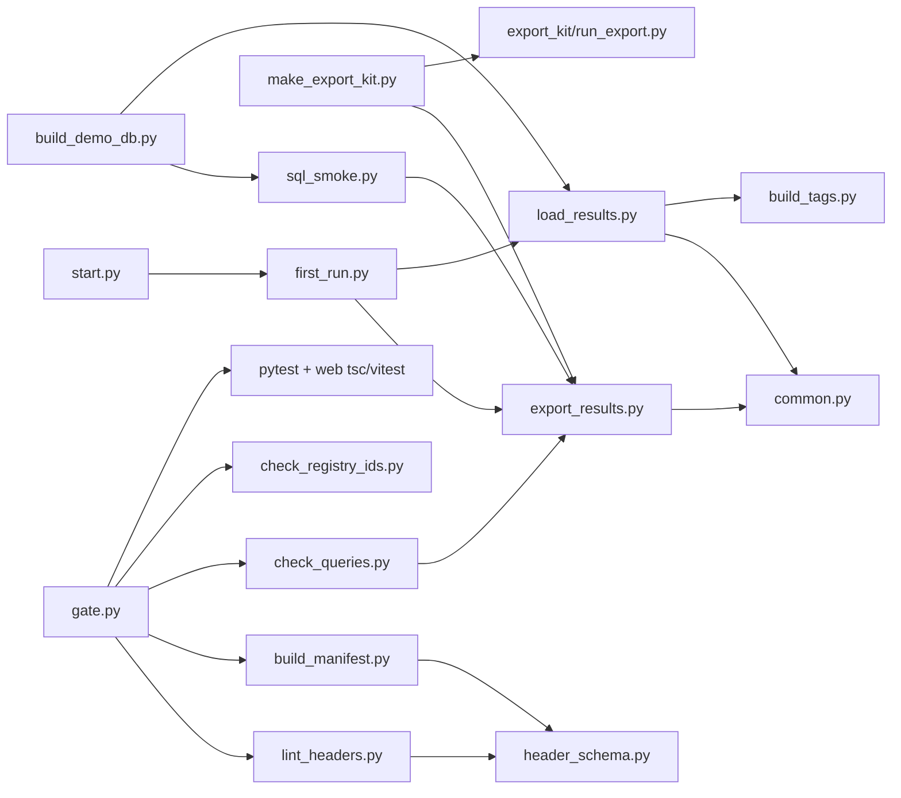

# tools/: command-line scripts

Every `tools/*.py` script: the export and load pipeline, the export kit, demo/fake data, and the checks that gate a change. `tools/streamlit_deploy/` (Streamlit in Snowflake upload) is a separate folder, out of this page's scope.

(Edges from the imports and subprocess calls in each file; start.py -> first_run.py from start.py:248.)

## Pipeline

### export_results.py — run the checks on Snowflake, write a results folder
- Purpose: tools/export_results.py:1-8. Flow: flows/export.md. Prices: logic/pricing.md. Fallbacks: logic/fallbacks.md.
- Main functions: `run_export` (1129-1366), `run_validate` (1382-1447), `render` (600-639), `assert_read_only` (642-647), `connect` (672-695), `account_context` (821-873), `probe_visibility` (938-975), `detect_edition` (788-818), `run_shims` (444-544), `run_query_feed` (410-441), `expand_shims` (142-180), `fallback_blocked` (242-254), `load_sources` (1080-1092), `render_report` (1095-1126), `main` (1547-1596).
- Flags (tools/export_results.py:1499-1522): `--out DIR` (required, outside repo), `--windows` (30), `--credit-price`, `--ai-credit-price`, `--storage-price`, `--use-fallbacks`, `--max-rows` (50,000, tools/common.py:18), `--statement-timeout SECONDS` (900), `--only ID...`, `--workers N` (4, or 1 with browser sign-in), `--mask KINDS`, `--mask-salt TEXT`, `--validate`.
- Exit: 0 ok, 1 connection error (or SQL errors in `--validate`), 2 config error (tools/export_results.py:1557-1587).

### load_results.py — load a results folder or .zip into DuckDB
- Purpose: tools/load_results.py:1-7. Main: `load_folder` (306), `safe_unzip` (191), `normalise_timestamps` (87), `build_finding_counts` (426), `main` (727). Masks person columns with `common.apply_masking` (tools/load_results.py:402, 555).
- Flags (tools/load_results.py:706-724): `SRC` (optional; default newest export in the data folder), `--db PATH` (outside the repo or under `data/`).

### first_run.py — export then load, one command
- Purpose and exit codes: tools/first_run.py:1-27. Runs `export_results.py --out <data dir>/results/<UTC stamp>` then `load_results.py <that folder>`, stops at the first failure (tools/first_run.py:110-135, 183-216).
- Flags (tools/first_run.py:70-91): `--windows DAYS`, `--credit-price`, `--ai-credit-price`, `--storage-price`, `--workers N`. Every flag is forwarded only when given (tools/first_run.py:119-131).
- Rule: no flag may contain token/password/secret/credential; checked when the parser is built (tools/first_run.py:53-55, 92-98). Tests: tests/test_first_run.py:192-217.
- Folder name: `datasource.results_stamp`, e.g. `20260929T101500Z` (app/core/datasource.py:45-49).
- `AUDIT_FROM_START` (set by start.py) silences the `.env` advice and the "open the app" lines (tools/first_run.py:197-198, 211-212).

### common.py — helpers shared by export and load
- `window_plan`, `window_sources`, `window_aliases_map` (tools/common.py:24-40); `is_windowed` (43-47); `apply_masking` (50-65, used by load_results); `blank_unflagged_waste` (68-85); `git_commit` (88-93); `DEFAULT_MAX_ROWS = 50_000`, `WINDOW_LABELS = (7, 30, 90)` (18-19).
- Example: `window_plan(7)` -> `[(7,7),(30,7),(90,7)]`; sources `[(7,7)]`; aliases `{30: 7, 90: 7}` (from tools/common.py:24-40).

### build_tags.py — the tags.* tables
- Called by load_results; builds tag_entity, tag_index, tag_account, cost_unit, cost_unit_tag, cost_reconciliation, perf_unit, perf_unit_tag in DuckDB from the export's tag sources and price (tools/build_tags.py:1-14). Main: `build` (91), `parse_query_tag` (38). No CLI.

## Export kit

### make_export_kit.py — rebuild tools/export_kit/
- Purpose: tools/make_export_kit.py:1-8. Main: `build` (152-221), `zip_kit` (224-236), `grants_sql` (126-129), `roles_section` (110-123), `refresh_masking` (144-149). Process: processes/export-kit.md.
- Flags: `--zip DIR` (writes `DIR/export_kit.zip`, outside the repo) (tools/make_export_kit.py:239-251).

### export_kit/run_export.py — the standalone export the customer runs
- Docstring and install: tools/export_kit/run_export.py:1-16. Main: `run_export` (1218-1438), `main` (1441-1485), `mask_folder` (401), `parse_sources`/`apply_sources` (64-101, copies of app/core/config.py:365-403).
- Flags (tools/export_kit/run_export.py:1443-1460): `--out` (`sf-audit-out`), `--windows` (30), `--credit-price`, `--ai-credit-price`, `--storage-price`, `--use-fallbacks`, `--only`, `--max-rows`, `--statement-timeout` (900), `--no-zip`, `--mask`, `--mask-salt`, `--source VIEW=COPY` (repeatable).

## Change checks (the "gate")

### gate.py — everything that must pass before a change is done
- Runs, never stopping early: `lint_headers`, `build_manifest --check`, `check_queries`, `check_registry_ids`, web (`tsc --noEmit` + `vitest run`, skipped without npm or `web/node_modules`), `pytest -q`; prints `GATE OK` or exits 1 (tools/gate.py:1-70). No flags. Stdlib only.
- Not related to the fallback privilege "gates" (logic/fallbacks.md).

### lint_headers.py — header schema and hygiene linter
- All 14 header fields, query_id == file name, enums, `money:`/`entity:` columns, `windowed` vs `:period_days`, `reads` vs the SQL, `next:` targets, no pipeline jargon, manifest in sync (tools/lint_headers.py:1-16). Main: `lint_file` (88), `main` (184). No flags.

### header_schema.py — shared header parser
- `parse_header` (203), `parse_params` (116), `parse_reads` (180), `load_all` (278); used by build_manifest and lint_headers (tools/header_schema.py:1-8). Library, no CLI.

### build_manifest.py — app/queries/manifest.json from the headers
- Never hand-edit manifest.json (tools/build_manifest.py:1-10). Main: `build` (82), `entry_for` (53), `main` (105). Flag: `--check` (exit 1 when stale) (tools/build_manifest.py:107).

### check_queries.py — parse every rendered check as Snowflake SQL
- Checks, dims, fallbacks and (with no pattern) shims (tools/check_queries.py:1-5, 58-68). Arg: optional glob pattern, e.g. `'sf_cost_*'`.

### check_registry_ids.py — UI registry vs manifest
- Every manifest query_id in exactly one `ids`/`refIds` list of `web/src/components/tab_registry.tsx`, every id real, every WASTE_ITEMS id homed (tools/check_registry_ids.py:1-8). No flags.

## Fake and demo data

### sql_smoke.py — run every check on fake Snowflake data in DuckDB
- Renders with export_results, answers `pre:` SHOWs from fake tables, transpiles with sqlglot (tools/sql_smoke.py:1-10). Main: `run_smoke` (414), `build_fake_db` (373), `to_duckdb` (274).
- Flags (tools/sql_smoke.py:491-498): `--out` (`data/sql_smoke.md`), `--export DIR`, `--only`, `--lenient`, `--show ID`, `--windows` (90).

### build_demo_db.py — demo DuckDB files from the larger fake account
- tools/build_demo_db.py:1-14. Main: `build` (93), `build_all` (110), `coverage` (47), `report` (62).
- Flags (tools/build_demo_db.py:128-133): `--db`, `--scenario` (`full`, one scenario, or `all`), `--jobs` (1), `--list`, `--report`, `--windows` (90).

### dump_live_catalog.py — refresh tests/fake_snowflake/live_catalog.json from a live account
- Column names and types only, from `SNOWFLAKE.INFORMATION_SCHEMA.COLUMNS` and `DESCRIBE RESULT` of each SHOW; keeps old entries the role cannot see (tools/dump_live_catalog.py:1-8). No flags. Needs a live sign-in.

