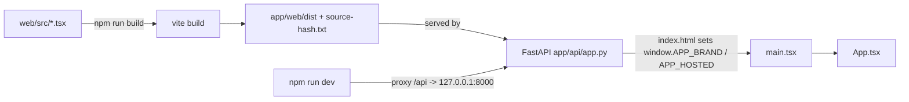
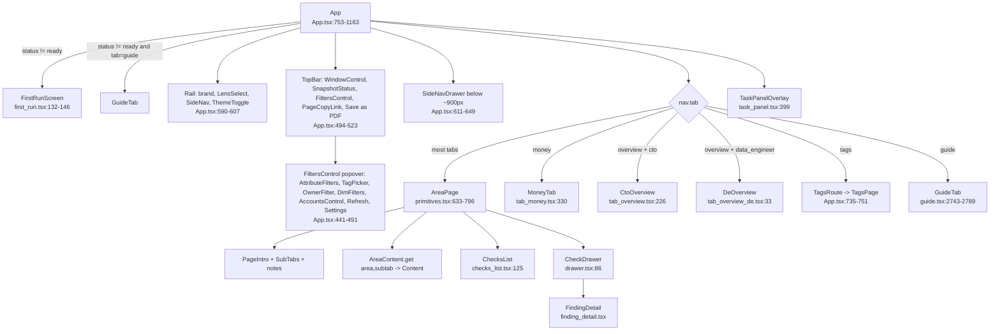
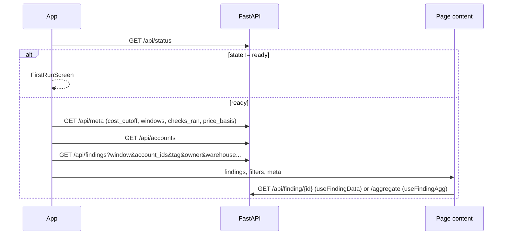

# Web UI (`web/src`)

React 18 + TypeScript single-page app, built by Vite into `app/web/dist` and served by FastAPI. It has no router: one root `App`, a URL hash that holds all state, and a registry that maps area → sub-tab → check ids.

Sources opened: `web/src/App.tsx`, `main.tsx`, `api.ts`, `types.ts`, `area_content.ts`, `range_store.ts`, `format.tsx`, `components/{tab_registry,lens_nav,nav_hash,hash_state,primitives,area_pages,area_*,drawer,checks_list,findings_table,finding_detail,guide,guide_links,overview_tile,waste_total,hooks,scope,first_run,names,filters,tag_picker,tag_rollup,settings_panel,task_panel,print_summary}` (print_summary: `MoneyPrintHeader` only), `tabs/*.tsx`, `test/*`, `web/package.json`, `web/vite.config.ts`.

## Build and boot

- Scripts: `dev`, `build`, `test` (vitest), `typecheck` (`web/package.json:6-11`). Runtime deps are only `react` and `react-dom` 18.3.1 (`web/package.json:12-15`).
- The build writes to `../app/web/dist`. The dev server proxies `/api` to `127.0.0.1:8000`. Tests run in jsdom (`web/vite.config.ts:41-47`).
- `sourceHash()` hashes every git-tracked file under `web/`, with CRLF read as LF, into `dist/source-hash.txt`. `tests/test_build_web.py` recomputes it, so a source change without a rebuild fails the tests (`web/vite.config.ts:11-28`).
- `main.tsx` imports every stylesheet, then mounts on `#audit-root` (the Streamlit deploy) or else `#root` (`web/src/main.tsx:1-30`).
- `BRAND_NAME` and `HOSTED` come from `window.APP_BRAND` and `window.APP_HOSTED`, which the server injects (`web/src/api.ts:6-10`). `HOSTED` hides Refresh and Settings (`web/src/App.tsx:276-278`, `490`, `646`).

## Component tree

| Part | Responsibility | Evidence |
|---|---|---|
| `App` | Shell only: filters, role, nav state, hash sync, loads status/meta/accounts/findings. It never draws an area's content. | `web/src/App.tsx:1-6`, `758-1168` |
| `AreaPage` | Generic frame for every area: PageIntro, SubTabs, notes, the registered Content, ChecksList and the drawer | `web/src/components/primitives.tsx:608-796` |
| `AreaContent` | Registry of `(area, subtab) -> Component`. Each tab module registers itself when it loads | `web/src/area_content.ts:1-16` |
| `tab_registry` | `AREA_REGISTRY` (area → sub-tabs → owned `ids` and reference `refIds`), `AREA_ORDER`, `WASTE_ITEMS`, `QUERY_HOME`, old-key redirects | `web/src/components/tab_registry.tsx:1-9`, `484-589` |
| `tab_area.tsx` | `AreaSubtabContent`: page component or tiles + up to 2 charts. Registered for every drill-down sub-tab | `web/src/tabs/tab_area.tsx:389-491` |
| `area_pages.tsx` | `AREA_CHART_PAGES` map plus `ApPanel` (one check → one chart, or the reason there is none) | `web/src/components/area_pages.tsx:68-101`, `181-190` |
| `area_compute.tsx` | Warehouses and Queries sub-tab pages (`COMPUTE_PAGES`) | `web/src/components/area_compute.tsx:1945-1948` |
| `area_governance.tsx` | Access, Audit, PII, Lineage and Sharing pages (`GOV_CHART_PAGES`) | `web/src/components/area_governance.tsx:1957-1964` |
| `area_ai_storage.tsx` | AI and Storage pages, plus the shared `useCheck`, `chkOf` and `useLede` | `web/src/components/area_ai_storage.tsx:50-80`, `327-330`, `1301-1305` |
| `area_activity.tsx` | Activity pages | `web/src/components/area_activity.tsx:1023-1026` |
| `area_pipelines.tsx` | Tasks, Loading and Serverless pages | `web/src/components/area_pages.tsx:22`, `184-186` |
| `drawer.tsx` | `DrawerBus` (one open drawer, mirrored to `open=`), `CheckDrawer` | `web/src/components/drawer.tsx:25-53`, `86` |
| `waste_total.tsx` | The one waste, saving and storage-per-month calculation | `web/src/components/waste_total.tsx:1-12`, `143-193` |
| `overview_tile.tsx` | `SummaryTile`, `tileFromFinding`, the money cut-off, window labels | `web/src/components/overview_tile.tsx:135-168`, `237-274`, `283-348` |
| `scope.tsx` | Wording for why a check did not run, and for filter reach | `web/src/components/scope.tsx:1-53` |
| `names.tsx` | "name (id)" lookup cache, `TaskFocus` store (`task=` hash key) | `web/src/components/names.tsx:1-14`, `118-136` |
| `guide.tsx` | The How it works page from `GET /api/guide` | `web/src/components/guide.tsx:1-6`, `2736-2782` |
| `first_run.tsx` | The four `/api/status` states, each with the next command to run | `web/src/components/first_run.tsx:1-8`, `132-146` |

## Data flow and API calls

- `App` calls `Api.status()` first and loads the rest only when `state === "ready"` (`web/src/App.tsx:839-860`). On `meta` it sets the cost cut-off and opens on `meta.open_window` unless the hash named a window (`web/src/App.tsx:847-853`).
- Findings are re-fetched when the window, the accounts or any filter key changes. Each finding gets `export_price` (`web/src/App.tsx:892-903`).
- `Api` is a thin `fetch` wrapper. Only Settings and Tags write, with `PUT`, and only to local config (`web/src/api.ts:32-65`, `197-287`).
- The tag, owner and warehouse/database/schema filters live in module-level state. `App` sets them during its own render, before any child fetches (`web/src/api.ts:81-158`, `web/src/App.tsx:831-834`). They ride along on `findings`, `finding`, `aggregate` and the CSV download (`web/src/api.ts:162-166`, `245-286`). A task-scoped `finding` drops the tag and owner filters (`web/src/api.ts:241-255`). Test: `web/src/test/filters.test.ts:17-45`.
  - Example: tag `{cost:center:[fin,ops], team:[]}`, owner `"  alice "`, warehouse `WH_A`, schema `DB.S` → `/api/finding/q1?window=30&account_ids=acct1&tag=cost%3Acenter:fin&tag=cost%3Acenter:ops&tag=team&owner=alice&warehouse=WH_A&schema=DB.S` (`web/src/test/filters.test.ts:20-32`).
- The data hooks return `{phase, outcome, data, error}`. The memo key includes every filter key, so a filter change refetches (`web/src/components/hooks.tsx:89-158`, `web/src/types.ts:59-64`).
- An API error becomes `"<status> <detail>"`. Example: 404 with `{detail:"unknown check"}` → `"404 unknown check"` (`web/src/api.ts:32-45`, `web/src/test/filters.test.ts:52-55`).
- Legacy spellings live only in `api.ts`: the `account_id` column, the `account_ids` param, rollup level `workspace` and `net_dbus` columns (`web/src/api.ts:67-79`).

Endpoints the live UI calls (see `flows/ui-navigation.md` for each screen): `/api/status`, `/api/meta`, `/api/accounts`, `/api/findings`, `/api/finding/{id}`, `/aggregate`, `/rows.csv`, `/api/dims`, `/api/coverage`, `/api/refresh` (GET/POST), `/api/guide`, `/api/guide/sql/{id}`, `/api/tags`, `/api/tag_origins`, `/api/tags/compliance`, `/api/settings/{cost-center,privacy,required-tags}` (GET/PUT), `/api/warehouses`, `/api/databases`, `/api/rollup`, `/api/rollup/keys`, `/api/access/names`, `/api/access/explore`.

## State and the URL hash

One place reads and writes `location.hash`: `HashState`. It holds plain `key=value` pairs, uses `replaceState` (no history entries), and each writer touches only its own keys (`web/src/components/hash_state.tsx:1-45`). Links that set `window.location.hash` directly (Guide links, the first-run link) do fire `hashchange`, which `App` listens to (`web/src/components/guide_links.tsx:40-45`, `web/src/components/first_run.tsx:18-24`, `web/src/App.tsx:807-828`).

| Key | Meaning | Writer | Reader |
|---|---|---|---|
| `tab`, `subtab`, `domain`, `focus` | page, sub-tab, domain, focused check | `App.tsx:905-910` | `readNavHash` `nav_hash.tsx:7-21`, `App.tsx:777-782` |
| `view` | status view (`overview`, `critical`...) | (none in live code) | `nav_hash.tsx:4`, `13-17` |
| `w` | window days | `App.tsx:908` | `filtersFromHash` `App.tsx:660-679` |
| `role` | lens; absent = finops | `App.tsx:801` | `App.tsx:771-775`, `823-824` |
| `ws` | account ids; absent = all | `App.tsx:912-916` | `accountSetFromHash` `App.tsx:681-684` |
| `attr_<key>` | account attribute filters | `HashState.setGroup` `App.tsx:918-924` | `App.tsx:664-667` |
| `tags` | tag filter, JSON `[[key,display,values,(1=all)]]` | `App.tsx:926-930` | `App.tsx:668-672` |
| `owner` | owner filter text | `App.tsx:835` | `App.tsx:770`, `821-822` |
| `wh`, `db`, `sch` | warehouse/database/schema filter, `|`-separated | `setDimFilter` `api.ts:136-146` | `api.ts:124-130` |
| `open`, `ocol`, `oval`, `olabel` | open drawer check and row filter | `DrawerBus` `drawer.tsx:28-49` | `drawer.tsx:30-36` |
| `task` | open task panel | `names.tsx:132` | `names.tsx:136` |
| `explore`, `to`, `open` | Access explorer start (read once at module load) | links | `area_access_explorer.tsx:27-33` |

- Tokens are checked against `^[A-Za-z0-9_.:-]{1,200}$`. A `tab` outside the accepted list makes the whole nav read null (`web/src/components/nav_hash.tsx:5-21`).
  - Example: `#tab=cost&subtab=trend&focus=sf_cost_x&view=critical` with valid tabs `[cost, overview]` → `{tab:cost, subtab:trend, view:critical, focusQueryId:sf_cost_x, domain:null}`. With only `[overview]` → `null`. `subtab=<script>` → `null` (`web/src/test/hash_state.test.ts:34-47`).
- `HashState.set({w:7, tab:null, subtab:""})` on `#role=cto&w=30&tab=cost` leaves `role=cto&w=7` (`web/src/test/hash_state.test.ts:10-18`).
- Old keys are redirected: tabs such as `query→queries`, `mlai→ai`, `governance→access`; `access/admins` → `audit`; `lineage/usage` → `activity/databases`; old sub-tab keys such as `config→idle` (`web/src/components/tab_registry.tsx:532-539`, `web/src/App.tsx:692-707`).
- Accepted tabs: `AREA_ORDER` plus `guide`, `money`, `tags` and the old keys (`web/src/App.tsx:97-105`).
- Kept in localStorage only: `role` and `theme` (`web/src/App.tsx:117-124`, `157-199`).

## Filters: accounts

- With all accounts ticked, the API gets `account_ids=[]`, which means "every account". Account > None, or an attribute filter that matches no account, sends the sentinel `__no_account_matches_filters__` instead (`web/src/App.tsx:95`, `877-889`).
  - Example: 3 accounts, all ticked → `[]`. None ticked → `["__no_account_matches_filters__"]`. With all ticked, clicking one account means "just this one" (`web/src/App.tsx:932-940`).
- The Account picker is hidden below 2 accounts (`web/src/App.tsx:419`).
- The Filters button counts active filters: attribute keys + tag groups + owner + dim filters + a narrowed account set (`web/src/App.tsx:992-996`).

## Tests (vitest, jsdom)

| File | What it pins |
|---|---|
| `web/src/test/roles.test.ts:6-49` | Lens page lists, homes, groups, clamp, active entry |
| `web/src/test/honesty.test.tsx:18-55` | `ApPanel` draws a chart only on `ok_rows`. It shows "–"+reason, "No data for this in …", "…" |
| `web/src/test/hash_state.test.ts:7-56` | Additive hash writes, token checking, `navHref` merge |
| `web/src/test/filters.test.ts:9-56` | Filters reach the query string; task scope; error text |
| `web/src/test/tag_picker.test.ts:7-39` | A just-picked tag name filters nothing until a value is unticked |
| `web/src/test/access_explorer.test.ts:4-44` | `cutPoints` (roles on every path), `dormantUsers` (90-day rule) |

## Issues found

- **Dead code:** `StateNote` and `NoDataBlock` were removed, but their CSS rules remain in `web/src/styles/styles.css` (not verified line by line).
- **summaryOnly is never true:** `App` always passes `summaryOnly={false}` (`App.tsx:1123`), so `AreaPage`'s summary mode and `summaryGoTo` (`primitives.tsx:660-662`, `906-916`) never run. `setCanDrill(true)` is constant (`App.tsx:837`). The comment saying the CTO lens picks "summary or full drill-down" is stale (`App.tsx:111-113`).
- **STATUS.md conflict:** STATUS.md says "don't keep compatibility with older versions" (`STATUS.md:32`), yet the UI keeps old-hash redirects (`tab_registry.tsx:531-539`, `App.tsx:691-707`) and the Databricks-era names (`api.ts:67-67`).
- **Hash key clash (inferred):** the Access explorer reads `open=` as "schema box to open" (`area_access_explorer.tsx:32-33`), while `DrawerBus` reads the same `open=` as the drawer's check id (`drawer.tsx:33-34`). A shared explorer link therefore also sets the drawer target. It is harmless while the value is not a query id, because no finding matches (`primitives.tsx:707`).
- **Registry comment wrong:** the header says every id sits in exactly one sub-tab (`tab_registry.tsx:4`). `sf_use_query_profile` and `sf_use_top_query_shapes` sit in both Activity › Tables `ids` and Activity › Users `refIds` (`tab_registry.tsx:399`, `415`). `QUERY_HOME` keeps the first, Tables (`tab_registry.tsx:563`).
