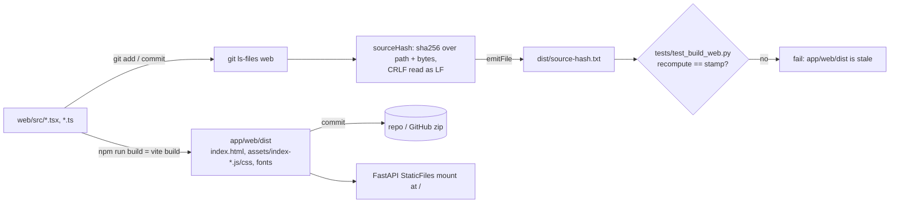

# Build the UI

The React 18 + TypeScript source in `web/` is built by Vite into `app/web/dist`, which is committed so users need no Node; a hash stamp keeps the two in step.

## Commands

From `web/` with Node 20+ (README.md:907-915; web/package.json scripts):

| Command | Does | Source |
|---|---|---|
| `npm ci` | install once | README.md:910 |
| `npm run dev` | Vite dev server on :5173, `/api` proxied to :8000 | web/package.json `dev`; web/vite.config.ts:45 |
| `npx tsc --noEmit` / `npm run typecheck` | type check | web/package.json `typecheck` |
| `npx vitest run` / `npm test` | UI tests (jsdom) | web/package.json `test`; web/vite.config.ts:46 |
| `npm run build` | write `app/web/dist` (emptied first) | web/vite.config.ts:44 |

## Rules

- **Output**: `outDir ../app/web/dist`, `emptyOutDir`, no sourcemaps, `base "/"` (web/vite.config.ts:41-47).
- **Stamp**: `sourceHash()` hashes every file `git ls-files web` lists, sorted, as `path\n` + bytes (CRLF→LF) + `\n`; written to `dist/source-hash.txt` at build (web/vite.config.ts:11-38).
  - It reads working-tree bytes of tracked files, so a new file must be at least `git add`ed before the build or it is left out; an empty list throws "git tracks no files under web/" (web/vite.config.ts:16-19).
  - Example: change `web/src/App.tsx`, commit, skip the build → `test_the_build_matches_the_source` fails "app/web/dist is stale: commit the web/ source, then cd web && npm run build" (tests/test_build_web.py:33-38).
  - The check is skipped in a GitHub zip (no `.git`) (tests/test_build_web.py:33).
- **index.html first-paint rules**: theme script reads `localStorage` before paint, author/copyright meta, empty favicon, no Google Fonts, hashed bundle `/assets/index-*.js` (tests/test_build_web.py:41-48).
- **No window globals** in `web/src` (`Object.assign(window` or `window.__`) (tests/test_build_web.py:57-60).
- **Old build gone**: no `.jsx` under `app/web`, no `app/web/vendor`, no `tools/build_web.js` (tests/test_build_web.py:51-54).
- **Commit order** (project rule): commit the `web/` source, then build, then commit `app/web/dist` (CLAUDE.md:74; README.md:917-918). Git log shows this as alternating commits, e.g. "Build UI" after a source commit (git log 556a877, 22b7644).

## Serving

- FastAPI mounts `app/web/dist` last at `/` so it never shadows `/api/*`; a path with no extension gets `index.html`; `index.html` is served `no-cache` with the settings brand put in `<title>` and `window.APP_BRAND` (app/api/app.py:1423-1471).
- No `dist` → `GET /` returns 404 text "The UI is not built. Run: cd web && npm ci && npm run build" (app/api/app.py:1467-1471; README.md:843).
- Streamlit deploy reuses the same `dist/assets` (tools/streamlit_deploy/deploy.py:21, 60-72; tools/streamlit_deploy/streamlit_app.py:176-183).

## Gate

- `tools/gate.py` runs `tsc --noEmit` and `vitest run` when `npx` and `web/node_modules` exist, else reports `web=skip` (tools/gate.py:42-49).
- Vitest files: `web/src/test/access_explorer.test.ts`, `filters.test.ts`, `hash_state.test.ts`, `honesty.test.tsx`, `roles.test.ts`, `tag_picker.test.ts` (6 files, listed from web/src/test/).
