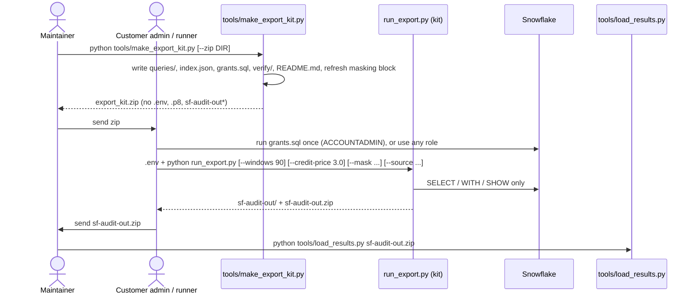

# Export kit: someone else runs the SQL

`tools/export_kit/` is a standalone copy of the export (one Python file plus every statement as plain `.sql`) that a customer runs on their own machine without the repo; they send back `sf-audit-out.zip`, which `tools/load_results.py` loads like a normal export (README.md:752-776).

## Steps

1. **Refresh the kit** after any SQL, check or README "Roles and privileges" change: `python tools/make_export_kit.py` (tools/make_export_kit.py:1-8; STATUS.md "Export kit"). `tests/test_export_kit.py:38-42` fails while the committed kit differs from a fresh build.
2. **What `build` writes** (tools/make_export_kit.py:154-229):
   - `queries/checks/*.sql`, `fallback/`, `shims/`, `common/is_query_history_feed.sql`, `tag_sources/`, `dims/`, each with includes pasted in and `__QUERY_SOURCE__` fixed to the query tag (tools/make_export_kit.py:164-202);
   - `queries/index.json`: per check `domain`, `windowed`, `pre`, `sources`, `params` (header defaults + thresholds), `needs_enterprise`, and `fallback` meta (`pre`, `reads`, `note`, `needs`, `query_feed`, `shims`); plus `defaults` (max_rows, include_today, the three settings prices, query_tag), tag_sources and dims (tools/make_export_kit.py:170-221);
   - `grants.sql`: cut from README "### The grant script", so the two never differ (tools/make_export_kit.py:128-131);
   - `verify/*.sql` from `app/queries/verify` (tools/make_export_kit.py:223-224);
   - `README.md` = fixed head + README "Roles and privileges" with the `--validate` bullet removed (tools/make_export_kit.py:32-102, 110-123, 217);
   - the masking block inside `run_export.py`, copied from `app/core/masking.py` between marker lines (tools/make_export_kit.py:134-151, 220).
   - A kit folder elsewhere must be outside the repo (tools/make_export_kit.py:156-157).
3. **Zip to send.** `--zip DIR` (outside the repo) copies the kit without `.env`, `*.p8`, `sf-audit-out*`, `__pycache__` and writes `DIR/export_kit.zip` (tools/make_export_kit.py:232-244). Test: tests/test_export_kit.py:59-64.
4. **Customer grants.** `grants.sql` creates placeholder `AUDIT_ROLE`, service `AUDIT_USER` with a public key, XS `AUDIT_WH`; grants `IMPORTED PRIVILEGES` (or four `SNOWFLAKE.*_VIEWER` database roles: 249 of 298 checks), `MONITOR USAGE`, `MONITOR EXECUTION`, Trust Center / Budget / Data quality application roles, optional `APPLY AUTHENTICATION|PASSWORD POLICY` (commented out: they let the role change those policies); per-warehouse `MONITOR` and org billing roles are commented (tools/export_kit/grants.sql:1-57). What each grant opens: README.md:203-230.
5. **Customer sign-in.** `.env` next to `run_export.py` or environment: the same 8 `SNOWFLAKE_*` keys; key file > password > browser (tools/export_kit/run_export.py:39-43, 839-873).
6. **Run.** `python run_export.py` (tools/export_kit/run_export.py:1484-1528). Flags: `--out` (default `sf-audit-out`), `--windows` (30), `--credit-price`, `--ai-credit-price`, `--storage-price`, `--use-fallbacks`, `--only`, `--max-rows`, `--statement-timeout` (900), `--no-zip`, `--mask`, `--mask-salt`, `--source VIEW=COPY` (repeatable) (tools/export_kit/run_export.py:1486-1503).
7. **Same decisions as the full export**, on one session: account context, probe, edition, fallback prerequisites, query feed, shims, then per check edition / fallback / not assessed / run (tools/export_kit/run_export.py:1294-1412). Prices default to `index.json` defaults instead of settings (tools/export_kit/run_export.py:1004-1048, 1235).
8. **Ctrl+C** keeps what ran, marks the rest `failed` "not run: the export was stopped ...", skips remaining tag sources and dims, and still writes `manifest.json` (`stopped_early: true`) and `report.md` (tools/export_kit/run_export.py:1359-1365, 1351-1357, 1382-1384, 1396-1398, 1429; report line 1201). Test: tests/test_export_kit.py:125-163.
9. **Output.** Same folder layout and manifest keys as `export_results.py`, masked before the manifest is written, renamed from `.tmp`, then zipped to `<out>.zip` unless `--no-zip` (tools/export_kit/run_export.py:1451-1480, 1482-1484). Test that both write the same: tests/test_export_kit.py:67-88.
10. **Load.** `python tools/load_results.py sf-audit-out.zip` (README.md:768-770; tools/load_results.py:711-729).

## Business rules

- **Read-only, refused before sending:** anything but one SELECT/WITH/SHOW raises `StopExport` (tools/export_kit/run_export.py:828-833). Test: tests/test_export_kit.py:90-106.
- **One failure never stops the run:** errors are recorded per check (tools/export_kit/run_export.py:1401-1405). Test: tests/test_export_kit.py:108-123.
- **A role that reads nothing still finishes**, every check `not_assessed` (tests/test_export_kit.py:165).
- **One Python file, no repo imports** (tests/test_export_kit.py:45-56).

## Differences from tools/export_results.py

| Topic | Full export | Kit | Cite |
|---|---|---|---|
| Copies of views | settings `sources:` | `--source` flag | tools/export_results.py:1097-1109; tools/export_kit/run_export.py:1501-1512 |
| Sessions | `--workers` (4, or 1 with browser) | one session | tools/export_results.py:1219-1228 |
| `--validate` | yes | no | tools/make_export_kit.py:117-124 |
| Zip | no | `<out>.zip` | tools/export_kit/run_export.py:1525-1527 |
| Ctrl+C | not caught | report still written | tools/export_kit/run_export.py:1359-1365 |
| Default prices | settings at run time | settings at kit build time (`index.json`) | tools/make_export_kit.py:207-211 |
| `include_snowflake_tasks` | from settings | from `index.json` defaults (kit build time) | tools/make_export_kit.py:212; tools/export_kit/run_export.py:1298 |
| `git_commit` in manifest | `git rev-parse HEAD` | null; `queries_sha256` (digest of the kit's `queries/*.sql`) names the SQL version instead | tools/common.py:88-93; tools/export_kit/run_export.py:1452; tools/make_export_kit.py:219 |
| Sign-in error | one line + fix (`explain_connection_error`) | "could not sign in: ..." plus a fix hint; the `.tmp` work folder is removed | tools/export_results.py:776-803; tools/export_kit/run_export.py:1287-1291 |
