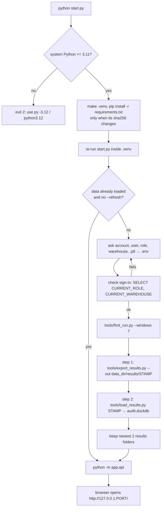
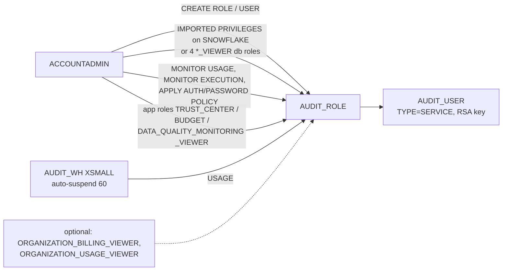

# Run locally

How a user goes from an unzipped folder to the app at `http://127.0.0.1:8000/`: install, sign-in, grants, export, load, start.

## Entry points

| Command | What it does | Default days | Source |
|---|---|---|---|
| `python start.py` | venv + .env + sign-in check + export + load + app | 7 | start.py:4-12, 52 |
| `python tools/first_run.py` | export + load (no venv, no prompt, no app) | export's own default, 30 | tools/first_run.py:4-13, 119-131; tools/export_results.py:1502 |
| `python tools/export_results.py --out DIR` | export only | 30 | tools/export_results.py:1499-1532 |
| `python tools/load_results.py [DIR or .zip]` | load only (newest export if none given) | – | tools/load_results.py:706-792 |
| `python -m app.api` | start FastAPI on 127.0.0.1:8000 | – | app/api/__main__.py:27-35 |

## 1. Install

- Python 3.11+ (tested on 3.12); pandas 3 does not install on 3.10 (README.md:57).
- `start.py` is stdlib only, runs on the system Python, refuses < 3.11 with exit 2 (start.py:12, 292-294, 297-299).
- It makes `.venv` (rebuilt if pip is missing or Python < 3.11) and installs `requirements.txt` only when the file's sha256 differs from `.venv/requirements.sha256` (start.py:62-85).
  - Example: edit `requirements.txt` → next `python start.py` prints "Installing packages (a few minutes the first time) ..." again; unchanged → skipped (start.py:78-81).
- By hand: `py -3.12 -m venv .venv`, activate, `python -m pip install -r requirements.txt`, `copy .env.example .env` (README.md:263-288).
- Runtime packages: duckdb 1.5.1, snowflake-connector-python >=3.12,<5, sqlglot, pyarrow, pyyaml, pandas 3.0.3, fastapi, uvicorn, httpx (requirements.txt:1-9).
- Node is not needed: the built UI is committed in `app/web/dist` (README.md:72; app/api/app.py:1537-1543).

## 2. Key pair and sign-in

- Make the key: `openssl genrsa 2048 | openssl pkcs8 -topk8 -inform PEM -out rsa_key.p8 -nocrypt` then `openssl rsa -in rsa_key.p8 -pubout -out rsa_key.pub` (README.md:79-82). Encrypted variant `-v2 des3` + `SNOWFLAKE_PRIVATE_KEY_PASSPHRASE` (README.md:84-90).
- Paste the public key (no BEGIN/END lines, no line breaks) into `CREATE USER ... RSA_PUBLIC_KEY` or `ALTER USER ... SET RSA_PUBLIC_KEY` (README.md:94-96).
- Sign-in choice, first match wins (tools/export_results.py:672-695):
  1. `SNOWFLAKE_PRIVATE_KEY_FILE` (+ passphrase) → key pair.
  2. `SNOWFLAKE_PASSWORD` → password.
  3. neither → `SNOWFLAKE_AUTHENTICATOR` or `externalbrowser`, with a cached temporary credential.
- Browser sign-in forces 1 worker, else 4 (tools/export_results.py:56, 748-755).
  - Example: `.env` with only ACCOUNT and USER → `--workers` default 1; with a `.p8` → 4.
- Where values come from: environment first, then the first matching line of `.env` per key; `SNOWFLAKE_ACCOUNT` and `SNOWFLAKE_USER` are required, else exit 2 "missing ..." (tools/export_results.py:47-52, 655-666).
- `start.py` prompts in this order: account, user, role, warehouse, key file; a blank key means browser (start.py:37-43, 120-147).
  - Account cleanup: `https://myorg-myacct.snowflakecomputing.com/` → `myorg-myacct` (start.py:114-117).
  - A key path that is not a file is asked again (start.py:130-132).
  - An encrypted key (text `ENCRYPTED` in the first 200 chars) → passphrase asked each run, kept in memory only (start.py:150-160).
- Sign-in check: connects and runs `SELECT CURRENT_ROLE(), CURRENT_WAREHOUSE()`; no warehouse → error; ok prints `Signed in: role R, warehouse W.` (start.py:163-177). On failure it asks "Enter the sign-in details again? [Y/n]" (start.py:241-247).
- `tools/first_run.py` never takes a credential flag; it asserts no option contains token/password/secret/credential (tools/first_run.py:15-19, 53-55, 92-98; tests/test_first_run.py:192-217).

## 3. Grants (read-only role)

- The script lives once, in README "The grant script" (README.md:143-199); `tools/make_export_kit.py` copies it into `tools/export_kit/grants.sql` so the two never differ (tools/make_export_kit.py:110-130).
- Who runs what: `USERADMIN` creates role/user, `SECURITYADMIN` grants the role, `ACCOUNTADMIN` grants `IMPORTED PRIVILEGES` and the viewer roles, `SYSADMIN` the warehouse (README.md:108-113).
- Any role works; what it cannot read shows as "the role can't see it", never zero (README.md:46-48, 203-206).
- Without `IMPORTED PRIVILEGES`, the four database roles open 249 of 298 checks (269 with an org role); the 10 task checks need `TASK_VERSIONS` which none of the four opens (README.md:153-159, 212, 217).
- No bulk `MONITOR` on warehouses or resource monitors exists; grant per object (README.md:244-247).
- Check a role before a run: `USE ROLE AUDIT_ROLE; USE WAREHOUSE AUDIT_WH; SELECT COUNT(*) FROM SNOWFLAKE.ACCOUNT_USAGE.WAREHOUSE_METERING_HISTORY;` (README.md:130-134).
- Dry run, nothing exported: `python tools/export_results.py --out <folder outside the repo> --windows 7 --validate` → `validate.md`; exit 1 only on a real SQL error (README.md:345-352; tools/export_results.py:1550-1574).
  - Expected line: `validated N statements: A ok, B not readable by this role or account, C SQL errors`, then one GRANT line per cause (tools/export_results.py:1564-1569).

## 4. Export

- `first_run.py` makes `<data dir>/results/<UTC stamp>` such as `results/20260929T101500Z` (tools/first_run.py:106-113; app/core/datasource.py:45-49).
- Data dir: `AUDIT_DATA_DIR`, else Windows `%LOCALAPPDATA%\snowflake-audit`, macOS `~/Library/Application Support/snowflake-audit`, Linux `$XDG_DATA_HOME` or `~/.local/share/snowflake-audit` (app/core/datasource.py:16-33; README.md:477-485).
- An `--out` inside the repo is refused: exit 2 "is inside the repository; choose a folder outside it" (tools/export_results.py:1145-1146, 1392-1393; app/core/datasource.py:36-38).
- Every statement must be one `SELECT`/`WITH`/`SHOW` or it is refused (tools/export_results.py:642-647).
- Session: `TIMEZONE=UTC`, `QUERY_TAG` from settings `query_source`, `STATEMENT_TIMEOUT_IN_SECONDS` 900 default (tools/export_results.py:55, 680-683).
- Expected output: one line per check, `[12/298] check_id: ok, 34 rows, 1.2s` (README.md:337; tools/export_results.py:1524-1533), then `wrote <folder>: N empty, N ok, ...` and `next: python tools/load_results.py <folder> --db PATH` (tools/export_results.py:1587-1594).
- Exit codes: 2 config error, 1 connection error, 0 ok (tools/export_results.py:1581-1595); `first_run.py` passes the first failing step's code on, 130 = interrupted (tools/first_run.py:21-22, 194-199).
- Prices: CLI flag → `RATE_SHEET_DAILY` → 90-day `USAGE_IN_CURRENCY_DAILY` rate → `config/settings.yml` 3.00 / 2.00 (README.md:376-394).
  - Example: `python tools/first_run.py --credit-price 3.0 --storage-price 23` (README.md:389-391).
- Main options: `--windows`, `--max-rows` (50,000), `--statement-timeout` (900), `--workers` (4), `--only`, `--mask`, `--mask-salt`, `--use-fallbacks`, `--validate` (README.md:358-369).

## 5. Load

- `tools/load_results.py <folder or .zip>` builds `audit.duckdb` in the data dir; no arg = newest export (tools/load_results.py:714-731).
- `--db` must be outside the repo or a `.duckdb` under the git-ignored `data/` (tools/load_results.py:70-75, 732-738).
- Loading into the data dir writes the `current_db.txt` pointer so `python -m app.api` opens it (tools/load_results.py:746-751; app/core/datasource.py:73-97).
- It builds the `tags.*` tables from `tags_src/*.parquet` via `tools/build_tags.py` (tools/load_results.py:384-394; tools/build_tags.py:1-13).
- Expected output: `loaded N finding(s) into <db>`, lists of failed / not run / capped checks, then `Run the app against this data:  python -m app.api` (tools/load_results.py:753-791).
- On Windows the load cannot replace `audit.duckdb` while the app holds it; `start.py` stops early with "The app is still open on the loaded data" (README.md:312-313; start.py:180-191, 233-235).

## 6. Start the app

- `python -m app.api` binds `AUDIT_API_HOST` (127.0.0.1) and `AUDIT_API_PORT` (8000), prints `database: <path>` then `open http://127.0.0.1:8000`, warms the findings list for each window in a thread (app/api/__main__.py:14-35).
- Which DB opens, first match wins: `AUDIT_DB` → `current_db.txt` pointer → `<data dir>/audit.duckdb` (app/core/data.py:103-112).
  - Example: after `load_results.py` into the data dir and no `AUDIT_DB`, the pointer names that file.
- `start.py` picks 8000 or the next free of 50 ports by binding, and opens the browser when the port answers (start.py:199-218, 267-272).
- `GET /` serves `app/web/dist/index.html` with the brand injected; any non-file path falls back to index.html; no build → 404 "The UI is not built. Run: cd web && npm ci && npm run build" (app/api/app.py:1499-1543).

## 7. Later runs

- `python start.py` with data present opens the app without exporting (start.py:259-266).
- `python start.py --refresh` exports again; `--windows 30|90` for more days (README.md:47-50; start.py:52-53).
- Refresh in the app (`POST /api/refresh`): export + load into a new `audit-<stamp>.duckdb`, switch `AUDIT_DB` and the pointer, delete older DB files and keep the newest two results folders (app/api/refresh.py:32-103).
  - It re-passes only CLI-typed prices from the newest manifest; invoice prices are read again (app/api/refresh.py:49-66).
  - Example (test): three old result stamps + one new → 2 folders remain, the oldest is gone (tests/test_refresh.py:21-50).
- After a successful `start.py` export, the same keep-two rule runs and `*.tmp` folders are dropped (start.py:221-229, 250-251).

## Not defined

- No automated install for Windows services, Docker or a hosted server: the app is a local process only (inferred from start.py:271-272 and app/api/__main__.py:28-35; no Dockerfile in the repo).
- No test covers `start.py` itself (no test file imports it; checked tests/*.py).
