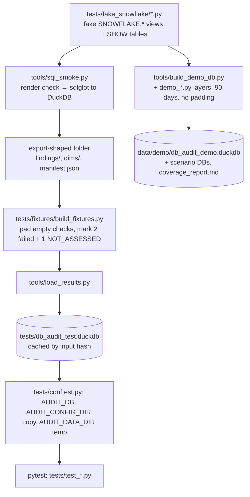

# Test

The suite runs every check against a fake Snowflake account built in DuckDB, then tests the loader, API, money rules and UI; `tools/gate.py` runs all of it.

## Levels

| Level | Command | When | Source |
|---|---|---|---|
| Compile check (default between changes) | `python -c "import app.api.app"` and `cd web && npx tsc --noEmit` | every change, unless tests are asked for | CLAUDE.md:73 |
| SQL smoke only | `python tools/sql_smoke.py [--only ID] [--windows 90] [--export DIR]` | after SQL edits | tools/sql_smoke.py:1-11 |
| Full gate | `pip install -r requirements-dev.txt` then `python tools/gate.py` | before a change is done | README.md:866-870; tools/gate.py:1-13 |
| pytest only | `python -m pytest -q` (testpaths = tests) | – | pytest.ini:1-3; tools/gate.py:59 |
| UI tests | `cd web && npx vitest run` | – | README.md:911 |
| Browser check | Playwright on real data, each changed page | before calling a page done | CLAUDE.md:80 |

- Dev deps: pytest 9.1.1, sqlfluff 3.5.0 (requirements-dev.txt:1-4).
- Gate order, none stops early: `lint_headers`, `build_manifest --check`, `check_queries`, `check_registry_ids`, web (tsc + vitest, or skip), pytest; prints `gate summary: ...` then `GATE OK` or exit 1 (tools/gate.py:52-66).
- Cost: the full suite takes ~25 minutes and several GB of memory (README.md:874); it last passed at 485 tests (STATUS.md:24).

## The test database

- Built once per session by the autouse fixture: `build_fixtures.build(tests/db_audit_test.duckdb)`; rebuilt only when an input changes (tests/conftest.py:42-47; tests/fixtures/build_fixtures.py:13).
- Steps: sql_smoke runs every check (lenient, windows 7 and 30, so 90 is an alias of 30) → empty/failed checks get 2–3 typed fake rows → two checks forced failed and one all NOT_ASSESSED → load (tests/fixtures/build_fixtures.py:1-13).
- Isolation: `AUDIT_DATA_DIR` and a copy of `config/` in a temp folder, so no test writes the real data folder or repo config (tests/conftest.py:33-66).
- Fixed as-of: `2026-09-21T12:00:00` (tests/conftest.py:29-30).
- The DB and its sidecars are git-ignored (.gitignore:6-8, 17).

## Fake account

- Code, not a file: `tests/fake_snowflake/schema.py` defines fake `SNOWFLAKE.*` views and SHOW outputs as DuckDB tables (tests/fake_snowflake/schema.py docstring; README.md:878-879).
- Base account used by tests: `data.py` (deterministic, fixed seed and as-of), `gap_*.py`, `new_checks_data.py`, `batch3_data.py`; do not change them, tests depend on them (STATUS.md:26).
  - Fake identity: locator `FAKE01`, name `FAKE_ACCOUNT`, org `FAKE_ORG` (tests/fake_snowflake/data.py:25-28). The Streamlit deploy refuses any DB carrying `FAKE%` (tools/streamlit_deploy/deploy.py:43-57).
  - `tools/fake_fingerprint.py` prints a fingerprint of the base rows; no value is pinned (STATUS.md:26).
- Demo layers `demo_*.py`: 57 warehouses across 8 teams, ~120 users, tasks, pipes, AI, policies, partial tags, 90 days (README.md:880-881). One module per area: billing, compute, entities, gov_fit, lifecycle, pipe_fit, pipelines, platform, queries, review_fit, security, storage, tags, wh_fit, ai_perf, worst_case (module docstrings in tests/fake_snowflake/).
- `live_catalog.json` holds live column names and types; refresh it with `python tools/dump_live_catalog.py` against a live account. It reads names and types only (`INFORMATION_SCHEMA.COLUMNS`, `DESCRIBE RESULT` of each SHOW); views the role can't see keep their old entry (tools/dump_live_catalog.py:1-8).

## Demo DB scenarios

`python tools/build_demo_db.py [--scenario NAME|all] [--list] [--report] [--jobs N] [--windows 90]` (tools/build_demo_db.py:1-15, 126-162).

| Scenario | What it is (tests/fake_snowflake/demo_scenarios.py:40-58) |
|---|---|
| full | Enterprise, every source readable, a year of history |
| no_org_access | no ORGANIZATION_USAGE: no invoice, rate sheet or other accounts |
| limited_role | no org views, people, grants, policies or access history; SHOW sees part |
| standard_edition | Standard, detected: Enterprise-only checks read "needs Enterprise" |
| standard_undetected | Standard not detected: those views are just empty |
| new_account | 21 days old |
| unused_account | every view empty |
| worst_case | CRITICAL/WARN results no other account reaches |
| failing_checks | QUERY_ATTRIBUTION_HISTORY and ACCESS_HISTORY time out; TABLE_STORAGE_METRICS and LOGIN_HISTORY error |

- Output: `data/demo/db_audit_demo.duckdb` (full) or `data/demo/<scenario>/db_audit_demo.duckdb`, each with `.coverage.json` (rows and statuses per check) (tools/build_demo_db.py:36, 43-44, 93-107).
- `--scenario all` builds one process per scenario (`--jobs` 1 by default, each needs several GB) and writes `data/demo/coverage_report.md`: per-scenario counts and "Statuses a check's SQL can give that no built scenario reaches" (tools/build_demo_db.py:62-90, 110-123).
- Guard: refuses a `--db` inside the repo outside `data/`, and refuses the real `audit.duckdb` path (tools/build_demo_db.py:144-151).
- Expected output: `N of 298 checks have rows, M flag something; per check: ....coverage.json` then `built <db>: ...` (tools/build_demo_db.py:153-158).
- Run the app on it: `AUDIT_DB=data/demo/db_audit_demo.duckdb python -m app.api` (PowerShell: `$env:AUDIT_DB="..."`) (README.md:887-902).
- Cost: about 4 min and 2.3 GB per build, one at a time (STATUS.md:28).

## Key rules tested, with examples

- **≥ 100 checks reach WARN or CRITICAL on fake data** (tests/test_sql_smoke.py:173-175).
- **No check exports statement text** (tests/test_sql_smoke.py:52-57).
- **Same dollars on every screen**: total spend is one number across cost pages; a 90-day window over a 30-day export says so; one money cut-off, today excluded (tests/test_totals_agree.py:52-92).
- **Waste is never spend**: waste columns come from `finding_columns.MONEY_COLUMN_KIND == "waste"`; idle dollars of `sf_cost_warehouse_idle_credits_daily` and `sf_task_warehouse_vs_serverless` are context, not waste (tests/test_waste_contract.py:1-30).
- **first_run chains two steps from the repo root** and never forwards a token-shaped flag (tests/test_first_run.py:76-98, 192-217).
- **Refresh keeps two results folders** and switches `AUDIT_DB` and the pointer (tests/test_refresh.py:21-50).
- **The export kit is up to date** with a fresh build of it (tests/test_export_kit.py:38-42).
- **The UI build matches the source** (tests/test_build_web.py:33-38).

## Test files (pytest)

access_explorer, api (83 tests), api_features, build_web, config_cost_center, core_changes, datasource, export_kit, export_more, export_show (connector-shaped fake cursor, SHOW path, `--validate`), first_run, guide, identity_masking, load_results, masking, materiality (class-based), owner_filter, query_source, refresh, registry, sources, sql_smoke, totals_agree, waste_contract (counts from `def test` lines in tests/test_*.py).

## Gaps

- No tests for `start.py`, `tools/streamlit_deploy/*`, `tools/build_demo_db.py` or `tools/dump_live_catalog.py` (no test file references them).
- `tests/test_waste_contract.py:7` docstring names `app/web/components/tab_registry.jsx`, a path the old build used; the test reads `web/src` (tests/test_waste_contract.py:24) and `.jsx` under `app/web` is now forbidden (tests/test_build_web.py:53). Stale docstring.
