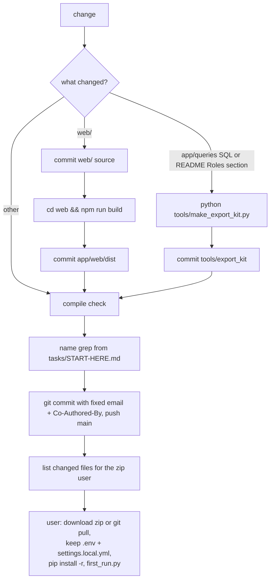

# Update and release

There is no versioned release: every finished change is committed and pushed to `main`, and users take the GitHub zip; derived artifacts (UI build, export kit) are regenerated and committed with the change.



## Maintainer side

- Commit and push to `main` after every finished change; it is a POC (CLAUDE.md:75; STATUS.md:55).
- Commit with the project's fixed author email via `git -c user.email=... commit` and end the message with the `Co-Authored-By: Claude Opus 5.5 <noreply@anthropic.com>` line (CLAUDE.md:76-77). Recent commits follow it (git log 556a877, 22b7644, d2fe712).
- Before every commit run the name grep in `tasks/START-HERE.md` (git-ignored; not opened here) and add any real name seen in an export to it (CLAUDE.md:58-61).
- Planning notes, reviews and exports stay out of git: `tasks/`, `data/`, `.env`, `config/settings.local.yml`, `*.p8`, test DBs (CLAUDE.md:62; .gitignore:1-24).
- After a push, list the changed files, because the user runs from the zip (CLAUDE.md:78).
- Default check is a compile check only; tests and browser review at the end of a batch (CLAUDE.md:73, 80; STATUS.md:58).
- Keep `STATUS.md` up to date (CLAUDE.md:9).
- Commit messages: short, no task ids or dates in code (CLAUDE.md:64-67).

## Derived files that must be refreshed

| Trigger | Command | Guard test | Source |
|---|---|---|---|
| any `web/` change | commit source → `cd web && npm run build` → commit `app/web/dist` | tests/test_build_web.py:33-38 | CLAUDE.md:74; web/vite.config.ts:11-38 |
| any SQL in `app/queries`, a check, or README "Roles and privileges" | `python tools/make_export_kit.py` | tests/test_export_kit.py:38-42 | README.md:773-774; STATUS.md:46; tools/make_export_kit.py:1-8 |
| the masking code | same command: the kit holds a copy of `app/core/masking.py` between markers | tests/test_export_kit.py:38-42 | tools/make_export_kit.py:134-167 |
| check headers | `python tools/build_manifest.py --check` in the gate | tools/gate.py:55 | tools/gate.py:52-60 |

- The kit: `run_export.py`, `queries/` (each statement with includes pasted in, plus `index.json`), `grants.sql` cut from README, `verify/`, `README.md` (README.md:754-766; tools/make_export_kit.py:169-245).
  - `grants.sql` example: the text between ` ```sql ` and ` ``` ` after "### The grant script" in README (tools/make_export_kit.py:128-132) → `tools/export_kit/grants.sql:1-57`.
- `python tools/make_export_kit.py --zip <folder outside the repo>` writes `export_kit.zip` without `.env`, `*.p8`, `sf-audit-out*`, `__pycache__` (tools/make_export_kit.py:247-270; README.md:775-776).

## User side (update to a new version)

1. Download the new zip, or `git pull` (README.md:539).
2. Keep `.env` and `config/settings.local.yml` (not in the zip). `settings.yml`, `tag_aliases.yml`, `thresholds.yml`, `materiality.yml` are replaced, so keep a copy of any edit (README.md:540-543).
3. `python -m pip install -r requirements.txt` again; in a new folder, make the venv first (README.md:544-545). `start.py` does this when `requirements.txt` changed (start.py:78-85).
4. `python tools/first_run.py`: new or changed checks appear only after a new export (README.md:546).

- The data folder is outside the repo, so an update never touches it (README.md:548).
- The UI ships built; Node is only needed to change it (README.md:548-549).
- No version number, changelog, tag or release step exists (inferred: `web/package.json` version is `0.0.0`; no CHANGELOG in the repo).

## Licence

- Dual MIT or Apache-2.0, at the user's option; contributions under the same terms (README.md:920-923; LICENSE-MIT; LICENSE-APACHE).
